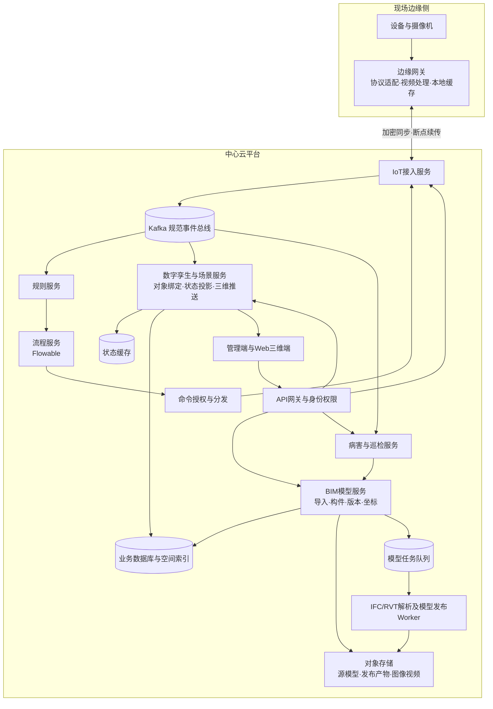
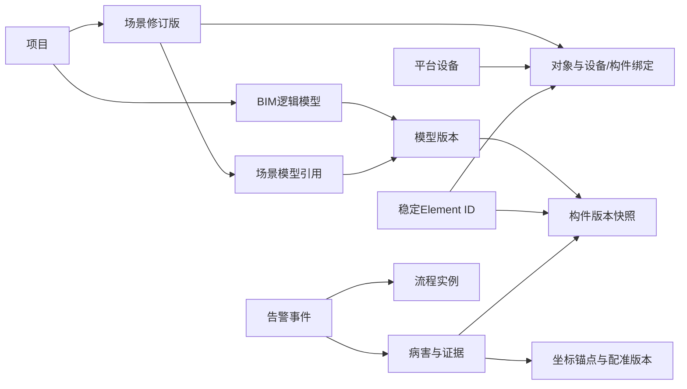

# 数字孪生平台总体架构与改造路线图

> 文档状态：V1.0设计基线（评审稿，尚未表示用户确认或实现验收通过）
>
> 本轮工作：先形成总体设计，解析引擎采购、Revit安装和样本实测安排在实施验证阶段。
>
> 适用范围：BIM模型、三维场景、物联网接入、规则判断、病害处置、业务流程及云边协同
>
> 设计原则：以项目空间为边界，以模型版本和构件身份为BIM事实来源，以统一事件连接设备与业务，以中心云和边缘网关分工协作。

## 1. 总体结论

数字孪生平台围绕现场对象的身份、空间位置、状态和生命周期建立一致的业务模型。改造后由BIM模型服务维护模型和构件事实，三维服务维护场景运行态与交互投影，物联网（IoT）服务负责外部连接和协议转换，规则服务产生可解释的业务事件，流程服务负责人工处置与长事务，巡检病害服务维护检查证据及构件关联。各服务使用明确的应用程序接口（API）和版本化事件协作，不跨模块直接改写彼此数据表。

中心云负责模型及业务数据的权威存储、BIM解析与智能计算、全局任务调度和跨项目管理。边缘网关负责设备接入、现场协议转换、视频流接入与按需处理、本地缓存和断网续传。边缘可缓存已发布的轻量模型供现场查看，但不创建或覆盖中心云的正式模型版本。

## 2. 架构目标与当前基线

### 2.1 建设目标

- 以项目、场景和现场对象形成统一的业务空间；BIM模型中的构件、设备、病害和流程能够互相定位。
- 版本化管理BIM源文件、构件身份、空间变换和发布产物；历史病害和业务记录保留发现时的模型上下文。
- 通过规范化事件承接设备遥测、告警、病害和命令回执，避免不同接入方的私有字段扩散至业务模块。
- 通过中心云与边缘网关分工，适应现场网络隔离、视频带宽和断网缓存需求。
- 在不重写现有管理端、三维端和流程引擎的前提下增量演进，支持灰度、对比和回滚。

### 2.2 已有项目基础

- 后端为Java 17、Spring Boot 3.1.x的Maven多模块工程。`wx-module-3d`已承载模型资源、场景及设备消息消费、Redis当前状态和WebSocket推送；其既有FBX/OBJ/3DS转换能力不视为IFC/RVT语义解析能力。
- `wx-module-bpm`已集成Flowable，可作为流程运行时继续演进。
- Kafka、Redis、MinIO及网关等已有基础设施可优先复用；统一事件契约、幂等、版本追溯及失败重放仍需建设。
- 管理端`Web/wx-web-2.0`和三维端`Web/web-unity`继续沿用现有技术栈，通过API、WebSocket及权限契约集成，不安排框架重写。

以上是架构规划基线，实际开发前需核对部署版本、现有主题和数据库写入方。设计文件中提出但尚未进入运行环境的模块能力，不作为现成实现承诺。

### 2.3 本版设计决策

以下决策作为本版方案的编写基线，供统一评审。后续更换解析工具或厂商时应保持领域身份、发布清单和业务接口兼容；涉及这些契约的变化须更新设计版本。

| 决策项 | 本版方案 | 实施时补充内容 |
| --- | --- | --- |
| 改造方式 | 保留现有管理端、三维端、网关、权限及BPM基础，新增领域能力并逐步迁移 | 试点清单、迁移批次与回滚开关 |
| 服务划分 | BIM、IoT、场景、巡检病害、规则、BPM六个领域；各领域可独立部署 | 各服务副本数和资源配额 |
| 模型计算 | Java负责业务编排；解析、几何和媒体计算由隔离工作进程（Worker）执行 | 引擎产品、SDK及运行环境 |
| 格式适配 | IFC与RVT采用同一中间契约；RVT适配器按能力注册与路由 | RVT兼容矩阵、许可、无人值守验证 |
| 部署模式 | 中心云加现场边缘网关，优先私有部署 | 现场网络、边缘容量及硬件清单 |
| 数据底座 | 复用MySQL、MinIO、Redis和Kafka；每类数据有唯一权威写入方 | 容量、保留期及备份配置 |
| 模型身份 | 平台Element ID独立于源格式、渲染节点和源文件内的数字编号 | 既有对象映射及人工复核规则 |
| 发布一致性 | 模型版本不可变；场景修订版固定引用模型版本及配准版本 | 发布权限与资源保留策略 |
| 三维接入 | 使用模型清单和查看器适配层集成现有Web端，业务层不绑定单一渲染引擎 | GLB、分块和3D Tiles加载能力验证 |
| 事件协同 | Kafka统一领域事件、命令和回执；数据库事务发件箱保障异步衔接 | 分区、消费组、限流及重放配置 |
| 处置闭环 | 规则形成告警事件，Flowable负责人工处置；IoT校验和执行物理命令 | 首批规则、流程及命令白名单 |
| 实施顺序 | 设计基线 → 统一契约与基础链路 → IFC及场景 → IoT与病害 → 规则流程 → 全量验收 | RVT在适配器支线验证后并入，正式交付仍须满足RVT要求 |

整体架构评审以本章、服务边界、数据归属、核心链路和阶段出口为依据。RVT供应商及版本未确定，不阻塞上述设计评审；它仍是原生RVT能力交付前必须关闭的依赖。

## 3. 领域对象与标识体系

平台采用“项目空间—场景—模型/对象—现场设备或业务记录”的关联结构。以下标识各自承担不同职责，不可相互替代：

| 对象 | 标识 | 事实来源与用途 |
| --- | --- | --- |
| 项目 | `projectId` | 项目权限、模型和场景的组织边界 |
| 三维场景 | `sceneId`、`sceneRevisionId` | `wx-module-3d`维护场景结构、资源引用和场景发布版本 |
| BIM逻辑模型 | `modelId` | BIM服务维护，可与一个项目关联多个模型 |
| BIM模型版本 | `modelVersionId` | 固定源文件哈希、解析器、坐标参数和发布清单 |
| BIM构件 | 平台`elementId` | BIM服务生成的稳定业务身份，病害关联主键 |
| 源构件 | `sourceElementId`、`sourceUniqueId`、`occurrencePath` | 分别保存源数字编号/标识、稳定标识和链接实例路径；IFC的GlobalId或RVT的UniqueId用于匹配，RVT数字ElementId用于源应用回溯 |
| 场景对象 | `objectKey` | 三维服务内可定位的场景对象身份，可映射至一个或多个BIM构件 |
| 设备 | `deviceId` | IoT/设备域稳定身份，与外部平台设备编号分离 |
| 病害 | `defectId` | 病害域业务记录，保存发现时模型版本、构件和空间锚点 |
| 业务事件/告警 | `incidentId` | 规则与流程协同的处置身份，可关联设备、病害、构件和流程实例 |

场景对象与BIM构件、设备之间通过带生效范围和版本的绑定关系连接。一个场景对象可以表示构件、设备或组合对象；若一个业务对象关联多个构件，绑定记录明确主构件及关系类型。业务数据引用稳定业务ID，并保存事件发生时的模型/场景版本，禁止用当前版本覆盖历史上下文。

### 3.1 版本与坐标一致性

每个模型版本保存源坐标系、目标现场坐标系、单位、轴向、转换参数版本、控制点/检核点报告、构件索引和轻量化资源清单。场景发布记录引用确定的模型版本及其空间变换。切换模型时，几何、构件属性、坐标变换、病害锚点和构件映射必须作为同一版本上下文切换，避免新旧资源混载。

病害图像的像素坐标不能直接视为BIM空间坐标。图像定位经相机标定、深度或射线求交、现场配准和模型坐标变换后得到世界坐标及构件关联；缺少必要定位信息时返回待校验状态。BIM模型配准误差与病害端到端定位误差分别验收，不能用模型配准合格替代病害定位验证。

### 3.2 租户、应用与项目的兼容关系

新领域契约使用`tenantId + appId + projectId`表达租户、现有应用范围和工程项目。现有`Project.appId`、`SceneDef.project`、各表`app_id/project_id`的含义和类型并不完全一致，不能直接改名或相互复制。

项目与场景管理继续由`wx-module-3d`承载，首期在该领域建立`project_legacy_mapping`，将旧系统标识映射到新的规范项目身份；BIM、IoT、规则和巡检病害通过项目API取得授权后的项目引用。一次迁移冻结各旧表的来源和映射规则；存在歧义的记录进入人工确认，不按编号相同自动合并。历史接口保留旧字段，由兼容层转换，新接口同时保留应用和项目范围。

所有新业务记录、查询条件、对象存储前缀、缓存和幂等键均携带适用的租户与项目范围。网关和服务依据已认证身份解析范围，不直接信任请求体中的租户编号。跨服务关联同时校验项目及租户，不仅校验对象ID存在。

## 4. 分层架构与服务边界

| 架构层 | 核心模块 | 权威职责 | 明确边界 |
| --- | --- | --- | --- |
| 现场接入层 | 边缘网关、协议适配、视频接入与缓存 | 设备和视频就近接入、协议转换、缓存、增量同步 | 不维护中心权威模型版本，不绕过IoT业务契约直写数据库 |
| 统一接入层 | API网关、身份认证、租户与项目权限 | 对外入口、鉴权、审计、限流和路由 | 外部平台不直连Kafka、数据库及内部服务接口 |
| 领域服务层 | BIM、IoT、数字孪生/场景、病害、规则、BPM | 分别维护本领域数据、接口、状态机与规则 | 不跨域直接改写其他服务表；通过API、事件和业务回调协作 |
| 异步处理层 | Kafka、IFC/RVT Worker、视频/图像处理Worker、Outbox | 长耗时任务、事件分发、可靠异步处理 | HTTP请求线程不执行大模型解析或长时媒体处理 |
| 数据与资产层 | MySQL、Redis、空间索引、MinIO及可选时序存储 | 保存业务事实、当前状态、空间检索和大文件资产 | 高频时序、关系数据和模型二进制按数据类型分别存储 |
| 展示交互层 | 管理端、Web三维端、开放API | 业务管理、模型交互、病害和设备状态展示 | 前端不承担规则、坐标变换、命令授权等权威判断 |

### 4.1 BIM模型服务

新增独立`wx-module-bim`，沿用API/业务服务分层并配套独立解析与发布Worker。BIM服务负责IFC 4.0及以上版本和RVT导入编排、构件及属性索引、平台Element ID、分类编码、模型版本、坐标配准、跨版本映射、发布清单和构件查询API。IFC/RVT解析、网格优化、LOD及GLB/3D Tiles生成在隔离Worker执行；RVT运行节点按目标Revit版本和许可要求单独部署。

MinIO保存原始模型、图像、视频及GLB/3D Tiles等发布资源；MySQL保存模型、版本、任务、构件属性、映射、坐标和业务关联；空间索引支撑范围查询。大型几何通过受控资源接口或分块地址访问，构件详情API返回稳定ID、空间信息、自定义属性和几何引用。模型版本通过完整性检查后原子发布，失败版本不替换当前稳定版本。

`wx-module-3d`继续负责场景、场景对象、对象绑定、三维运行态投影和WebSocket推送。它消费BIM发布/版本事件并调用BIM API查询模型与构件信息，不复制成为第二个模型主数据源；既有三维资源功能逐步与BIM源模型/语义模型职责区分。

### 4.2 物联网接入服务

新增`wx-module-iot`，负责外部物联网平台连接、协议适配、凭据引用、外部设备映射、点位/单位转换、上行事件规范化及下行命令传输和回执。Modbus、OPC UA等直接处于现场控制网络的协议优先由边缘代理处理，再向中心端发送规范化数据。IoT不执行BIM构件维护、规则判定、人工审批或三维渲染。

### 4.3 数字孪生与场景服务

现有`wx-module-3d`按增量方式演进，继续作为三维场景、场景版本、设备/构件对象绑定、实时状态投影及三维推送服务。最新设备状态存Redis或等价缓存；场景和绑定关系以持久化数据为准。它消费标准事件并生成场景可读投影，不成为高频原始数据的永久存储库，也不执行可编程业务规则。

### 4.4 病害、规则与流程服务

- 病害服务维护病害记录、图像/视频证据、类型、评级、置信度、参数、发现时间、Element ID、模型版本、坐标锚点及复核状态。病害与BIM构件关联经BIM服务解析/校验，坐标由版本化坐标服务处理。
- 规则服务消费规范化设备、病害和业务事件，管理规则版本、窗口、去重、告警和命中解释。规则只生成受约束的`incident`或动作意图，不直接连接设备或修改场景模型。
- `wx-module-bpm`复用Flowable承载人工确认、派单、审批、超时升级、补偿及业务长事务。高频遥测不逐条启动流程；仅业务规则判定成立后创建流程。
- 命令授权与分发校验租户、项目、对象绑定、操作者、设备能力、审批状态、幂等键和过期时间，由IoT服务承载物理命令执行。场景表现动作和设备物理命令使用不同动作类型和权限，部署归属见4.5节。

### 4.5 逻辑职责与首期部署单元

| 领域 | 首期承载模块 | 权威数据 | 对外协作 |
| --- | --- | --- | --- |
| 项目、场景与孪生投影 | 现有`wx-module-3d` | 项目映射、场景修订版、对象绑定、视点、状态投影 | 固定引用BIM版本；消费IoT、病害和处置事件 |
| BIM | 新增`wx-module-bim-api/biz` | 模型、版本、构件身份及版本快照、配准、任务和产物清单 | 提供构件与坐标API，发布模型就绪/发布事件 |
| IoT | 新增`wx-module-iot-api/biz` | 连接、外部设备映射、点位、物理命令及执行回执 | 规范事件上报，校验并执行受控物理命令 |
| 巡检病害 | 新增`wx-module-inspection-api/biz` | 巡检、病害、证据引用、定位结果、复核和构件安全评级 | 调用BIM坐标与空间接口，发布病害及评级变更 |
| 规则与告警 | 新增`wx-module-rule-api/biz` | 规则修订版、窗口配置、执行解释、incident及去重 | 消费事件；请求启动流程或提交动作意图 |
| 流程 | 现有`wx-module-bpm` | 流程定义、实例、任务、审批与处置轨迹 | 通过业务ID关联incident/病害，通过API回写处理结果 |

表中新增模块均为设计项，尚未创建或部署。`api`为跨服务契约依赖，`biz`为可独立启动的业务服务；共享基础设施不等于共享业务表写权限。开发及小规模试点可共用物理数据库实例，但按领域分库或分表前缀及账号权限隔离。

图像定位首期由巡检病害服务编排，计算交给媒体/定位Worker；BIM服务只维护模型坐标、配准和空间查询。构件安全评级由巡检病害服务维护并发布展示投影，BIM几何产物不因实时评级变化重新生成。设备与构件的绑定统一归场景服务，IoT保留外部设备到平台设备的映射。

命令授权器首期作为逻辑组件落在IoT模块，设备命令记录由IoT写入；场景动画、显隐等表现动作由三维模块校验并执行。规则和BPM只提交意图，IoT实际发送前再次检查权限、审批、绑定版本和有效期，不新增独立动作微服务。解析、几何发布、媒体定位也先按工作进程独立部署，不各自建设一套业务主数据服务。

## 5. 统一事件与接口契约

Kafka作为平台内部事件主干，首期统一使用现有集群，不对同一业务事实双写Kafka与RocketMQ。事件及命令共同包含`eventId/commandId`、`schemaVersion`、`tenantId`、`appId`、`projectId`、`traceId`和来源。事件记录`occurredAt`及`receivedAt`，命令记录`createdAt`、`expiresAt`及执行端接收时间；按领域扩展`sceneId`、`sceneRevisionId`、`modelId`、`modelVersionId`、`elementId`、`deviceId`、`objectKey`、`defectId`和质量状态。

| 契约 | 生产方 | 消费方 | 用途 |
| --- | --- | --- | --- |
| `twin.event.v1` | IoT适配器、BIM/病害服务、旧主题桥接器 | 规则、三维状态投影、审计/分析 | 遥测、设备状态、模型发布、构件映射、病害和业务事件 |
| `twin.command.v1` | BPM、经授权的规则/人工动作 | 命令授权器、IoT服务 | 统一受控动作请求，携带幂等键、权限上下文与过期时间 |
| `twin.command.ack.v1` | IoT及命令执行端 | BPM、规则、三维投影 | 区分传输接收、设备执行、失败、超时和过期 |
| REST/OpenAPI 3.0 | BIM、病害、场景及管理服务 | 管理端、三维端及获授权外部系统 | 模型、构件、坐标、病害、版本和空间范围查询 |
| WebSocket事件 | 三维状态投影 | `web-unity` | 推送实时状态、病害/告警和流程摘要，不传输权威业务状态机 |

模型发布、版本切换和跨版本映射可通过版本化领域事件通知下游；大文件和几何数据只在对象存储或模型资源服务传输，Kafka消息仅引用资源ID/版本/哈希。REST接口遵循OpenAPI 3.0，跨服务DTO和事件Schema版本化，字段增量向后兼容。

可靠性采用Outbox/Inbox或等价事务发件箱与消费去重；事件允许至少一次投递并保证业务幂等。死信保留错误码和原事件引用，受权重放不得触发已经过期的物理命令。数据库是领域事实来源，Kafka是事件分发通道，Redis是易重建的状态投影缓存。

### 5.1 契约约束

- `schemaVersion`描述消息结构，`eventType`描述事实类型，两者分开管理。对象ID在新增JSON契约中统一用字符串，避免浏览器对大整数的精度损失；既有数值字段由兼容层转换。
- 遥测按租户、项目、设备分区，同设备保留源序号及发生时间；模型事件按模型分区。跨主题无全局顺序保证，消费者按版本、时间及幂等键处理。
- 元数据写入与待发送事件在同一个数据库事务提交；投递器重试发件箱，消费者以`consumerName + eventId`去重。命令终态由IoT维护，BPM和场景保存可重建投影。
- 对外REST接口遵循开放接口规范（OpenAPI）3.0，管理、开放查询、Worker内部回调使用不同权限范围。构件详情、定位和病害查询显式指定`modelVersionId`，响应回显坐标及配准版本。
- 场景加载先取固定修订版清单，再取其中指定的模型、构件索引及变换；不逐个请求“最新版本”拼装一个场景。WebSocket断线重连后先读投影快照再接续增量，携带修订版和序号去重。

## 6. 数据与存储分工

| 数据类别 | 建议存储 | 主要内容 |
| --- | --- | --- |
| 领域事务数据 | MySQL | 项目/场景引用、BIM版本、构件属性、坐标参数、病害、规则、流程关联及审计 |
| 大型文件与发布资产 | MinIO/对象存储 | IFC/RVT原文件、GLB/3D Tiles、纹理、图像、视频片段和误差报告 |
| 当前状态与热点索引 | Redis | 设备最新态、场景状态投影、短期幂等/锁和热点查询缓存 |
| 异步事件与任务 | Kafka | 规范化事件、命令、回执、模型任务调度和领域变更通知 |
| 高频历史遥测 | 现有持久化或后续评估时序存储 | 按吞吐、查询和保留期评估；首期不因架构图而引入未验证的数据库 |
| 空间查询 | MySQL空间能力/空间索引 | 构件包围盒、位置、区域及配准检查点；按实际查询规模扩展 |

模型属性不整体塞进一张宽表：稳定查询字段结构化，长尾属性分组保存。业务关联使用平台Element ID和模型版本，不依赖GLB节点名、渲染批次或文件内部的临时序号。

### 6.1 核心关系与写入归属

| 数据集合 | 写入方 | 关联规则 |
| --- | --- | --- |
| 项目映射、`scene_revision`、`scene_model_ref`、对象绑定 | 三维服务 | 场景修订版固定引用模型版本、配准版本及构件身份 |
| `bim_model`、`bim_model_version`、构件身份与版本快照、任务和产物 | BIM服务 | 稳定身份与版本几何/属性分开；仅BIM服务提交正式数据，Worker通过暂存产物及内部回调提交 |
| `iot_connector`、设备映射、点位、`device_command` | IoT服务 | 平台设备身份稳定；命令关联审批、绑定修订版及过期时间 |
| 巡检、病害、证据、定位、评级 | 巡检病害服务 | 保留发现时模型版本、Element ID、坐标及配准版本；新版本映射另存 |
| 规则、修订版、incident、执行记录 | 规则服务 | 命中事实与规则版本不可覆盖；与病害通过业务关系关联 |
| 流程实例和人工任务 | BPM服务 | 使用业务唯一键幂等关联incident/病害，不重复存储模型和设备主数据 |

跨领域关联使用逻辑引用和API校验，不创建需要跨服务事务才能维护的数据库外键。发布/清理服务通过引用登记和确认流程保护被场景、病害或工单使用的模型版本；暂时无法确认引用时不执行物理回收。

三维包围盒保存六个双精度数值及坐标框架。首期用项目、模型版本、空间层级及范围粗筛，再做三维相交判断；二维空间索引只能作为辅助，不视为完整三维索引。后续按实测负载决定是否增加专用空间服务。

## 7. 核心端到端链路

### 7.1 BIM导入、发布与场景加载

1. 用户在管理端或获授权客户端申请分片上传；模型文件直传对象存储并校验大小、摘要和格式。
2. BIM服务创建模型版本和幂等任务，记录输入文件哈希、坐标配置快照、解析器及发布参数版本。
3. Kafka将任务路由至IFC或RVT Worker；Worker提取空间层级、构件源ID、属性和几何，生成统一构件记录。
4. BIM服务分配/复用平台Element ID，形成构件属性、空间索引和跨版本映射；低置信度映射进入复核队列。
5. 几何Worker进行轻量化、LOD和分块；根据规模生成GLB及/或3D Tiles，保留渲染节点到Element ID的映射。
6. 校验发布清单、构件索引、坐标变换和资源哈希后激活不可变模型版本，并发布模型版本事件。
7. 场景服务将模型版本绑定到场景修订版，三维端按默认视点渐进加载，支持构件搜索、属性查询、高亮和剖切。

模型发布与场景发布分开：新模型版本发布后成为可选版本，既有已发布场景继续引用原版本；采用新模型需生成并验证新的场景修订版，再发布该场景。回滚只切换到已验证的版本引用，不改写原版本文件和历史病害数据。

支持500MB级文件、10,000以上构件、标准IFC 4.0成功率不低于95%以及15秒首屏等指标，需在双方冻结的有效样本、客户端、网络和缓存条件下进行验收。RVT支持按实施阶段确认的Revit版本、引擎运行环境及合法许可矩阵验证。文件大小不能单独决定首屏性能，需同时记录面数、材质、纹理及网络/显卡条件。

### 7.2 设备事件与三维状态

1. 边缘网关或外部平台将设备数据发送至IoT适配器；边缘断网时在容量策略内缓存并记录事件标识，恢复后断点补传。
2. IoT校验连接身份、外部设备映射、字段类型、单位、事件时间和质量码，生成`twin.event.v1`规范事件。
3. 三维状态投影更新Redis和场景设备状态，规则服务独立消费事件进行条件判断。
4. 告警/incident只有在规则满足时创建；事件、规则版本、模型/场景上下文及对象绑定可追溯。

### 7.3 病害图像定位与模型版本关联

1. 图像、视频片段和巡检记录进入证据存储并保留来源、时间、设备和相机标定引用。
2. 定位服务结合像素、相机内外参、深度/射线交点、现场控制点及对应模型版本计算世界坐标。
3. BIM空间索引匹配候选构件，病害服务保存Element ID、模型版本、配准版本、误差/质量状态和人工复核记录。
4. 三维端按模型版本显示标注和悬浮信息；病害列表与场景双向定位。模型升级后依据构件映射迁移显示关系，未确认时明确提示重新映射，保留旧版证据。

5cm坐标配准和病害标注分别以独立检核点/真值数据验收，记录最大误差及统计口径。二维像素没有深度或空间约束时不能唯一确定三维位置，系统应返回待定位/待复核，不伪称精确结果。

### 7.4 告警处置与受控动作

规则生成`incidentId`并通过可靠事件/发件箱触发Flowable；流程负责审批、派单、计时、补偿和关闭。确需设备动作时，流程或人工请求经过命令授权器，验证动作白名单、权限、审批、幂等键及过期时间；IoT发送后分别记录外部接收确认和设备执行确认。三维动画/显隐与设备命令分开授权和审计。

## 8. 前端与对外接口

### 8.1 管理端

沿用`wx-web-2.0`，逐步增加模型/版本发布、构件映射复核、坐标校准、设备连接与映射、病害管理、安全评级、规则发布、事件/告警处置、流程监控和运维监控页面。具体页面按领域服务API构建，前端不直接读取业务数据库。

### 8.2 三维端

沿用`web-unity`和现有三维技术栈，集成WebGL模型加载、构件ID定位与高亮、属性面板、预设/自定义视点、剖切、评级着色、病害锚点、筛选和列表联动。WebSocket只推送增量投影；模型几何、属性详情和历史版本按需调用API/资源接口。

### 8.3 API与消息契约

对外API至少覆盖模型与版本、Element ID构件详情、几何资源、空间范围、坐标转换、配准检查、病害与构件关联、OpenAPI 3.0文档及认证方式。管理接口和Worker内部回调使用独立权限范围；回调进行服务身份验证和幂等处理。契约目录集中保存REST Schema、Kafka事件/命令Schema、WebSocket消息、枚举、错误码和权限码。

## 9. 部署拓扑、扩展与运维

中心云独立部署网关和领域API、数据库、Kafka、Redis、对象存储、规则/BPM及各类Worker。API服务根据在线并发扩容；解析/发布Worker按队列长度、CPU、内存和临时磁盘扩容；RVT Worker按引擎版本与许可约束隔离；媒体处理与模型解析分开配置资源，避免互相抢占。

首期中心云分为在线业务区、模型/媒体计算区和数据区；共享网络与监控，分别配置账号和资源配额。在线业务不依赖某个解析节点本地磁盘；工作进程从对象存储读取冻结输入并写入任务尝试目录。RVT节点仅在引擎和许可落实后启用，对外呈现的业务接口保持一致。

边缘网关部署在现场网络侧，根据设备协议和视频负载配置连接器、处理能力、缓存容量及保留周期。边缘与中心通过加密链路交换配置、任务、遥测、状态和证据引用；缓存在溢出时执行明确策略并告警。边缘侧缓存模型仅使用中心云正式发布且校验过的资源。

运维统一观测模型解析时长与失败率、发布队列、文件上传、首屏耗时、Worker资源、坐标校准误差、事件延迟/积压、边缘离线与缓存、规则命中、流程耗时、命令执行确认、API错误和对象存储用量。日志按`traceId`、`projectId`、`modelVersionId`、`taskId`、`eventId`、`incidentId`及`commandId`关联，敏感字段脱敏。

## 10. 安全、可靠性与兼容迁移

- 身份权限按租户、项目、场景、模型、设备、构件、病害和动作细分；外部凭据保存在受控密钥系统，仅业务表保存引用。
- 上传、Worker输入及归档执行格式、路径、压缩包和资源配额校验；Worker使用隔离进程/容器、非特权身份、超时和临时目录配额。
- 生产版本目录不可变，校验全部通过再原子切换当前发布指针；被业务引用的模型版本不得清理。
- Kafka消费者按至少一次交付设计，通过Inbox/幂等键避免重复业务副作用；失败按错误分类重试或进入死信，不允许过期命令在重放时执行。
- 云边断连时缓存范围、过期时间、补传顺序和冲突策略可配置；设备状态按事件发生时间及质量规则更新，不让迟到数据无条件覆盖新状态。
- 按“新增契约—旁路消费—新旧结果比对—小范围灰度—读路径切换—写路径切换—清理旧链路”迁移。数据库采用向前兼容迁移，保留旧主题桥接与回滚开关直至业务验收。

## 11. 分阶段改造路线

| 阶段 | 目标与关键工作 | 阶段出口 |
| --- | --- | --- |
| 0 总体设计评审 | 确认六个领域、云边职责、身份体系、数据归属、发布一致性、核心链路及交付范围；登记技术选型依赖 | 评审确认本设计基线和试点边界；RVT具体引擎不作为本阶段前置 |
| 1 领域标识与契约 | 明确project/scene/model/version/element/object/device/defect/incident关系；定义事件、API、坐标和版本契约；梳理数据权威与权限 | 形成领域模型、契约Schema、数据迁移和权限矩阵 |
| 2 BIM基础链路与IFC | 建设BIM API/业务服务、分片上传、异步任务、统一适配契约、IFC Worker、构件ID、版本、坐标及GLB发布；按复杂度增加分块 | 真实IFC可导入发布、构件可查询、失败可恢复；模拟产物只用于接口联调，不计为格式验收 |
| 3 场景与模型融合 | 场景修订版关联BIM模型版本；实现Element ID/ObjectKey映射、搜索高亮、剖切、评级着色和病害标注基础UI | 模型/场景版本一致，三维交互及API联调通过 |
| 4 边缘与IoT事件链 | 按专项IoT设计接入一个外部平台/协议，建立设备映射、边缘缓存与补传、规范事件和三维实时状态投影 | 采集—事件—状态投影闭环可观测，旧链路可比对和回滚 |
| 5 病害空间定位与版本追踪 | 建设图像/视频证据引用、坐标转换、检核报告、Element ID关联、版本映射和人工复核 | 端到端病害定位按冻结真值样本分别通过配准与标注精度验收 |
| 6 规则与流程闭环 | 规则消费遥测/病害事件，创建可去重incident；Flowable承接复核、派单、审批、升级及关闭 | 告警、规则版本、流程及模型上下文可追溯，不逐条遥测启动流程 |
| 7 RVT并入、受控动作与完整验收 | RVT支线完成兼容与授权验证后接入同一发布链；完善命令白名单、审批、幂等和执行回执；完成全部投标指标验证 | RVT、500MB/10,000构件、15秒、95%、5cm及故障恢复逐项留证，完成灰度和回滚演练 |

IoT、规则及流程专项的内部任务仍可独立排期；本路线图定义其依赖顺序和跨域接口。RVT引擎选型、插件完善与许可验证作为阶段1之后的独立实施支线，满足条件后即可接入，无需等到阶段7才开始。其他领域先依照稳定契约实施，正式整体交付前仍须完成RVT直接导入能力。BIM导入/版本与空间身份先具备可用基础，业务模块不得各自建立重复模型。

## 12. 验收基线与关键风险

| 验收能力 | 验证口径 |
| --- | --- |
| IFC/RVT导入 | 冻结IFC 4.x标准样本、目标Revit版本及许可；核对几何、构件、属性、坐标和失败诊断，不以文件上传成功代替导入成功 |
| 模型规模及首屏 | 至少500MB文件及10,000构件代表样本；在约定浏览器、硬件、网络和缓存条件测首屏≤15秒，并留存面数/纹理等复杂度信息 |
| IFC成功率 | 在测试前确认有效IFC 4.0样本和成功判定规则，成功率不低于95%，不得在测试后从分母移除失败有效样本 |
| 配准与病害标注 | 独立检核点测量模型配准误差≤5cm；使用独立真值另行验证病害图像到模型锚点误差≤5cm |
| 构件身份和版本 | 通过增删改、拆分/合并样本检查Element ID复用/映射、历史病害关联及低置信度人工复核 |
| 云边和事件可靠性 | 验证断网缓存、续传、重复事件、迟到消息、死信、重放、版本回滚及过期命令不执行 |

关键风险包括RVT版本与许可限制、模型真实几何复杂度导致首屏差异、现场坐标与图像标定数据不足、跨版本构件源ID变化、边缘缓存容量及高频遥测存储增长。通过实施阶段的样本验证、版本矩阵、独立检核点、映射复核、资源隔离和明确的数据保留策略控制风险。任何指标以合同及双方确认的验收基线为准，不能仅凭架构设计文本认定已实测达标。

### 12.1 设计评审与实施验证的出口

| 事项 | 当前设计结论 | 关闭时点 |
| --- | --- | --- |
| 服务职责、身份体系、数据归属、版本发布、云边分工 | 本文已给出统一方案，供评审确认 | 正式拆分开发任务前 |
| REST、事件、适配器及发布清单字段 | 按本版原则形成详细契约，详见专项设计 | 对应接口实现前 |
| IFC解析器版本、RVT引擎及许可 | 依赖适配层，保留更换能力 | 对应格式生产启用前 |
| 既有RevitExportPlugin | 已收到含源码插件；本机未装Revit，已读代码仅实现选中构件编号和属性导出，缺几何、坐标及稳定标识 | RVT支线验证阶段，当前不安排安装或执行 |
| 前端分块/3D Tiles、资源容量和并发 | 由真实模型及客户端负载确定 | 性能验收前 |
| 现场控制点、相机标定和病害定位精度 | 数据采集方案与测量基准单独落实 | 空间定位现场验收前 |

投标响应文档保留各技术要求、实施方法及验收目标；方案评审、接口联调、格式实测和最终验收分别记录状态。当前总体方案是可评审的设计结果，不能替代真实模型、现场精度及性能报告。

## 13. 配套设计文档

- [01 BIM模型处理微服务详细设计](./01_BIM模型处理微服务详细设计.md)
- [02 数字孪生物联网接入系统设计规划](./02_数字孪生物联网接入系统设计规划.md)
- [03 数字孪生流程引擎与规则引擎设计规划](./03_数字孪生流程引擎与规则引擎设计规划.md)
- [04 BIM平台技术要求响应及投标实施方案](./04_BIM平台技术要求响应及投标实施方案.md)
- [05 RVT原生模型导入验证方案](./05_RVT原生模型导入验证方案.md)
- [06 RVT样本验证记录](./06_RVT样本验证记录.md)
- [10 植被生成微服务设计](./10_植被生成微服务设计.md)
- [11 植被规则数据结构设计](./11_植被规则数据结构设计.md)
- [12 三维场景持久化与二维组件设计](./12_三维场景持久化与二维组件设计.md)
- [13 三维模型转换工具使用手册](./13_三维模型转换工具使用手册.md)
