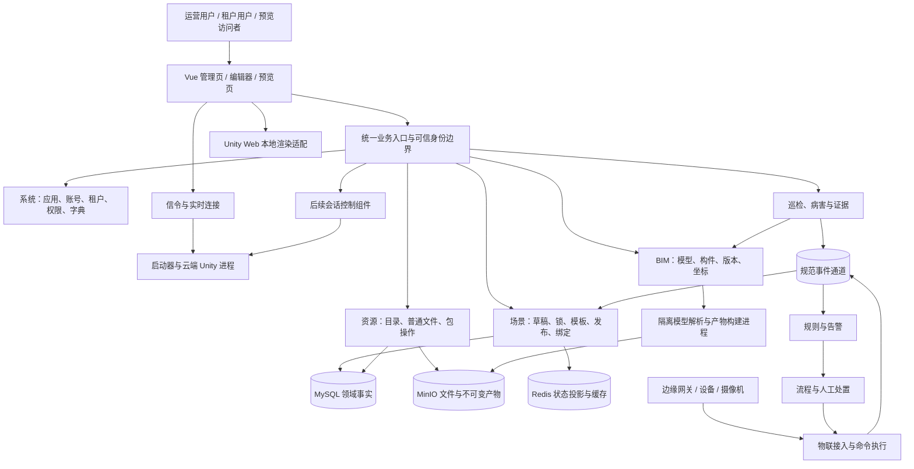

# 项目总体设计

版本：V1.1 评审稿。日期：2026-10-31。角色：按用户指定 agency-agents-zh 技能采用全栈架构专家工作方式。本文是软件设计说明，不是功能上线或最终验收证明。

## 1. 项目定位与交付边界

建设以场景为业务入口的数字孪生平台：用户管理项目与资源，在浏览器编辑二维界面和三维场景，发布受控访问的应用；后续关联建筑模型、现场设备、业务告警、巡检证据和处置流程。

前端主工程为 `F:/JTYFGitWorkSpace/wx-vue-unity`，业务后端为 `F:/JTYFGitWorkSpace/wx-cloud`。Unity 工程、信令、启动器、模型解析器、物联连接器及媒体网关各有独立职责，不因浏览器存在调用适配器就视为服务已经实现。

交付分三层：

1. **可用编辑平台：**双端认证、场景管理、完整二维编辑、可靠保存、资源/模板及发布预览。
2. **可用三维平台：**Unity 网页本地渲染与云渲染，真实模型包、地理场景和资源生命周期。
3. **行业业务平台：**建筑模型、物联、规则、流程、巡检病害、云边协同和正式运维。

最小可用产品（MVP）的验收入口是完整二维场景业务闭环，不能把仅有文字演示或仅出现三维视频首帧作为平台交付。

## 2. 依据、现状与设计权威

| 能力 | 源码或记录事实 | 本轮规划结论 |
| --- | --- | --- |
| 基础后端 | 2026-10-30 部署记录显示网关、系统、基础设施、三维服务及独立 MySQL/Redis 已验收 | 继续复用；本轮没有重新在线巡检 |
| 资源服务 | 已有目录、私有桶、受控上传/提交、固定内容读取、签名下载及测试 | 基础能力可用，仍需前端协议适配及真实 Unity 包端到端验收 |
| Vue 前端 | 有资源、场景、编辑器、预览、植被页面及双端认证代码 | 继续采用现有 Vue、状态管理和组件，不做框架重写 |
| 场景持久化 | 当前后端有旧场景接口；未发现当前前端新四包/编辑锁/发布预览完整实现 | 新增场景领域及适配接口 |
| Unity 双端 | 前端有双端使用说明、启动描述和连接适配 | 记录为源码/接入基础；需取得实际工程、构建和服务验证，不能认定两端业务已验收 |
| IoT | 根目录存在 `wx-module-iot-*`，但本轮只发现 `target` 等构建残留，没有 Java 源码及模块 `pom.xml` | 先找回并审计权威源码，不能直接列为可构建交付模块 |
| 规则、巡检、BIM | 有专项方案，BPM 有 Flowable 基础 | 按专项建设；已有方案不等于已有实现 |

本文是当前唯一总体设计入口，负责功能边界、模块归属、数据一致性和跨端规则。阶段顺序及范围见 [02 里程碑与交付计划](02_里程碑与交付计划.md)，任务状态和开工条件见 [03 近期执行任务](03_近期执行任务.md)。专项仅在对应任务需要时阅读。前端 `docs/api/` 是现有消费者合同依据；发生差异先记录并冻结决策，不能只取前端或后端单侧声明作为上线依据。历史归档不作为当前执行指令。

已明确覆盖早期设计的一项规则：**当前草稿维护一份四包及递增保存书签，发布时生成不可变场景快照。**不要求每次自动保存都新增完整历史版本。建筑模型版本、场景发布快照、资源内容修订分别管理，不合并为整个平台统一版本号。

## 3. 总体架构

图中会话、BIM、IoT、规则、巡检为目标职责，并非当前全部已部署。浏览器绘制二维，Unity 承担三维；云渲染视频直接走实时连接，业务后端不转发视频帧。Unity 命令和场景持久化是两条链路，渲染进程不持有业务数据库写权限。

首期维持现有四个业务部署单元，在模块内部新增清晰的领域服务；BIM 计算、媒体、Unity 播放进程单独隔离。逻辑领域不必立即拆成同数量微服务，按容量、故障隔离和团队归属逐步独立部署。

## 4. 用户、空间与身份模型

| 对象 | 定义及约束 |
| --- | --- |
| 运营用户 | 可信运营应用中的真实用户，平台维护权限由服务端角色决定 |
| 租户用户 | 始终绑定真实租户和应用；租户管理员与普通使用者分权 |
| 预览访问者 | 由场景访问模式和短时票据授权，不获得后台管理身份 |
| 项目空间 | 聚合场景、设备和行业对象；应用编号与项目编号不能互相替代 |
| 场景 | 拥有唯一归属和当前草稿，可引用已授权的共享资源；跨租户授权以明确关系维护 |
| 资源 | 可在授权范围内被多个场景引用，不默认绑定单个项目 |
| 建筑构件/设备 | 保留各自稳定身份，通过场景对象映射关联，不能用渲染节点编号替代业务编号 |

统一可信链：访问令牌 → 已登记应用 → 允许的平台 → 用户与租户 → 对象归属及动作权限。手机号相同而租户不同的登录歧义必须在认证合同中解决；不能以“取第一个用户”继续登录。

业务动作至少区分查询、编辑、发布、授权、全局资源维护和物理设备控制。前端能力开关用于展示，服务端每次操作再次鉴权。运营身份不默认拥有其他租户所有资源的写权限。

## 5. 功能设计矩阵

| 功能域 | 前端功能 | 后端设计与核心数据 | 主要验收 |
| --- | --- | --- | --- |
| 双端认证 | 运营/租户登录、资料、恢复、退出 | 复用系统账号、角色及令牌；平台/应用绑定，刷新撤销策略 | 换平台、换应用、换租户拒绝；退出后旧凭据失效 |
| 项目与基础配置 | 项目上下文、分类、发布模式、租户选择 | 明确项目到应用/租户映射；字典和权限可重复迁移 | 字典真实，租户只见授权项目与对象 |
| 场景管理 | 列表、搜索、新建、编辑、复制、删除、封面 | 场景主表、归属、用途、草稿和发布指针；删除保留审计 | 空列表合法；大编号不失真；复制身份全新 |
| 二维编辑 | 画布、控件、图表、结构树、分组、对齐、动画、撤销重做 | 配置持久化与校验；浏览器执行二维行为，后端不执行任意脚本 | 完整组件配置、隐藏项和未知扩展保存重开一致 |
| 数据绑定与联动 | 公共请求、实例请求、字段映射、条件、事件、状态动作 | 保存绑定及拥有者引用；凭据使用受控连接配置，不能写入公开发布内容 | 公共请求共享；实例首次激活；失败不伪装空数据 |
| 编辑锁与保存 | 页签锁、续期、冲突提示、失败重试 | 四包草稿、数据库权威租约、书签、请求幂等记录 | 双页签互斥；旧锁/旧书签拒绝；四包事务全回滚 |
| 图片与普通文件 | 上传、封面、选择、替换 | 基础设施文件服务、文件元信息和明确编号映射 | 上传失败不写有效记录；不越租户取文件 |
| 模型与资源目录 | 模型、图片、模板分类及上下线 | 复用目录和受控资源操作，区分普通文件与包资源 | 系统共享只读边界；替换失败保留旧内容 |
| 模型转换与产物 | 上传进度、转换进度、失败重试 | 异步任务、冻结输入、尝试目录、校验、不可变产物 | 网页模型和 Unity 包类型明确；真实产物可加载 |
| 模板 | 从当前内容另存、分类、应用、域选择 | 接收内存四包快照；二维/三维/全部范围裁剪和依赖校验 | 未保存编辑可另存；共享模板不被实例编辑覆盖 |
| 发布与分享 | 发布、取消、访问模式、密码、租户授权 | 不可变发布快照、授权关系、票据和依赖索引 | 草稿变化不影响已发页面；撤销后不能再获新授权 |
| 发布预览 | 二维独立预览、混合预览、隐藏对象按需激活 | 读取固定发布的三包和实例依赖；用途受限资源签发 | 不通过管理接口补读；过期/拒绝有明确反馈 |
| Unity 双端 | 同一编辑外壳选择 Web 本地或云端三维 | 启动描述、构建兼容、资源固定修订；会话与进程生命周期 | 加载、选中、变换、删除、重开、断连和释放分别验收 |
| 地理与植被 | 地图/地形、地理坐标、生成范围、预览、发布 | 复用植被专项与地理数据服务；任务版本、坐标变换和产物索引 | 地理/本地语义不混；错误版本不能回退“最新”蒙混 |
| 建筑模型 | 导入、版本、构件查询、定位、属性、模型绑定 | 建筑信息模型（BIM）服务维护模型、版本、构件、配准；计算交给隔离进程 | 真实格式解析、构件身份、几何/属性/坐标一致 |
| 设备与遥测 | 连接状态、点位、设备绑定、实时值、历史查询 | 物联网（IoT）维护连接与设备映射；事件驱动场景投影 | 重复去重、迟到值不覆盖新值、断网补传 |
| 规则与告警 | 条件配置、版本启停、告警列表、命中解释 | 有界表达式、窗口、去重、告警事实及版本上下文 | 同事件不重复告警；规则版本可追踪 |
| 流程与命令 | 确认、派单、审批、处理、关闭、受控操作 | 复用 Flowable；关联业务编号；IoT 复核并执行物理命令 | 命令过期不执行；已接收和已执行区分 |
| 巡检与病害 | 证据、标注、构件关联、复核、评级和处理记录 | 巡检事实、证据文件、模型版本和定位结果；计算服务只返回候选结果 | 独立真值核验；人工复核与模型上下文保留 |
| 运维与审计 | 任务诊断、失败重试、审计、容量及告警 | 统一追踪、备份、配额、任务清理及恢复工具 | 可定位失败、恢复数据、回退程序且不破坏已发布内容 |

项目级管理页、行业业务页和部分专项控件仍需增加，不视为现有 Vue 页面已覆盖矩阵全部功能。商城、支付、客户管理等仓库可选模块按真实业务立项，价格字段本身不触发支付系统建设。

## 6. 场景、资源和行业数据设计

四包分别是场景容器 `sceneJson`、三维内容 `threeDJson`、二维内容 `twoDJson` 和依赖 `dependenciesJson`，均以结构化数据格式（JSON）字符串传输和保全。后端解析必要字段建索引，不为每类图表或组件建独立业务表。

| 领域 | 权威数据 | 一致性及保留策略 |
| --- | --- | --- |
| 系统 | 用户、租户、应用、角色、权限及会话 | 复用现有结构，显式补充应用和平台绑定 |
| 场景 | 主记录、当前四包草稿、编辑锁、保存回执 | 同库短事务；锁、书签、草稿及回执一起验证提交 |
| 发布 | 不可变四包、发布记录、依赖索引及授权 | 固定 `publicationId`；取消发布不是删除共享底层资源 |
| 资源 | 目录、当前内容、资源操作及文件身份映射 | 复用 ART 合同；文件签名不入永久快照；被引用内容不能直接清理 |
| BIM | 源模型、模型版本、构件稳定身份及坐标配准 | 历史业务固定引用版本；新版本映射可人工复核 |
| IoT | 连接、设备、点位、命令和执行回执 | 归接入服务写入；高频历史按实际吞吐与保留期选存储 |
| 行业业务 | 病害、告警、规则、流程及证据关联 | 业务事实和模型上下文可追溯，展示状态可重建 |

近期新增场景结构按 《近期执行任务》中的主表、草稿、锁、幂等、发布、依赖索引及授权关系实施。逻辑归属不等于立即物理分库；初期可共用独立数据库实例，领域账号、迁移和写入方必须明确。

MySQL 保存权威事实；对象存储保存原文件和产物；Redis 保存可重建投影及缓存；Kafka 承载跨域事实通知。数据库事务发件箱（Outbox）及消费去重记录（Inbox）用于可靠异步协作，不宣称消息恰好投递一次。

首期不为架构图预先引入多套消息系统、时序库或搜索集群。容量达到基准后再通过实测选型，保留标准接口和导出能力。

## 7. 接口整体规划

开放接口规范（OpenAPI）及数据结构模式（Schema）是两端共享依据。新建 `contracts/editor/`，与既有 `contracts/art01/` 及行业专项合同并存，分别指定维护者和版本。

| 接口组 | 首期约定 | 归属及规则 |
| --- | --- | --- |
| 独立认证 | `/api/auth/...`；用户资料使用当前两端各自路径 | 系统模块适配现有服务；校验真实应用与平台 |
| 编辑业务 | `/api/operation/...`、`/api/tenant/web/...` | 沿用前端当前调用，控制器投影同一领域服务，不复制两套业务 |
| 普通文件和字典 | 当前公共 `/api` 合同中的精确路径 | “公共”表示路径分类，不代表匿名或无限权限 |
| ART 资源 | 保持已实现 `/admin-api/dim3d` 合同 | 前端兼容入口复用同一服务及范围校验，不增加旁路写入 |
| 发布预览 | 按前端当前解析和发布读取合同逐项冻结 | 票据、登录、公开模式分清用途，先审计请求层平台改写规则 |
| 内部接入 | 独立的任务回调、连接器上报及节点管理合同 | 节点凭据与用户令牌分离；不经浏览器普通业务身份操作 |
| 云渲染会话 | 现有草案尚未冻结 | 后端、浏览器、信令、启动器及 Unity 五方确认后定稿 |

外部业务成功码保持 `200`，编号传字符串，时间带时区，有效期字段注明秒或毫秒，分页对前端明确投影。未认证与权限不足分别处理，保留既有 ART 领域错误，不盲目重编号。

DATA-09-25 的匿名发布正文消费使用精确路由 `POST /admin-api/dim3d/scene/publication/preview`，只接受专用请求头中的短时只读票据，可信租户与修订由票据绑定关系推导。读取固定四包并复核发布摘要，禁止回退草稿或最新修订；接口、失效与依赖闭包限制见[不可变发布合同](10_专项设计/10_场景不可变发布记录合同.md#8-匿名消费子合同data-09-25)。

DATA-09-26 发布侧为托管模型建立独立的固定资源引用，原依赖四包原文保持不变。发布、引用和指针同事务提交，回退复用原发布引用，版本缺省只在首次发布时由服务端解析当前已提交版；不能据数据库元数据冻结认定物理文件闭包或票据文件签发已完成，详见同一发布合同的资源引用冻结子项。

票据文件读取通过 `/admin-api/dim3d/scene/publication/preview/resources` 和 `/admin-api/dim3d/scene/publication/preview/file` 两个精确 POST 路由提供。资源身份从冻结引用推导，复用 ART 清单及成员校验，签名不超过票据到期时间；撤销后拒绝新签发，既有签名按自身有效期失效。新引用表用二进制规则比较范围/租户，并将操作编号与旧表 ASCII 主键对齐，避免历史表排序规则不同造成查询失败。文件读取不持有数据库长事务，成员可用性用元信息检查，客户端必须核对下载摘要；资源回收保护和发布前物理预检仍需独立完成。

字典读取按 2026-11-04 当前前端使用 `/api/system/dict/data/type/{dictType}`，网关仅将该精确只读路径转发到系统模块 `/admin-api/system/dict/data/type/{dictType}`。沿用已有登录和租户校验，复用按类型及启用状态查询和排序；响应字段映射及空列表语义见 [编辑器合同](../contracts/editor/README.md#4-当前前端字典读取补充2026-11-04)，不引入独立分类表或分类写入口。

每接口必须登记方法/路径、请求头、数据模型、权限、幂等、并发、错误、分页/配额、调用方和测试样例。接口有破坏性变化时同步迁移两端和合同；首期不再额外创建一套无消费者的第三路径体系。

## 8. 关键流程与失效设计

### 8.1 编辑和保存

登录并重验权限 → 创建/读取场景 → 获取页签锁 → 编辑二维/三维配置 → 生成四包 → 校验幂等与书签 → 单事务保存 → 返回真实书签 → 重开一致。

原文结构预检在事务外进行；事务内再次验证权限和锁租约，锁定草稿并比较书签。幂等成功回执优先识别，避免把一次已成功保存的重试误判成新冲突。锁令牌、持有者和代次一起校验，不能仅凭场景编号解锁。

### 8.2 上传和发布

普通文件与包资源分别建身份 → 上传到任务暂存空间 → 产物校验 → 冻结对象 → 提交资源指针 → 场景引用 → 发布时固化场景快照 → 访问解析发放用途受限票据。

文件 IO、解析和网络请求不占用长数据库事务。上传成功不等于业务提交成功；提交失败保留旧内容，孤立文件按任务归属延后清理。

### 8.3 设备与处置

设备上报 → 接入映射和鉴权 → 规范事件 → 规则命中与去重 → 告警 → 人工或流程处置 → 命令再次授权 → 设备执行 → 回执 → 场景状态投影。

遥测不逐条创建流程；传输接收不代表设备执行。重试和重放不能执行已经过期的物理命令。网页动画、对象显隐等表现动作与物理设备动作分权。

### 8.4 Unity 会话

场景/发布授权 → 构建和资源兼容检查 → 本地启动描述或云会话申请 → 对端连接与协议协商 → 三维加载 → 交互 → 断连恢复或释放。

云会话拟采用 `REQUESTED/ALLOCATING/READY/ACTIVE/RELEASING/CLOSED/FAILED/EXPIRED` 状态，作为待跨端评审的设计提案。过程必须幂等，按会话释放进程，不得按浏览器断线杀掉同节点其他会话。临时连接编号、令牌和视频状态不写入场景设计数据。

## 9. 前端和渲染专项约束

- 沿用现有页面、样式、组件及能力端口。页面状态、业务场景状态、渲染对象和网络连接分别管理，避免巨型组件掌握全部生命周期。
- 二维单独可用，未知三维内容原文保全；未接入的三维操作有明确状态，不静默成功。
- Unity Web 本地渲染与云端 Windows 构建使用各自平台产物，不能互换资源包。精确 Unity/管线/协议兼容关系由真实工程验证，不在规划中升级依赖。
- 网页图形处理器接口（WebGPU）线程构建需要核实安全上下文和跨源隔离响应头；启用隔离策略前验证对象存储、嵌入页和媒体来源的兼容，不能直接一刀切阻断现有资源。
- 浏览器实时通信（WebRTC）的信令、媒体/输入通道、业务调用分别观测。业务后端不能把连接成功当作场景加载成功。
- 保留键盘操作、可见焦点、错误恢复及禁用原因；二维可操作性与三维画面质量分别验收。

## 10. 安全、性能及运行设计

### 10.1 安全

按角色和数据归属授权；所有租户越权、对象枚举、公开票据越权均有失败测试。客户端不能选择可信角色或租户。发布内容不携带连接密钥、刷新令牌、管理员密码、短时签名或节点访问票据。

远程数据源、模型回调和媒体地址仅在确有后端代理需求时启用，限制协议、目标和重定向，防止服务端请求伪造（SSRF）。上传检查大小、数量、压缩展开、路径和摘要；计算及 Unity 进程使用非特权身份和配额。

### 10.2 性能及容量

性能目标先登记为待测指标，不继承“部署健康即达标”的结论。M0 固定用户数、场景节点/依赖数量、四包字节、模型复杂度、网络和冷热缓存；首个可用阶段记录基线，最终阶段在同一负载复测。

普通接口、四包保存、首屏、资源加载、事件延迟分别测量第 95 百分位（P95）、失败率和资源占用。已有投标目标如大文件、构件规模、首屏和精度，沿用 平台早期方案及 BIM 专项的验收条件，不能据此对所有 Unity 场景作无条件性能承诺。

数据库使用分页、白名单排序、归属复合索引及批量关联查询；依赖树用映射和集合做到近线性遍历。前端资源按需加载并取消过时请求，场景退出释放事件、定时器、缓存引用及渲染实例；后台计算限制并发和临时空间。

### 10.3 运维

开发、隔离联调和正式入口分配置；148 是当前测试基础，不能默认有能力承载所有云端渲染和模型计算。图形计算、解析引擎许可、边缘机器另列容量清单。

按请求、场景、发布、资源操作、任务、事件和会话追踪；记录审计、队列积压、租约过期、失败及清理结果，禁止日志输出认证秘密。数据库与对象存储联合备份并做恢复演练，不能只备份程序包。

发布采用向前兼容迁移和候选包摘要校验。先加字段/新接口、再切调用方，最后退旧接口；破坏性删除与程序回退分开评审。已有回到 metabase 的脚本不作为后续每一阶段的通用回退方案。

## 11. 验证和交付

测试驱动开发（TDD）覆盖身份、状态转换、锁、幂等、事务及越权，先失败用例后实现。可逆的文档和样式调整不机械堆测试。每一里程碑同时提供接口样例、迁移、测试结果、真实页面/产物证据、部署回退及已知限制。

单元测试证明局部规则；MySQL/Redis/对象存储集成测试证明真实一致性；端到端测试证明 Vue 到后端的实际用户流程；Unity、格式、现场精度和视频必须各自有真实环境证据。历史测试报告不能替代本阶段新增能力的验收。

里程碑、依赖、责任和参考排期见[02 里程碑与交付计划](02_里程碑与交付计划.md)。近期接口及测试任务见[03 近期执行任务](03_近期执行任务.md)。
