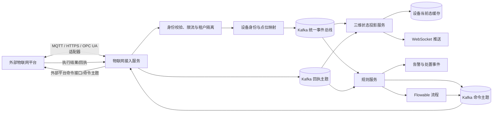

# 02 数字孪生物联网接入系统设计规划

## 1. 文档信息

| 项目 | 内容 |
|---|---|
| 文档编号 | 02 |
| 文档状态 | 规划稿 |
| 适用系统 | `wx-cloud` 数字孪生体系 |
| 设计范围 | 外部物联网平台接入、物联协议适配、设备与点位映射、数据上报、命令下发、回执和安全运维 |
| 上游规划 | [01 数字孪生流程引擎与规则引擎设计规划](01_数字孪生流程引擎与规则引擎设计规划.md) |
| 首期协议假设 | MQTT（消息队列遥测传输）和 HTTPS（安全超文本传输协议）；最终需按首个外部平台接口确认 |

本文面向“通过物联协议连接外部物联网服务”的场景。协议负责传输，业务系统还需要设备身份、数据模型、点位映射、权限、去重、命令回执和审计，不能把建立 MQTT 或 HTTP 连接视为集成完成。

## 2. 设计结论

建议新增独立的物联网接入服务 `wx-module-iot`，把外部平台协议隔离在三维业务、规则计算和 Flowable 流程之外。首期只实现实际合作平台所需的适配器，建议预留 MQTT 与 HTTPS 两类通道；工业现场协议在出现明确设备需求后通过边缘网关扩展。

整体数据方向：



核心决定：

1. 外部平台只连接物联网接入服务，不直接访问三维业务库、规则库或 Flowable 库。
2. 物联网服务完成认证、协议解析、设备身份校验和点位转换后，发布统一事件到 Kafka。
3. 规则服务与三维运行端分别使用独立消费组订阅统一事件；规则命中不能阻塞三维状态刷新。
4. 控制命令也通过统一命令主题进入物联网服务，完成授权和协议转换后再发往外部平台。
5. 每个命令都要关联 `commandId`、幂等键和回执状态；MQTT/HTTP 的传输确认不等同于设备已执行。
6. 协议适配器由服务内置并经过版本管理，管理员只能选择和配置已登记的适配器，不能上传代码或脚本。

## 3. 当前项目基础与需要衔接的部分

### 3.1 当前已有能力

- `wx-module-3d` 已通过多个 Kafka 消费者接收建筑、消防、电气、人员等业务主题。
- `AbstractTaskMessageConsumer` 负责消息转换、Redis 最新设备数据写入、消息保存和后续 WebSocket 发送事件。
- 三维服务配置了 Kafka，但当前 Kafka 消息使用 WebSocket 专用序列化器 `KafkaWebSocketMessageSerializer` 和反序列化器 `KafkaWebSocketMessageDeserializer`。
- `wx-module-bpm` 已使用 Flowable，并有供内部服务启动流程的 `BpmProcessInstanceApi`。
- `AlertScheme` 保存预警展示样式，不是完整的设备模型、连接配置或规则定义。

### 3.2 本设计的衔接方式

1. **建立内外网边界**：外部平台通过物联网协议连接 `wx-module-iot`；Kafka 是系统内部事件总线，不直接暴露给外部平台。
2. **区分业务事件与 WebSocket 消息**：新增孪生事件使用独立 DTO 和标准 JSON Kafka 序列化配置，不复用 WebSocket 广播消息封套。
3. **渐进迁移现有主题**：先由接入适配器把外部平台消息转换为统一事件；旧有内部 Kafka 主题仍由兼容桥接器转换，三维既有 WebSocket 消息结构可以暂时保持。
4. **保持场景数据的事实来源**：外部设备编号映射为系统 `deviceId`；设备与 `sceneId/objectKey` 的绑定以三维场景服务为准，物联网服务只缓存经过版本标记的映射或调用内部查询接口。
5. **避免重复维护当前态**：物联网服务负责协议连接和接入记录；三维状态投影服务继续维护现有 Redis 当前态和场景推送。长期时序数据由后续明确选择的时序库承载，不将所有高频数据无限写入普通业务表。

## 4. 服务边界与部署

### 4.1 服务职责

| 服务/模块 | 负责内容 | 不负责内容 |
|---|---|---|
| `wx-module-iot` | 外部连接配置、协议会话、接入认证、数据解码、数据映射、命令发送、回执关联、连接状态和协议审计 | 规则表达式执行、审批任务、三维渲染配置 |
| `wx-module-3d` | 场景、对象、资源、设备与场景对象关联、Redis 当前态和三维 WebSocket 推送；兼容原始设备主题 | 外部平台账号凭证和协议连接池 |
| `wx-module-rule` | 消费规范事件、规则版本和计算、告警、流程触发 | 建立外部协议连接、直接发送厂商私有报文 |
| `wx-module-bpm` | 处置流程、人工任务、审批、流程超时与补偿 | 设备遥测数据消费和设备协议解析 |
| Kafka | 服务之间的持久化事件、命令和回执传递 | 面向外部平台的公共接入端点 |

### 4.2 Maven 模块建议

参考仓库中 API/BIZ 分层的服务模块，建议结构如下：

```text
wx-module-iot
├─ wx-module-iot-api
└─ wx-module-iot-biz
   ├─ controller/admin       连接、设备映射、点位映射管理
   ├─ controller/open        外部 HTTPS 回调入口
   ├─ connector               协议连接生命周期与驱动接口
   ├─ protocol/mqtt           MQTT 客户端和消息处理
   ├─ protocol/http           HTTP 回调和外部 API 客户端
   ├─ protocol/legacy-kafka   旧设备 Kafka 主题兼容桥接
   ├─ protocol/opcua          后续按项目需要增加
   ├─ consumer                 Kafka 命令和内部回执消费者
   ├─ producer                 统一事件、命令回执生产者
   ├─ service                  连接管理、设备映射、命令调度
   ├─ dal                      连接、映射、命令和审计数据
   └─ security                 凭据引用、签名校验、权限校验
```

服务建议注册为 `iot-server`，独立设置连接数、线程池、内存、Kafka 消费并发和网络出口策略。若连接量增长，应将“管理 API”和“协议工作进程”以不同部署角色运行，避免管理接口扩容时复制过多外部长连接。

### 4.3 协议驱动接口

内置驱动统一实现类似的协议接口：

```java
public interface IoTProtocolDriver {
    // 创建连接前校验协议参数和凭据引用
    ValidationResult validate(ConnectorConfig config);

    // 建立或恢复外部协议会话
    void start(ConnectorContext context);

    // 停止会话并释放网络资源
    void stop(String connectorId);

    // 向指定外部设备发送已授权命令
    CommandSendResult send(CommandEnvelope command);

    // 返回连接状态、最近消息时间和错误摘要
    ConnectorHealth getHealth(String connectorId);
}
```

实现要求：

- 连接管理器按 `connectorId + revision` 管理会话；同一连接不能因配置刷新重复启动多个消费者。
- 连接配置变化时先验证新版本，再平滑切换；失败时保留旧版本运行并记录错误。
- 断线重连使用有上限的指数退避和随机抖动；避免多个连接同时高频重连外部服务。
- 驱动不允许执行动态类加载、任意反射配置、脚本或从管理端上传的 JAR。
- 长连接线程池、每连接消息队列和最大未确认命令数均设置上限。

## 5. 协议支持策略

### 5.1 首期协议

| 协议 | 首期用途 | 上行数据 | 下行控制 | 设计建议 |
|---|---|---|---|---|
| MQTT 3.1.1 / 5.0 | 与外部平台的持续遥测和事件订阅 | 订阅合作方授权的设备主题 | 向合作方授权的命令主题发布命令，并订阅回执主题 | 两端都支持时优先 MQTT 5.0；按合作方要求兼容 3.1.1。遥测默认使用 QoS 1，并在业务层去重 |
| HTTPS / REST | 外部平台主动回调、低频轮询、设备或平台管理 API | Webhook 推送或按游标增量拉取 | 调用外部命令 API | 高优先级事件优先采用主动回调；轮询必须带游标、限流和退避，不做无游标全量扫描 |
| HTTPS / Webhook | 外部服务推送状态变更和异步命令回执 | 提供签名认证的回调入口 | 接收方式不直接执行命令 | 入口需支持签名、时间戳、重放保护、限流和来源校验 |

MQTT 是发布/订阅消息传输协议，并定义最多一次、至少一次和恰好一次三种服务质量（QoS）；至少一次可能造成重复投递，因此系统仍需用事件编号和业务幂等处理。[OASIS MQTT 5.0 标准](https://docs.oasis-open.org/mqtt/mqtt/v5.0/mqtt-v5.0.html)

HTTPS/REST 适合请求/响应式平台接口、回调接收和命令调用；HTTP 语义由 IETF RFC 9110 定义。[IETF RFC 9110：HTTP 语义](https://www.rfc-editor.org/rfc/rfc9110.html)

### 5.2 后续可扩展协议

| 协议 | 适用条件 | 设计方式 |
|---|---|---|
| OPC UA（开放平台通信统一架构） | 工厂、能源、楼宇自动化等工业系统，需要结构化信息模型和安全的客户端/服务器通信 | 优先通过部署在现场网络的边缘网关访问 OPC UA Server，再把映射后的统一事件送入中心 Kafka；不得把中心服务直接暴露到控制网 |
| Modbus TCP/RTU | 接入存量仪表、PLC 或串口设备，通常位于现场网络 | 放入边缘采集代理，由代理完成寄存器轮询、字节序和量程换算；中心服务接收规范化数据 |
| CoAP（受限应用协议） | 低功耗、受限网络设备或既有 CoAP 平台明确要求 | 按合作方和网络能力单独评估安全、代理、设备寻址和运维成本 |
| 厂商云 API / 专有协议 | 合作平台没有标准协议，或设备模型和签名机制是厂商私有的 | 通过独立厂商驱动封装，输出统一事件；凭证、限流、错误码和升级周期按厂商分别管理 |

OPC UA 包含独立的安全模型和安全策略，应按现场部署的安全要求配置身份验证、消息完整性和加密。[OPC Foundation：OPC UA 安全模型](https://reference.opcfoundation.org/specs/OPC-10000-2/full)

原则上不在中心系统中实现所有工业现场协议。若网络隔离、串口、私有 VPN 或低时延控制要求存在，使用边缘代理比中心服务直连现场设备更容易控制网络边界和故障范围。

### 5.3 协议接入模式

每个连接配置明确连接模式，避免不同平台的方向和会话语义混在一起：

- **连接外部 Broker**：`iot-server` 作为 MQTT 客户端连接外部 Broker，订阅遥测主题并发布命令。
- **外部服务调用本系统**：合作方通过 HTTPS Webhook 推送事件或回执到本系统提供的受保护入口。
- **本系统提供 MQTT 接入点**：只有当合作方要求向本系统 MQTT Broker 发布时才启用；Broker 作为独立基础设施部署，外网 ACL 与业务服务隔离。
- **边缘代理接入**：现场网关连接 OPC UA、Modbus 等本地设备，再用 MQTT/HTTPS 向中心物联网服务上报。

首期只启用合同和网络条件已确认的一种或两种模式。除非确实需要本系统接收外部 MQTT 客户端连接，否则不为接入功能额外公开中心 MQTT Broker。

## 6. 统一设备与遥测模型

### 6.1 设备身份

外部设备标识不能直接充当系统主键。维护以下映射：

```text
tenantId + connectorId + externalDeviceId → deviceId
 deviceId → sceneId + objectKey + bindingRevision
```

- `externalDeviceId` 在不同外部平台间可能重复，必须与 `connectorId` 和租户一起组成外部唯一键。
- `deviceId` 是数字孪生内部稳定标识。
- `sceneId/objectKey` 是三维对象关联，来源于三维场景设备绑定；设备未绑定场景时仍可接入数据，但无法三维定位。
- `bindingRevision` 记录绑定版本，历史事件不能因后续重新绑定而改变历史对象归属。

### 6.2 统一遥测事件

协议驱动解析平台消息后，转换为统一孪生事件。多个点位映射为 `payload` 中的稳定业务字段，并在 `pointMetadata` 中记录单位、类型和质量，方便规则沿用统一的 `payload.<字段>` 路径判断。

```json
{
  "eventId": "evt-20261015-000001",
  "eventType": "telemetry.points.reported",
  "schemaVersion": 1,
  "tenantId": 1001,
  "appId": 2001,
  "connectorId": "conn-plant-01",
  "connectorRevision": 4,
  "sourceProtocol": "mqtt",
  "externalDeviceId": "boiler-07",
  "deviceId": "device-00987",
  "sceneId": "scene-001",
  "sceneRevisionId": 38,
  "objectKey": "boiler-room-boiler-07",
  "bindingRevision": 2,
  "occurredAt": "2026-10-15T10:20:30+08:00",
  "receivedAt": "2026-10-15T10:20:31+08:00",
  "sequence": 812033,
  "traceId": "trace-001",
  "payload": {
    "temperature": 78.4,
    "pressure": 0.62
  },
  "pointMetadata": {
    "temperature": { "valueType": "DECIMAL", "unit": "Cel", "quality": "GOOD" },
    "pressure": { "valueType": "DECIMAL", "unit": "MPa", "quality": "GOOD" }
  },
  "rawPayloadRef": "raw-event-001"
}
```

### 6.3 字段规则

- `eventId`：在接入侧生成或从合作方事件标识映射而来；重试时保持不变。
- `occurredAt`：外部设备或平台的事件时间；`receivedAt` 由本系统生成。
- `sequence`：合作方提供时保留；没有时不伪造连续序号。
- `payload` 键：平台无关的点位编码；外部字段名通过映射转换为稳定键。
- `pointMetadata`：记录类型、单位和质量码；规则使用字段前应按规则定义处理质量状态。
- `unit`：使用明确的单位编码并按配置进行转换，禁止仅凭字段名推断单位。
- `rawPayloadRef`：指向受限访问的原始报文归档，可按保留策略清理；敏感原文不得无期限复制到消息日志。
- 负数、NaN、无穷值、异常枚举和类型错误按映射策略拒收、隔离或标记质量，不允许悄悄转换成 0。

### 6.4 外部字段映射

每个连接可以绑定一个或多个版本化映射配置：

```json
{
  "mappingCode": "boiler-v2",
  "mappingRevision": 2,
  "deviceIdPath": "deviceCode",
  "eventTimePath": "timestamp",
  "sequencePath": "seq",
  "points": [
    {
      "sourcePath": "data.temp_c",
      "pointCode": "temperature",
      "valueType": "DECIMAL",
      "sourceUnit": "Cel",
      "targetUnit": "Cel",
      "scale": 1,
      "offset": 0
    }
  ]
}
```

映射编辑器应提供样例报文验证，校验必填字段、类型、单位换算、枚举映射和设备识别结果。发布映射新版本后，已接收事件保留当时的 `mappingRevision`。

## 7. 命令与回执模型

### 7.1 统一命令

规则流程和人工审批不直接发送外部协议报文，而是生成规范化命令：

```json
{
  "commandId": "cmd-20261015-000023",
  "idempotencyKey": "incident-001:ventilation.start:1",
  "tenantId": 1001,
  "connectorId": "conn-plant-01",
  "deviceId": "device-00987",
  "externalDeviceId": "boiler-07",
  "commandCode": "ventilation.start",
  "parameters": { "mode": "emergency" },
  "requestedBy": { "type": "workflow", "id": "process-123" },
  "incidentId": "incident-001",
  "traceId": "trace-001",
  "expiresAt": "2026-10-15T10:25:00+08:00",
  "mappingRevision": 2
}
```

### 7.2 命令生命周期

```text
CREATED → AUTHORIZED → SENT → ACCEPTED → EXECUTED
                         │          │
                         ├→ FAILED  ├→ REJECTED
                         └→ TIMEOUT └→ TIMEOUT
```

- `SENT` 表示本系统已把命令交给协议客户端。
- `ACCEPTED` 表示外部平台确认接收；不表示设备完成动作。
- `EXECUTED` 只在设备或平台提供明确执行回执后设置。
- 无异步回执的平台可记录 `HTTP_ACCEPTED` 等传输结果，但不能将其伪装为设备执行成功。
- 命令默认有失效时间，过期命令不得在网络恢复后无条件补发。
- 重试只对幂等且允许重试的命令启用；动作型命令的重试策略由设备能力配置决定。

### 7.3 协议映射

- MQTT：根据连接配置生成已登记的命令主题和消息结构，并订阅对应回执主题。
- HTTPS：调用已登记的外部 API 路径，设置请求超时、认证头和幂等键；异步结果通过受签名保护的 Webhook 或状态查询关联。
- OPC UA：只允许调用映射表中已登记且有权限的节点/方法；按现场安全策略配置客户端证书和安全策略。
- 对外平台命令拒绝、超时和成功执行都必须转为统一 `command.acknowledged` 或 `command.status.changed` 事件。

## 8. 连接配置与数据模型

建议新增数据表，所有修改通过增量 SQL 脚本执行。

| 表 | 主要字段 | 作用与约束 |
|---|---|---|
| `iot_connector` | `id`、`tenant_id`、`app_id`、`connector_code`、`name`、`protocol_type`、`direction_mode`、`status`、`current_revision` | 连接身份；唯一索引 `(tenant_id, app_id, connector_code)` |
| `iot_connector_revision` | `connector_id`、`revision_no`、`endpoint`、`client_id`、`topic_config`、`timeout_config`、`credential_ref`、`config_hash` | 不可变连接配置；敏感字段只保存凭据引用，不保存明文密钥 |
| `iot_device_binding` | `connector_id`、`external_device_id`、`device_id`、`scene_id`、`object_key`、`binding_revision`、`enabled` | 外部设备到内部设备/对象映射；唯一索引 `(connector_id, external_device_id)` |
| `iot_mapping_revision` | `connector_id`、`mapping_code`、`revision_no`、`mapping_json`、`status` | 外部数据字段和单位映射；唯一索引 `(connector_id, mapping_code, revision_no)` |
| `iot_message_inbox` | `event_id`、`connector_id`、`external_message_id`、`received_at`、`status`、`error_code`、`trace_id` | 接入去重和失败重放索引；按时间归档并配置保留期 |
| `iot_command` | `command_id`、`idempotency_key`、`connector_id`、`device_id`、`command_code`、`status`、`expires_at`、`trace_id` | 命令权威状态；唯一索引 `idempotency_key` |
| `iot_command_attempt` | `command_id`、`attempt_no`、`protocol_request_ref`、`status`、`response_summary`、`created_at` | 命令每次发送和回执审计，不保存不必要的完整敏感载荷 |
| `iot_connector_health`（可选） | `connector_id`、`connected`、`last_message_at`、`last_error_code`、`checked_at` | 可由缓存或监控系统承载；避免高频轮询时反复更新主配置表 |

连接状态、最近心跳和执行计数属于运行状态，不应与不可变连接版本配置混为同一事实来源。原始遥测适合消息系统或时序存储；MySQL 主要保存管理配置、映射、命令状态和审计索引。

## 9. 消息主题与内部契约

建议统一事件主题，并按租户、设备或聚合键分区：

| Kafka 主题 | 生产方 | 消费方 | 用途 |
|---|---|---|---|
| `twin.event.v1` | `wx-module-iot`、旧主题桥接器 | 规则服务、三维状态投影、审计归档 | 规范设备遥测和状态事件 |
| `twin.command.v1` | 规则服务、BPM 适配器、受权人工操作 | `wx-module-iot` | 统一控制请求 |
| `twin.command.ack.v1` | `wx-module-iot` | 规则服务、BPM、三维状态投影 | 命令接收、执行、失败和超时状态 |
| `twin.connector.status.v1` | `wx-module-iot` | 运维看板、管理端 | 连接建立、断开、认证失败和恢复事件 |

消息建议使用版本化 DTO 和 JSON Schema（JSON 结构约束）进行兼容校验。新增字段应向后兼容；删除、改名或改变字段语义时增加新版本主题或新 `schemaVersion`。IoT 模块使用自己的序列化配置，不复用 WebSocket 消息传输专用类型。

## 10. 关键处理流程

### 10.1 遥测上行

```text
接收外部消息
  ↓
校验连接身份、主题/路径和凭据状态
  ↓
校验报文大小、速率、结构和时间字段
  ↓
通过 connector + externalDeviceId 定位内部 deviceId
  ↓
按 mappingRevision 转换点位、类型、单位和质量码
  ↓
生成稳定 eventId，写入 inbox / 去重状态
  ↓
发布 twin.event.v1
  ├─ 规则服务执行规则
  └─ 三维服务更新 Redis 当前态并推送 WebSocket
```

解析错误需要带 `connectorId`、外部消息标识和错误码进入隔离队列；不能用默认值伪造有效遥测。重放数据必须显式标记 `replay=true`，避免历史回放触发实时控制。

### 10.2 命令下行

```text
规则/流程/人工操作生成命令
  ↓
写入命令记录和 outbox
  ↓
检查租户、场景绑定、设备能力、操作者权限和审批状态
  ↓
检查幂等键、过期时间和连接状态
  ↓
协议驱动发送到外部平台
  ↓
等待传输确认或设备异步回执
  ↓
更新命令状态并发布 twin.command.ack.v1
  ↓
关联告警和 Flowable 流程任务
```

命令请求记录应先持久化再发送。网络请求和数据库写入不可能天然构成一个跨系统事务，因此使用事务发件箱（Transactional Outbox）保证可恢复投递；下游根据幂等键消除重复操作。

### 10.3 HTTPS 回调

- 为每个连接生成独立回调标识和签名密钥引用。
- 检查签名、时间戳、请求编号和来源策略后，快速持久化接入结果并返回。
- 业务规则计算、流程启动和慢速设备调用放入异步链路。
- 外部重复回调返回稳定结果，不重复创建告警或命令。

## 11. 管理接口与前端

### 11.1 管理接口建议

| 方法 | 示例路径 | 用途 |
|---|---|---|
| `POST` | `/admin-api/iot/connector/create` | 新建连接草稿 |
| `PUT` | `/admin-api/iot/connector/update` | 修改连接草稿并创建新修订版 |
| `POST` | `/admin-api/iot/connector/test` | 校验网络、认证、主题权限和接口响应 |
| `POST` | `/admin-api/iot/connector/enable` | 启用已发布连接 |
| `POST` | `/admin-api/iot/connector/disable` | 停止连接并保留历史记录 |
| `GET` | `/admin-api/iot/connector/page` | 连接、状态和最近错误分页查询 |
| `POST` | `/admin-api/iot/mapping/validate` | 用样例消息校验数据映射 |
| `POST` | `/admin-api/iot/mapping/publish` | 发布映射版本 |
| `POST` | `/admin-api/iot/device/bind` | 绑定外部设备和内部设备/场景对象 |
| `GET` | `/admin-api/iot/command/page` | 查询命令发送和回执状态 |
| `POST` | `/admin-api/iot/command/retry` | 按权限和命令策略重试可重试命令 |
| `GET` | `/admin-api/iot/message/error/page` | 查看隔离消息和解析错误 |

### 11.2 外部 HTTPS 接口建议

```text
POST /open-api/iot/v1/connectors/{connectorCode}/telemetry
POST /open-api/iot/v1/connectors/{connectorCode}/command-ack
```

该入口只为已配置的 HTTPS/Webhook 连接启用，使用独立鉴权和流量限制，不暴露后台管理 API。平台主动推送与本系统拉取由连接模式字段区分。

### 11.3 前端页面

- 连接列表：平台、协议、方向、状态、最近消息、错误摘要。
- 连接配置：地址、协议版本、客户端标识、主题/路径、超时和凭据引用。
- 数据映射：外部字段、内部点位、单位、类型、质量码和示例值。
- 设备绑定：外部设备、内部设备、场景和三维对象定位。
- 消息监控：吞吐量、消费延迟、隔离原因、回放操作。
- 命令中心：审批来源、发送状态、外部响应和设备执行回执。

敏感凭据创建后仅展示掩码和引用标识；接口测试不得把完整凭据回传前端。

## 12. 安全与隔离

1. **凭据管理**：连接表只保存 `credentialRef`。凭据由受控密钥服务或加密凭据库保存；禁止明文进入配置 JSON、日志、前端响应和异常栈。
2. **传输保护**：优先使用 TLS；支持双向 TLS（mTLS）时应验证客户端和服务端证书。MQTT 认证和主题 ACL 需要同时配置，不能只依赖用户名密码。
3. **租户隔离**：连接、设备、映射、消息和命令均校验 `tenantId/appId`；消费者处理消息时不可从客户端 payload 自行信任租户范围。
4. **网络出口控制**：外部 URL、Broker 地址和端口使用管理员配置的允许清单；解析 DNS 后校验目标地址和重定向，阻止访问未授权的内网管理地址、云元数据地址和本机端口。确需私网平台时通过明确网络策略授权。
5. **主题和 API 权限**：MQTT 禁止不受控通配订阅和发布；HTTP 限制方法、路径、请求体、速率和回调来源。
6. **报文防护**：限制最大报文、批次点位数、JSON 深度和字符串长度；拒绝压缩炸弹、异常时间值和非法编码。
7. **命令权限**：按连接、设备类型、动作编码和角色控制；高风险命令必须关联 BPM 审批记录；设备绑定失效时拒绝下发。
8. **重放防护**：HTTPS 回调签名纳入时间戳和请求编号；MQTT 消息使用事件编号、序列号和有效时间做去重与过期判断。
9. **审计**：连接创建、测试、启用、停用、映射发布、命令批准、发送、重试和手工回放都记录操作者、租户、时间、版本和原因。

## 13. 可靠性与容量

### 13.1 消息交付

- MQTT QoS、Kafka 提交和外部 HTTP 返回属于不同层次的确认，不能推导出业务处理“恰好一次”。业务侧使用稳定 `eventId`、`commandId` 和唯一幂等键。
- 遥测按至少一次接收设计，消费者幂等；可以丢弃的高频采样可由明确策略降采样，告警相关事件不得静默丢弃。
- Kafka 消费失败按错误类型重试；不可恢复格式错误进入隔离/死信主题，提供带权限的回放入口。
- 连接重建、映射发布和服务重启不能丢失未完成命令；未过期命令可恢复投递，过期命令必须转为 `EXPIRED`。
- WebSocket 断开不影响事件总线、规则执行或命令回执处理。

### 13.2 扩容和限额

- 按连接数、消息吞吐量、连接模式和外部服务配额估算资源；每个租户和连接可配置消息速率、最大连接数和命令并发。
- MQTT 长连接消费者按 `connectorId` 分片，水平扩容需有连接租约或分区分配机制，避免同一配置被多个实例重复订阅和执行。
- HTTP 入站接口使用无状态实例扩容；轮询任务使用分布式租约和游标，保证同一连接不被多个实例同时全量轮询。
- 原始报文按需归档、加密并设置保留期；状态快照、遥测历史和执行审计分别设定存储策略。

## 14. 运维监控

至少暴露以下监控维度：

- 连接状态、建立/断开次数、重连次数、认证失败、证书过期天数。
- 按连接和协议统计的上行消息数、解析失败数、数据映射失败数和限流数。
- Kafka 生产失败、消费延迟、分区积压、隔离队列数量和最老消息年龄。
- 设备最近上报时间、设备离线时长、遥测质量分布和时间戳偏差。
- 命令发送成功率、外部接收延迟、设备回执延迟、过期命令和重复命令拒绝数。
- 按 `tenantId`、`connectorId`、`deviceId`、`eventId`、`commandId` 和 `traceId` 关联日志；敏感值必须脱敏。

连接“已连接”只表示协议会话正常，还需根据 `lastMessageAt`、心跳和业务健康规则判断设备或外部平台是否实际可用。

## 15. 分阶段实施

### 阶段一：确认外部平台契约

- 确认首个合作平台、连接方向、协议版本、认证方式、消息样例、设备规模、峰值频率和命令回执语义。
- 明确哪些数据需要实时规则处理，哪些只需三维展示或历史存储。
- 形成协议字段映射、网络端口、证书和验收样例。

**交付物**：外部平台接入契约、字段映射表、网络与安全清单。

### 阶段二：接入服务与上行数据

- 新增 `wx-module-iot` API/BIZ 服务及连接配置管理。
- 根据首个合作方先实现 MQTT 或 HTTPS 一种主协议；另一协议保留为下一适配器。
- 实现设备映射、点位转换、事件编号、Kafka `twin.event.v1` 和隔离队列。
- 让三维状态投影和规则服务以独立消费组接入。

**交付物**：连接管理、测试连接、映射验证、遥测上行和监控。

### 阶段三：命令和异步回执

- 实现统一命令 DTO、命令白名单、幂等表、事务发件箱和状态机。
- 对接合作方命令接口/主题和回执接口/主题。
- 先从低风险设备能力和测试环境开始验证。

**交付物**：命令下行、执行回执、超时、受控重试和操作审计。

### 阶段四：多平台与工业边缘接入

- 抽取可复用协议驱动和平台适配规范，接入第二家外部平台。
- 根据现场网络和设备种类增加 OPC UA 或边缘代理；Modbus 等现场协议优先放在边缘侧。
- 评估连接分片、租户配额、时序库存储和跨机房恢复。

**交付物**：第二平台适配、边缘接入规范、容量与灾备方案。

## 16. 首期验收标准

1. 外部平台使用已配置协议建立连接，连接状态和认证失败原因可查看。
2. 外部设备消息能按连接和设备映射转换为统一事件，并被规则服务与三维状态投影独立消费。
3. 无映射、非法类型、单位错误或过期消息会进入明确的隔离路径，不伪造默认正常值。
4. 重复遥测不会重复产生告警；重启或重复消费不会导致事件链失去幂等性。
5. 连接凭据不以明文保存到普通配置表、日志和接口响应中。
6. `twin.command.v1` 命令能够校验权限、调用正确协议端点，并记录发送状态与外部/设备回执。
7. 相同命令幂等键只执行一次；命令超时、失败、拒绝和过期状态可区分。
8. 映射版本变更不会改写历史事件所使用的映射版本。
9. 外部连接中断不会阻塞 BPM、规则管理、场景编辑或 WebSocket 服务。
10. 外部平台只能访问明确开放的协议入口，无法直接访问 Kafka、业务数据库和内部管理 API。

## 17. 需要外部平台提供的信息

实际开发前由项目对接人向平台方确认以下内容；这不影响先完成协议无关的系统骨架：

- 服务名称、版本和测试/生产环境地址。
- MQTT Broker 地址、端口、协议版本、客户端标识规则、QoS、主题 ACL；或 HTTPS API/回调地址及签名算法。
- 设备唯一标识、点位字段、类型、单位、质量码、时间戳和序列号定义。
- 上行消息频率、批量上限、峰值吞吐、离线缓存和补发策略。
- 命令接口/主题、命令参数、幂等要求、超时、回执状态和回执时限。
- 证书、密钥轮换流程、网络白名单、VPN/专线、证书吊销和故障联系人。
- 数据保留、个人信息/敏感信息范围、生产环境审计和服务等级要求。

若尚无指定平台，建议先用 MQTT 5.0 和 HTTPS Webhook 作为接口样例完成契约测试，并把真实平台差异放入对应连接配置与映射，不将厂商字段扩散到规则和三维业务模型。

## 18. 主要风险与应对

| 风险 | 应对方案 |
|---|---|
| 外部设备编号或字段不统一 | 连接级映射和稳定内部 `deviceId`，发布映射版本 |
| 协议确认成功但设备未执行 | 分离传输状态与执行状态，要求设备/平台回执或明确标注无执行回执 |
| QoS/重试造成重复消息 | 事件编号、Inbox 去重、命令幂等键和审计记录 |
| 某连接消息洪峰拖慢其他平台 | 按连接隔离队列、连接配额、Kafka 分区和消费限流 |
| 外部配置被滥用访问内部网络 | URL/Broker 允许清单、DNS/IP 校验、出口防火墙和私网专门授权 |
| 数据格式或单位变更 | 样例验证、映射版本、协议契约测试和异常隔离 |
| 中心端访问现场网络风险过大 | OPC UA/Modbus 通过边缘网关采集，网络区间只开放必要方向 |
| 新协议模块成为万能适配代码 | 驱动接口统一，厂商差异封装于独立适配器并限制受支持范围 |

## 19. 参考标准与项目文档

- [OASIS MQTT Version 5.0 标准](https://docs.oasis-open.org/mqtt/mqtt/v5.0/mqtt-v5.0.html)
- [IETF RFC 9110：HTTP 语义](https://www.rfc-editor.org/rfc/rfc9110.html)
- [OPC Foundation：OPC UA Part 2 安全模型](https://reference.opcfoundation.org/specs/OPC-10000-2/full)
- [01 数字孪生流程引擎与规则引擎设计规划](01_数字孪生流程引擎与规则引擎设计规划.md)
- `wx-module-3d/src/main/java/cn/iocoder/wx/module/dimensions/consumer/common/AbstractTaskMessageConsumer.java`
- `wx-module-3d/src/main/java/cn/iocoder/wx/module/dimensions/consumer/common/KafkaTopicsConstants.java`
- `wx-module-3d/src/main/resources/application.yaml`
- `wx-module-bpm/wx-module-bpm-api/src/main/java/cn/iocoder/wx/module/bpm/api/task/BpmProcessInstanceApi.java`

## 20. 当前实施进度（2026-10-15）

本专项已从纯设计阶段进入阶段二的基础实现阶段。当前实现以协议无关的接入骨架为主，真实外部平台协议仍需在确认平台契约后接入。

### 20.1 已落地代码

- `wx-module-iot` 已加入根 Maven 工程，拆分为 `wx-module-iot-api` 和 `wx-module-iot-biz`。
- 已实现 `TwinTelemetryEvent` 和 `TwinTelemetryIngestRequest`，统一遥测输入和 Kafka 输出契约。
- 已实现 `IotEventPublisher`，向 `twin.event.v1` 发布 JSON 事件。
- 已实现连接器管理接口：`/admin-api/iot/connector/*`。
- 已增加连接器显式启用/停用接口；启用后状态为 `DISCONNECTED`，等待真实协议适配器建立会话，停用后状态为 `DISABLED`。
- 已实现外部设备绑定接口：`/admin-api/iot/device-binding/*`。
- 已实现模拟遥测入口：`POST /admin-api/iot/telemetry/mock`。
- 已实现连接器编号、外部设备绑定唯一性校验和协议类型校验。
- 已接入现有多租户数据库隔离，连接器与绑定表使用 `TenantBaseDO`。
- 已新增数据库脚本 `wx-module-iot/db/iot.sql`。
- 已新增 `wx-module-iot/db/iot-inbox-replay-migration.sql`，用于旧环境补充事件快照字段；旧记录没有快照时不允许直接重放。
- 已新增 `wx-module-iot/db/iot-inbox-claim-token-migration.sql`，用于旧环境补充抢占令牌字段；新环境仅需执行 `iot.sql`。

### 20.2 已验证内容

- `mvn -DskipTests -pl wx-module-iot/wx-module-iot-biz -am compile` 通过。
- `mvn -DskipTests validate` 通过。
- `git diff --check` 通过。
- 当前验证范围为编译、依赖和代码静态检查，尚未连接真实 Kafka、Nacos、MySQL、MQTT Broker 或外部 HTTPS 平台。

### 20.3 实现与设计的差异

| 设计项 | 当前状态 |
|---|---|
| MQTT、HTTPS 协议适配 | 已有通用 HTTPS 签名遥测入口；厂商字段转换和 MQTT 适配器等待外部平台契约 |
| 点位、类型、单位转换 | 已实现基础点位编码、类型、单位和 `scale/offset` 数值换算 |
| Inbox 去重、发布状态 | 已实现唯一键去重、`CLAIMED/PUBLISHED/FAILED/DEAD_LETTER` 状态和超时重新抢占 |
| Inbox 失败查询、重放 | 已实现事件快照、失败分页查询和受权限控制的失败/死信事件重放 |
| Inbox 重试上限、死信 | 已实现 5 次失败后进入 `DEAD_LETTER` |
| Inbox 归档 | 待实现 |
| 下行命令和执行回执 | 待实现 |
| 规则引擎消费组 | 待实现 |
| `web-unity` 三维状态投影 | 待实现 |

### 20.4 下一开发顺序

1. 根据外部平台提供的消息样例完成 HTTPS 字段转换或 MQTT 适配器。
2. 补齐 Inbox 死信归档和按保留期清理。
3. 将 `twin.event.v1` 接入三维状态投影和规则服务独立消费组。
4. 再实现 `twin.command.v1`、命令回执和 Flowable 流程关联。

## 21. 增量实施记录（2026-10-16）

- 已将设备绑定中的 `pointMappingJson` 接入遥测编排流程，映射结果再生成统一 `TwinTelemetryEvent`，不改变现有模拟遥测接口。
- 已新增 `IotMessageInboxService`，使用数据库唯一键实现跨实例幂等抢占；Kafka 发布完成后更新发布状态，异常时记录失败原因。
- 已增加失败或超时占用事件的重新抢占窗口，暂定为 5 分钟；死信、人工重放和历史归档将在真实平台联调后按吞吐量确定。
- 已保存统一事件快照，提供 Inbox 分页查询和失败事件重放接口；重放复用原 `eventId`，并重新经过幂等抢占。
- 已增加最大 5 次失败重试，超过上限自动进入 `DEAD_LETTER`；人工重放会重置计数，归档和保留期清理待后续实现。
- 已补齐连接器启用/停用生命周期接口，避免通过普通配置更新隐式改变运行状态。
- 本次仅完成协议无关基础能力，尚未连接真实 Kafka、MySQL、MQTT Broker 或外部 HTTPS 平台。

## 22. 通用 HTTPS 遥测入口（2026-10-16）

- 网关已将 `/admin-api/iot/**` 和 `/open-api/iot/**` 转发到 `iot-server`；修正管理控制器与框架自动前缀叠加的问题。
- 新增 `POST /open-api/iot/v1/connectors/{connectorId}/telemetry`。请求头必须提供 `tenant-id`、`X-Iot-Timestamp`（Unix 秒）和 `X-Iot-Signature`（小写十六进制 HMAC-SHA256）。
- 签名原文为 UTF-8 编码的 `timestamp + "\\n" + tenantId + "\\n" + connectorId + "\\n"`，后接原始请求体字节。时间偏差不得超过 300 秒，请求体不得超过 64 KiB。
- HTTPS 连接器的 `credentialRef` 指向部署环境中的变量名，格式为 `IOT_WEBHOOK_[A-Z0-9_]+`；变量值至少 32 字节。密钥不写入连接器表、普通配置 JSON 或响应。
- 请求体沿用 `TwinTelemetryIngestRequest`，必须包含稳定的 `eventTime` 和 `traceId`，`connectorId` 与路径一致。服务端强制覆盖租户号并将 `replay` 设为 `false`。
- 入口仅对已启用的 HTTPS 连接器开放，先校验租户和签名，再进入点位映射、Inbox 去重及 Kafka 发布链路。发布结果异步写回 Inbox；接口成功响应表示已接收，不表示 Kafka 已确认。
- 该入口是平台无关的标准报文适配；厂商私有字段、回执、TLS 网关部署和真实平台联调仍需按外部契约完成。

## 23. 接入状态一致性加固（2026-10-16）

- 连接器创建后固定为 `enabled=false`、`DISABLED`；普通配置修改忽略兼容字段 `enabled`，启停只通过生命周期接口完成，避免状态矛盾及并发覆盖。
- Inbox 首次接收、失败重试和人工重放均生成新的 `claimToken`。Kafka 异步回调需同时匹配事件编号、当前令牌和 `CLAIMED` 状态，才能写入发布结果；过期回调不会覆盖新一轮投递状态。
- 人工重放先校验保存的事件快照与 Inbox 的事件编号、连接器编号一致，再使用 Inbox 所属租户发布，避免历史快照中的租户字段改变隔离边界。
- 已部署环境按顺序执行 `iot-inbox-replay-migration.sql` 和 `iot-inbox-claim-token-migration.sql`；旧记录的令牌可为空，下一次重新抢占时更新。实际数据库迁移及 Kafka 并发场景尚待集成验证。
- Inbox 首次写入使用普通插入，仅捕获唯一键冲突以决定是否重抢占；字段约束或数据库故障直接报错。Kafka 发送在返回异步结果前抛错时，立即记录该次抢占失败并让入口返回错误。
