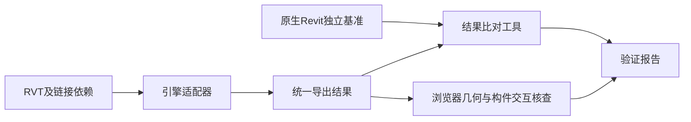

# RVT原生模型导入验证方案

> 当前工作安排：优先评审[平台总体设计](./00_数字孪生平台总体架构与改造路线图.md)。本文件保留后续实施验证方法，暂不继续安装、采购或运行验证；RVT引擎选型不作为确定整体架构的前置。

## 1 验证目标与当前状态

验证目标是判断RVT是否能够直接上传、自动处理并输出可查询的构件语义和可交互的几何资源，为BIM微服务选型提供证据。验证分为引擎读取、语义及坐标比对、浏览器交互、后台稳定性和规模性能五项。结果比对工具通过不表示其余四项自动通过。

截至2026年10月21日，已收到厨房模型样本，本地只读预检识别其内嵌版本信息为Revit 2022，文件为3,612,672字节。用户已选择优先完全私有部署，并确认没有ODA BimRv开发工具包（SDK）或授权工具。常见安装目录及本机软件安装登记中未发现Revit或ODA BimRv。实际构件提取和几何转换尚未执行，具体证据及限制见[样本验证记录](./06_RVT样本验证记录.md)。

## 2 引擎路线及选择门槛

| 路线 | 适用条件 | 验证内容 | 选择门槛 |
| --- | --- | --- | --- |
| Autodesk平台服务（APS）Revit自动化 | 允许使用外部云服务并上传模型 | 插件打包、目标Revit引擎、任务提交、属性和几何导出、链接依赖、配额和费用 | 数据上传范围、账号和费用方案明确；目标版本样本成功；自动化任务可恢复 |
| 本地商业开发工具包（SDK），如ODA BimRv | 要求完全私有部署 | SDK实际版本、目标操作系统、运行依赖、构件属性与几何访问、链接实例、许可和服务端部署能力 | 对应SDK版本和许可可用；样本语义、坐标、几何覆盖达到冻结要求 |

当前按完全私有部署准备验证，优先评估本地引擎；尚未采购或冻结具体产品，APS作为需另行确认数据上传条件的备选。普通桌面Revit应用程序接口（API）不能直接当作通用无界面服务端运行时；桌面Revit可用于建立独立基准，但其插件运行成功不代表后台引擎验证通过。任何候选引擎都需要按实际SDK版本验证，不以产品宣传中的格式支持范围替代样本测试。

官方资料：

- [Autodesk自动化服务](https://aps.autodesk.com/developer/overview/automation-api)
- [Autodesk关于无界面Revit及RevitCoreConsole的说明](https://www.autodesk.com/support/technical/article/caas/sfdcarticles/sfdcarticles/Cannot-find-the-RevitCoreConsole-exe-program-in-Revit.html)
- [ODA BimRv产品能力](https://www.opendesign.com/products/bimrv)
- [ODA BimRv导出及授权说明](https://www.opendesign.com/faq/bimrv)

### 2.1 本地BimRv试用申请与费用

1. 在[ODA免费试用入口](https://www.opendesign.com/free-trial)使用本人或公司邮箱注册，填写公司等信息并确认邮箱；由用户本人确认账号条款。
2. 申请用于Revit文件的BimRv试用包，选择适配本机的Windows 64位版本；如采用.NET适配器，同时取得对应包装库及示例。
3. 按账号内说明下载和激活，提供本机安装包或解压目录即可继续对接，无需在聊天中提供密钥。

官网公开试用期为60天。正式使用采用年订阅，BimRv至少需要Sustaining会员及独立BimRv模块许可。[官方FAQ](https://www.opendesign.com/faq/bimrv)与[价格页](https://www.opendesign.com/pricing)在2026年10月21日的公开信息显示：Sustaining基础会员首年7,500美元、以后每年4,500美元；这不包含BimRv附加模块费用，不能作为RVT引擎总价。模块价格及实际部署范围须取得官方报价后确认。先用试用包验证样本，再确定采购。

### 2.2 开源及其他可选路线

目前所核查的开源项目不足以提供无需Revit及商业解析库、可直接完整读取原生RVT的生产方案。可选的开源工具主要承担Revit内导出或IFC后处理：

| 工具或路线 | 可承担工作 | 依赖与边界 |
| --- | --- | --- |
| [Autodesk revit-ifc](https://github.com/Autodesk/revit-ifc) | 在Revit中导出IFC；可配置和扩展导出内容 | 开源导出器，依赖Revit运行；不是独立RVT解析内核 |
| [pyRevit](https://github.com/pyrevitlabs/pyRevit) | 在Revit中编写属性、构件标识、坐标导出脚本 | 开源扩展环境，仍依赖Revit及相应使用许可 |
| [Revit Batch Processor](https://github.com/bvn-architecture/RevitBatchProcessor) | 批量打开RVT并运行导出脚本 | 必须安装匹配的Revit；批处理不等于官方支持的无界面服务；原作者已提示未来维护受限 |
| [IfcOpenShell](https://docs.ifcopenshell.org/ifcopenshell.html) | 服务端解析IFC的属性、空间关系和几何 | 可私有部署处理IFC，不能承担原生RVT读取步骤 |

低成本验证可采用“设计方Revit导出IFC 4及源标识/坐标清单 → 平台用IfcOpenShell解析 → 统一构件索引和轻量化发布”。源标识清单应显式保留文档命名空间、链接实例路径、源Element ID、源UniqueId、IFC GlobalId及坐标变换，验证导出筛选导致的缺失与几何差异。不得假定IFC GlobalId与Revit UniqueId天然相同，也不得在每次导入时重新随机分配平台身份。

该路线可实现平台内网处理，并减少自行采购RVT解析库的需求；仍依赖上游Revit导出。若由用户人工先转换再上传IFC，只能声明支持IFC导入，不能据此宣称已满足招标“平台直接导入原生RVT”。正式直接导入仍需落实平台侧原生读取步骤及运行许可。

其他商业候选包括[HOOPS Exchange原生RVT读取](https://docs.techsoft3d.com/hoops/exchange/start/supported-formats.html)及[BIMFACE私有化部署](https://doc.bimface.com/pricing)。它们需要另行询价和样本验证；BIMFACE离线查看包不能单独证明转换引擎也完全本地部署，需向厂商明确确认。上述候选尚未下载或实测。

## 3 样本与基准准备

初期建议5至10个真实模型。下表为样本分类，数量及目标年份在获得项目文件后冻结；并非要求准备10个不同格式版本。

| 编号 | 样本特征 | 核查重点 |
| --- | --- | --- |
| RVT-001 | 简单建筑模型 | 基本构件、属性、几何、单位和本地坐标 |
| RVT-002 | 结构模型及复杂族 | 洞口、嵌套族、实例及类型属性、几何完整性 |
| RVT-003 | 机电模型 | 管线、设备、类别和自定义参数 |
| RVT-004 | 链接模型，同一链接多次插入 | 链接实例命名空间、平移/旋转、重复实例不重ID |
| RVT-005 | 共享坐标及大坐标模型 | 单位、源/目标坐标变换、局部渲染原点 |
| RVT-006 | 不少于500MB且含10,000以上目标构件 | 峰值内存、磁盘、解析耗时及发布后首屏 |
| RVT-007/008 | 同一模型的V1/V2 | 未变化、修改、新增、删除、复制重建及映射复核 |
| RVT-009 | 缺失链接或不支持版本 | 明确错误、部分结果标记、不静默成功 |

在原生Revit中人工确认源文件可正常打开，登记文件SHA-256、Revit版本、专业、链接清单、视图、阶段、设计选项和构件筛选条件。导出独立基准：构件清单、必需属性、代表坐标、包围盒及截图。基准不得由同一个待测引擎生成，否则只能验证自洽性。

冻结构件范围时区分实体实例与类型定义、视图、图纸、标注等对象。无几何的业务对象可纳入属性基准，但不得强制其生成几何。对链接模型保留完整链接实例路径。样本有效性和基准差异说明在执行前确定；测试失败后不得通过缩减基准掩盖缺失。

## 4 最小验证链路



第一阶段运行独立命令行/引擎任务，不接生产数据库，不先建设完整Java微服务。适配器读取原生RVT；如内部使用中间格式，必须保留源构件标识、属性、链接实例及坐标关系。源文件只读，升级和转换产物写入独立输出目录。

输出目录约定如下。几何格式转换如需单独步骤，应记录所用工具、版本及配置，并保证构件索引不丢失。

```text
case-work/
├─ case.json                  本地验证配置
├─ baseline.elements.jsonl    原生Revit独立基准
└─ result/
   ├─ manifest.json          源文件摘要、引擎、坐标和结果范围
   ├─ elements.jsonl         构件逐行记录
   ├─ preview.glb            实际几何资源
   └─ errors.json            未解决错误列表，正常时为[]
```

## 5 统一输出与比对范围

配置及导出清单模板位于[验证任务模板](./templates/rvt/case.template.json)和[引擎输出清单模板](./templates/rvt/manifest.template.json)。复制至本地验证目录后填写真实值；模板中的占位值不可用于通过判定。

`case.json`配置源RVT路径、源Revit年份版本、独立基准路径、样本编号、筛选规则版本、坐标框架和坐标比对容差。配置文件中的相对路径以配置文件目录为基准。

`manifest.json`必须记录原始源文件摘要、引擎名称及版本、运行方式、筛选版本、坐标框架、米单位、结果状态、构件文件、错误文件和几何资产。`status=SUCCEEDED`仅表示适配器自报完成，仍须通过结果比对和后续人工验证。实际使用的许可证证明不放入清单，另行受控留存。

构件使用每行一个JSON对象的格式（JSON Lines）。示例仅说明结构：

```json
{"sourceUniqueId":"原生稳定标识","occurrencePath":"host","sourceElementId":"123","hasGeometry":true,"properties":{"name":"墙001","category":"墙","family":"基础墙","type":"200mm"},"positionM":[1.0,2.0,0.0],"bboxM":{"min":[0.0,0.0,0.0],"max":[2.0,3.0,3.0]},"geometryRefs":["preview.glb"]}
```

- 唯一键是`occurrencePath + sourceUniqueId`；链接实例路径应来自源链接实例的稳定标识，不使用临时递增序号。
- `sourceElementId`以字符串保存；平台Element ID在正式BIM服务中建立，本轮先验证源身份及实例隔离。
- `properties`保存已约定名称的归一化属性，区分实例参数和类型参数；数值参数使用冻结的单位和表示方式。
- `positionM`为可选代表点，不强求每种构件都有位置点；`bboxM`为可选包围盒。只比较基准确实提供的坐标字段。
- 所有坐标已转换为清单声明的统一框架和米单位。Revit内部坐标、共享坐标及发布坐标的关系另附变换报告。
- `hasGeometry`声明是否应有几何；有几何的实际输出必须给出存在且非空的`geometryRefs`，并在清单中登记。
- 多个构件可以引用同一合批GLB，但还须另行核查渲染特征到构件身份的索引；文件存在不证明构件映射正确。

基准构件使用相同字段结构，但不要求`geometryRefs`。基准与实际结果必须使用相同筛选范围和坐标框架。模板的0.001m容差仅为示例，需按导出精度及独立基准确认；它不等于现场5cm配准指标。

## 6 运行结果比对工具

项目提供[比对程序](../tools/bim/verify_rvt_export.py)，使用Python 3.10及以上版本和标准库，无第三方依赖。它不读取RVT内部结构、不调用商业引擎、不上传文件。

在仓库根目录使用PowerShell运行：

```powershell
python tools/bim/verify_rvt_export.py --case 'D:/BIM-Validation/RVT-001/case.json' --result-dir 'D:/BIM-Validation/RVT-001/result'
```

默认报告为输出目录中的`comparison-report.json`。程序检查源文件摘要、清单身份、源年份版本、筛选范围、构件重复/缺失/多出、基准属性、坐标、几何引用及未解决错误；GLB仅检查基础文件头。源文件摘要采用分块读取，几何资产去重检查。年份信息来自独立基准和适配器报告，程序不自行识别RVT文件内部版本。

退出码0表示仅本轮导出结果比对通过；2表示比对不通过；1表示配置、输入文件或输出格式无效。`PASSED_EXPORT_COMPARISON`不能改写为“RVT验收通过”。程序不验证三角网格与原生几何一致、不检查浏览器点击映射、不测无人值守稳定性、15秒首屏或现场5cm精度。

## 7 人工核查、稳定性和规模验证

| 项目 | 操作 | 通过条件 |
| --- | --- | --- |
| 几何 | 对照Revit截图检查代表构件、洞口、镜像、嵌套族、机电和链接模型 | 无未解释缺失或明显几何错误；差异经确认并记录 |
| 交互 | 按身份查询、点击拾取、高亮、剖切、属性展示 | 操作对象、返回属性及源构件对应一致 |
| 坐标 | 对比源模型已知点、链接变换及共享坐标 | 统一框架内的误差达到冻结容差；现场配准另验 |
| 跨版本 | 比较V1/V2的未变更、重建及拆分/合并构件 | 身份延续或映射可解释；低置信度进入复核 |
| 无人值守 | 连续处理多个任务、重启、超时终止及故障恢复 | 无人工弹窗依赖，失败可诊断，临时文件可回收 |
| 任务可靠性 | 重复提交/回调、取消及工作进程崩溃 | 幂等生效，取消后的旧结果不被激活 |
| 大模型 | 运行代表性大文件并记录峰值资源 | 完成解析发布，容量和并发按实测配置 |
| 首屏 | 在冻结浏览器、网络及冷缓存下加载正式发布资源 | 首屏主体可识别且可交互，时间≤15秒；转换耗时单独报告 |

RVT首轮建议所有约定的关键样本通过再进入微服务集成；具体目标与客户另行冻结。IFC 4.0的95%成功率指标不自动套用于RVT。失败样本必须保留错误和实际结果，不用剔除有效失败样本制造成功率。

## 8 执行顺序与待落实输入

1. 已确定优先私有部署，首个样本内嵌版本为Revit 2022；其他目标年份后续补齐。
2. 首个RVT路径及文件预检已完成；下一步取得合法可用的引擎/SDK及运行授权，或由设计方提供原生Revit导出结果用于IFC链路验证，并补齐链接依赖。
3. 使用原生Revit建立独立基准，冻结筛选规则和坐标容差。
4. 对接实际引擎适配器，生成统一导出结果，再执行比对和浏览器人工核查。
5. 扩展版本/链接/复杂族样本，执行大模型、故障恢复及无人值守验证。
6. 汇总兼容矩阵、错误清单、资源报告和授权范围，决定RVT技术路线后接入Java微服务。

原始模型、真实属性、SDK、授权和大体积产物放入受控本地验证目录并排除版本管理；仓库保留模板、工具和验证结论。当前可交付的是验证方案、比对工具和样本元数据预检记录，真实RVT解析结论需以上输入落实后产生。
