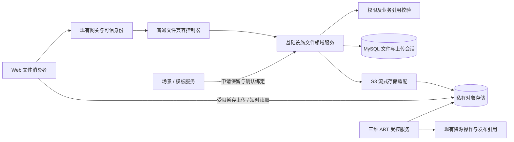

# 对象存储服务设计

版本：V1.2 实施设计评审稿。日期：2026-11-10。任务：OSS-00、OSS-EVAL-01、OSS-PLAN-01，对应 M3-01 文件能力准备及 DATA-09 普通文件依赖补充。角色：按用户指定 agency-agents-zh 技能采用 Java 后端专家工作方式。

本文为软件设计说明（SDD）评审稿。接口增量、表字段和配置值均为拟议设计；当前实施基线见第 13 节，里程碑与 10～12 分钟工作节点统一见[专项计划](../02_里程碑与交付计划.md#9-对象存储改造专项里程碑与分钟级节点)。规划与评估不表示合同已冻结、功能已实现、数据库已迁移或服务器已部署。执行状态统一见[OSS 专项台账](../03_近期执行任务.md#oss-专项执行台账)。

## 1. 结论与范围

复用基础设施模块 `wx-module-infra` 建设普通文件管理能力，以现有 MinIO 为首期对象存储（OSS）后端，使用简单存储服务协议（S3）适配。保持 Java 17、Spring Boot 3.3.4、MinIO Java 开发包（SDK）8.5.7，不升级依赖，不新增独立部署单元。

统一文件身份、授权、上传会话、签发和回收规则；物理存储与业务资源分层。普通图片、封面、附件归基础设施文件域；模型闭包、转换和内容修订继续由受控资源（ART）域负责。业务侧只保存稳定编号及内容身份，不保存短时签名地址。

本轮交付设计、源码差距、接口与数据提案、分期步骤和验收条件。暂不实施多云切换、跨区域复制、全局内容去重、自动物理回收或全部旧存储替换。后续先冻结普通文件合同，再按测试驱动开发（TDD）实施。

用户随后要求优先评估现成 Java 组件，X File Storage 2.3.0 的源码、依赖及隔离运行结论见[第 12 节](#12-x-file-storage-230-接入评估oss-eval-01)。该评估尚未修改业务依赖或采用既定方案之外的存储后端。

## 2. 已核查事实与差距

源码基准：本工作区 `dev` / `003f7669`，并核对当时未提交差异；未在线核验服务器和对象桶。下列链接均指向实际源码或现行合同。

| 位置 | 实际行为 | 本设计处理 |
| --- | --- | --- |
| [文件控制器](../../wx-module-infra/wx-module-infra-biz/src/main/java/cn/iocoder/wx/module/infra/controller/admin/file/FileController.java)与[文件服务](../../wx-module-infra/wx-module-infra-biz/src/main/java/cn/iocoder/wx/module/infra/service/file/FileServiceImpl.java) | 后端上传读取完整 `byte[]`；上传返回 URL 字符串；直传确认直接插入客户端元数据 | 新入口返回稳定身份，流式处理并独立验证，禁止客户端声明成功 |
| [文件记录](../../wx-module-infra/wx-module-infra-biz/src/main/java/cn/iocoder/wx/module/infra/dal/dataobject/file/FileDO.java)与[基础设施配置](../../wx-module-infra/wx-module-infra-biz/src/main/resources/application.yaml) | 文件实体继承 `BaseDO`，没有租户字段；文件及配置表在租户忽略清单中；文件大小为 `Integer` | 显式补充受管记录的租户和范围过滤，大小采用 `Long`；不能直接认为已有租户隔离 |
| [S3 客户端](../../wx-module-infra/wx-module-infra-biz/src/main/java/cn/iocoder/wx/module/infra/framework/file/core/client/s3/S3FileClient.java) | 实际使用 `io.minio`；旧注释却声称使用另一套开发包；返回拼接地址，签发 PUT 有效期十分钟 | 沿用实际依赖，新能力独立流式接口；实施时修正相关旧注释 |
| 文件下载与[应用文件控制器](../../wx-module-infra/wx-module-infra-biz/src/main/java/cn/iocoder/wx/module/infra/controller/app/file/AppFileController.java) | 按配置号、路径下载有 `@PermitAll`；应用上传、签名及建记录也声明匿名许可 | 新受管命名空间必须在服务层封堵这些旁路；不据注解推断所有网关已放行 |
| [文件配置服务](../../wx-module-infra/wx-module-infra-biz/src/main/java/cn/iocoder/wx/module/infra/service/file/FileConfigServiceImpl.java)与[客户端工厂](../../wx-module-infra/wx-module-infra-biz/src/main/java/cn/iocoder/wx/module/infra/framework/file/core/client/FileClientFactoryImpl.java) | 已有配置缓存和客户端复用，配置可原地更新 | 继续复用；新增“被引用的存储位置不可原地修改”及客户端轮换生命周期 |
| [ART 对象存储](../../wx-module-3d/src/main/java/cn/iocoder/wx/module/dimensions/service/ArtResourceObjectStore.java) | 有界流式校验、暂存到独占前缀冻结、冻结后再验字节；提交与对象 IO 分开 | 保持既有事务及清单合同，不搬迁资源指针、不让普通文件接口写 `resources/` |
| [ART 签发](../../wx-module-3d/src/main/java/cn/iocoder/wx/module/dimensions/service/ArtResourceDownloadSigner.java)及[发布合同](10_场景不可变发布记录合同.md) | 私有 HTTPS 签名，票据限制到期；历史发布引用阻止资源逻辑删除；普通图片依赖尚未闭环 | 复用签发原则；普通文件另建明确引用，不宣称已有 ART 引用表覆盖图片 |
| [前端文件差异清单](../../contracts/editor/interface-matrix.md#5-目录与普通文件m3前置准备可提前) | 当前消费者要求 `/api/resource/oss/upload` 与 `listByIds/{ids}`，返回 `ossId` 等字段；基础设施旧上传合同不满足 | 适配这两个真实路径；不新增无消费者的第三套公共路径 |

另核对当前 Web 工作区 `E:/Products/3D-editor/Web/web-unity` 的 `src/servers/manual/dim3d/api/oss.ts` 和 `src/integrations/scene/sceneAssetUrlResolver.ts`：上传表单只有 `file`，URL 用于即时预览，读取目前每次只传一个编号；解析器已有去重和最多八路并发。本轮不修改前端。

## 3. 架构与职责



- 控制器：校验请求、投影兼容字段；不能接受客户端指定可信租户、存储配置、桶、完整键或永久地址。
- `ManagedFileService`：拟新增的普通文件领域服务，负责会话、幂等、状态、配额及文件元数据。
- `ManagedFileAccessService`：拟新增授权服务，复用认证与系统权限，处理所有者、共享范围及已确认业务引用。
- `ManagedObjectStore`：拟新增流式存储能力，提供 `stat/open/put/freeze/signRead/signUpload/delete`；删除仅供回收工作线程使用。工厂及配置沿用现有机制，不让公开控制器调用任意对象操作。
- `ManagedFileReferenceService`：拟新增内部保留/确认/释放服务。跨服务用基础设施接口模块（API）及受认证远程调用（RPC），三维模块不依赖基础设施业务实现模块（BIZ）。
- ART：继续控制模型文件计划、清单、冻结、当前修订和事务回执；普通文件提交不能把一组模型文件发布为可消费资源。未来抽取公共存储组件必须保持依赖无环并单独回归，本轮不迁移 ART。

## 4. 文件身份、租户与对象布局

### 4.1 三种身份分开

| 身份 | 约定 |
| --- | --- |
| 普通文件 | 新受管文件使用 `wx_infra_file.id`，对外兼容字段名 `ossId`，规范十进制字符串；文件 READY 后内容不可变，替换上传产生新编号 |
| 模型资源 | `resourceId + revision + contentHash` 沿用 ART；不与 `ossId` 互换 |
| 历史外部文件 | 先按来源系统、旧编号、明确归属建立映射；数字相同不代表同文件，无法判定的记录不进入新读取 |

物理对象身份为“固定存储配置 + 桶 + 对象键 + 大小 + SHA-256 摘要”，必要时记录对象版本号。临时 URL 不参与永久内容身份。旧 `url` 列仅保留兼容定位用途，受管记录不写签名；新消费者不能把旧值当授权依据。

### 4.2 范围提案

| 范围 | 读 | 上传及管理 |
| --- | --- | --- |
| `OWNER_PRIVATE` | 同租户创建者；或经真实场景/模板业务上下文授予的读者 | 创建者在自身权限内操作；附件绑定再次验证业务对象编辑权限 |
| `TENANT_SHARED` | 本租户具备使用权限的用户 | 本租户管理员及明确权限；普通编辑者不能借上传变成共享资源管理员 |
| `GLOBAL_SYSTEM` | 已登录且具备使用权限的用户；公开发布另走票据 | 真实平台租户与启用的 `super_admin` 共同满足，沿用 ART 平台判定原则 |

全局所有者哨兵仍用 `0`，不是登录租户。普通文件表的可信租户采用系统有界 `Long`，全局范围必须同时匹配哨兵；ART 原有字符串租户字段不改。未认证拒绝，缺失归属默认拒绝；同租户也不自动读取私有文件。平台管理员不默认获得所有租户私有文件。

上传默认 `OWNER_PRIVATE`；若缺少场景上下文，仅允许有普通文件创建权限的用户创建自身文件。场景编辑者上传附件须附场景上下文并验证本人场景编辑权；当前前端无该字段时，实施阶段先补合同与调用，不能后台猜测关联场景。共享、全局上传必须显式请求范围并通过服务端授权。

### 4.3 对象布局

以下为新普通文件专用布局，不改现有桶或 ART 前缀：

```text
managed-files/staging/{tenantId}/{uploadId}/{attemptId}/payload
managed-files/frozen/{tenantId}/{fileId}/{attemptId}/payload
resources/...                                      # 现有 ART 专用，保持不变
```

原文件名只作元数据，不能作为对象键。前缀和尝试编号由服务端生成。拒绝绝对路径、协议、点段、反斜杠、编码绕过及超长键；调用方不提交任何完整路径。冻结前缀从不签发写入权限，旧基础设施和三维通用写/删/复制/匿名读入口均须识别新受管命名空间；即使两个配置指向同一桶也不能绕过。

## 5. 上传、冻结与失败恢复

### 5.1 首期小文件代理上传

`POST /api/resource/oss/upload` 复用真实消费者路径，表单字段保持 `file`。首期建议上限 20 MiB，作为待验证的配置起点；网关、应用表单、临时磁盘及租户配额必须一致，不允许先读完整 `byte[]` 再检查大小。

1. 认证并校验范围、业务上下文、扩展名及声明大小，先获得有上限的上传处理名额；流式落入有容量预算的临时文件，同时计算实际字节和摘要，超过上限立即停止。小文件先暂存磁盘，是为了让幂等请求摘要包含真实内容摘要，而不是只比较文件名和大小。
2. 短事务以 `requestId`、真实内容摘要和规范业务元数据创建会话、分配 `fileId`、预留配额；同号异文拒绝，同号同文可返回原结果。事务外从临时文件流式写服务端独占对象；关闭输入、存储响应，所有失败和重试分支最终清理本地临时文件及处理名额。
3. 检查实际长度、文件魔数和允许的媒体类型（MIME）。图片检查解码后像素、维度和解码资源预算；文件名和客户端 MIME 均不作为可信证据。不支持的活动内容（如脚本化 SVG/HTML）首期拒绝作为图片内联展示。
4. 对只有服务端可写的最终独占对象独立回读验证；通过后短事务重验权限、配置绑定、会话租约和配额，提交 READY、实际大小及成功回执。无需向客户端开放暂存 PUT。
5. 同步上传在成功时返回兼容对象；失败或超时不返回可消费记录。响应丢失时有 `requestId` 才能安全重试；旧消费者未提供时由适配器生成请求身份，但不能承诺跨请求自动去重。临时文件产生在持久配额预留前，因此还须限制请求并发、用户速率和整机临时盘总预算；不得只依赖租户数据库配额保护磁盘。

### 5.2 后续大文件直传与分片

先创建会话，再签发暂存上传目标。声明大小、SHA-256 和业务元数据组成固定请求摘要，实际内容必须在完成时匹配；目标绑定方法、键、截止时间和服务端可验证的约束。浏览器可设置的签名请求头需真实跨域验证。不能声称 PUT 签名天然限制文件大小和内容，提供方未支持的约束必须在完成时回读复核；无法限制的上传带宽风险用配额、限流、短期地址和存储侧能力共同控制。

客户端完成请求仅提交 `uploadId` 及固定计划，不能提交任意配置、对象键或 URL。服务端在事务外校验暂存内容，复制或流式写入新的独占冻结路径，再核验冻结字节。数据库最终提交只允许当前尝试编号和租约代次，防止旧工作线程迟到覆盖。

分片（Multipart Upload）由服务端创建和完成，记录提供方上传号、分片大小、数量和有序回执。续传列表从存储提供方核对，不能只信客户端；重复完成通过原会话返回原结果。取消或过期后由工作线程终止未完成分片。MinIO 8.5.7 的底层分片接口及兼容云支持须专门技术验证，不直接暴露已有通用分片工具。首期普通文件不因该设计开放大文件入口，模型仍走既有导入流程。

### 5.3 状态与并发

上传会话：`UPLOADING → VERIFYING → COMMITTED`，并可进入 `FAILED/CANCELLED/EXPIRED`；文件：`PENDING → READY → DELETE_PENDING → DELETED`。历史记录默认为 `LEGACY`，不自动成为 READY。

- `VERIFYING` 持有有截止时间的数据库租约和递增代次；心跳、状态回写均比较代次。租约过期可分配新尝试，旧尝试只留下孤立对象。
- 同租户、操作者、操作类型和 `requestId` 唯一；同载荷返回原回执，异载荷拒绝；幂等命中也必须重新授权。
- 上传对象成功但数据库失败：旧业务引用不变，新对象由会话追踪并保留待清理；不在异常处理器直接删可能已被另一重试提交的对象。
- 取消与提交竞争按会话行锁串行化；已提交返回原结果，不能报告取消成功。
- 配额先原子预留，计入暂存及冻结阶段的最大副本预算；无对象产生时失败/过期可释放，已有孤立对象则转入未提交物理占用，实际回收后才释放，避免反复失败绕过容量限制。成功把相应占用转为已提交使用量，全部转换幂等；首期可在租户配额行上短锁，不以每次全表 `SUM` 实现。
- 成功回执只持久化文件及内容身份，不保存签名地址；成功重试和状态查询按当时授权重新签发 URL，不能返回已到期的历史地址。
- 内容摘要、元信息检查和网络 IO 均在事务外；最终短事务重新核对事实。若权限服务为远程调用，先获取授权判定，提交时复核绑定及有效性，不能持数据库锁等待远程服务。

## 6. 接口与兼容提案

保持工程响应封套 `CommonResult {code:200,msg,data}`，鉴权失败沿用现有处理。所有编号和字节数对外用规范字符串；时间为含时区时间，有效期使用 `expiresAt`。下表增量未冻结，不改写既有已冻结 ART 接口。

| 方法与路径 | 数据及规则 | 阶段 |
| --- | --- | --- |
| `POST /api/resource/oss/upload` | 表单 `file`；拟增可选 `requestId`、`sceneId`、`scope`；返回 `ossId,url,fileName,originalName,fileSuffix,ext1,service`，拟增 `size,sha256,expiresAt` | 首期 |
| `GET /api/resource/oss/listByIds/{ids}` | 首期只接受一个规范编号，返回数组；缺失或不可见返回相同空数组语义，存储故障返回明确错误；`url` 是短期读取地址 | 首期 |
| `POST /api/resource/oss/uploads` | 拟新增直传会话，声明名称、大小、摘要和用途；返回 `uploadId`、暂存目标及有效期 | 后续 |
| `GET /api/resource/oss/uploads/{uploadId}` | 仅原操作者且仍有权限可查；状态及成功文件身份，不返回凭据 | 后续 |
| `POST /api/resource/oss/uploads/{uploadId}/complete` | 固定计划，异步校验时返回 VERIFYING，查询原会话得到结果 | 后续 |
| `POST /api/resource/oss/uploads/{uploadId}/cancel` | 幂等取消，提交成功不能回退为已取消 | 后续 |

`fileName` 为规范展示名，`originalName` 为原始展示名，`fileSuffix` 为不含点的小写扩展名；`ext1` 首期为空字符串；`service` 只返回冻结后的非敏感服务标识，不能返回配置或凭据。最终取值须核对全部调用方后写入机器可读合同，不能给未使用字段臆造业务含义。

批量读取拟增加独立 POST 批量接口、最多 100 个编号、去重查询并按输入顺序投影；现有单编号路径不猜测逗号分隔符。没有批量调用方前不先实施。场景上下文读取以经验证的 `sceneId` 等参数扩展合同，或由场景领域接口提供；单凭 `ossId` 不能越过私有授权。

对外按编号逻辑删除的路径待消费者和权限合同冻结；现有 `/admin-api/infra/file/delete` 对受管文件必须委托受控删除规则，不能继续直接物理删除。底层配置号/路径形式的下载不得访问新命名空间。

领域错误至少区分参数非法、幂等冲突、配额不足、文件类型拒绝、内容不符、状态冲突、存储不可用及引用受保护；正式数值码在 `contracts/editor/errors.md` 增量分配，不能复用 ART 数值码造成不同含义。

## 7. 数据模型与增量迁移提案

复用 `wx_infra_file` 主键，不另造一套普通文件主表。先审计实际库结构及旧调用方，只通过新迁移增加字段和表，不修改历史迁移。下列是设计字段，不是已执行建表脚本。

| 对象 | 拟增字段或约束 |
| --- | --- |
| `wx_infra_file` | `management_version`、可空 `tenant_id bigint`、`owner_user_id bigint`、`scope`、`state`、`sha256 char(64)`、`bucket`、`object_version_id`、`upload_id`、`verified_at`、`delete_after`、并发 `row_version`；`size` 迁为有界 `bigint`，Java `Long` |
| `wx_infra_file_upload` 新表 | 会话主键、可信租户/操作者、幂等号和请求摘要、预分配 `file_id`、固定配置号、暂存/冻结键、声明大小与摘要、预留字节、状态、尝试号、租约代次/到期、操作到期、失败原因、成功回执；后续分片信息按固定计划维护 |
| `wx_infra_file_reference` 新表 | 可信租户、文件号、业务域、业务对象号、业务修订/发布号、保留状态 `RESERVED/BOUND/RELEASED`、幂等保留号、来源摘要和审计时间；唯一键防重复绑定 |
| 租户配额记录 | 拟新增 `wx_infra_file_quota`，租户/配额域唯一，保存上限、预留、未提交物理占用、已提交使用、并发版本；逻辑删除和失败孤立对象不立即减少物理占用，回收成功后才扣减对应物理字节 |
| `wx_infra_file_config` | 沿用现有配置；增加受管用途/停用约束及凭据引用 `credential_ref`；存储位置一旦被会话或文件引用不得原地修改，换位置创建新配置记录 |

受管文件约束：READY 必须有可信归属、固定配置/桶/路径、已验证大小和摘要；`upload_id` 唯一防止重复建有效文件；全局哨兵和范围一致。旧记录新字段为空，按 LEGACY 处理，不据 `creator` 文本猜测租户。

建议索引：文件 `(tenant_id,scope,state,id)`、`(tenant_id,owner_user_id,state,id)`；会话唯一 `(tenant_id,operator_id,request_id)` 及恢复索引 `(state,lease_expires_at,id)`；引用唯一 `(tenant_id,domain,business_id,business_revision,file_id)` 及 `(file_id,status)`。编号及幂等字段长度明确并使用适当二进制比较，避免历史排序规则混用。

配置记录的 endpoint、bucket、region、寻址方式属于固定位置；凭据可在同一受控引用下轮换。含秘密的旧配置先保留受限读取以兼容，分期替换为运行时凭据引用；所有响应及日志脱敏。被引用配置不能直接删除，默认配置切换只影响新会话；未完成会话继续使用其固定位置，凭据轮换不得使其改写另一桶。

## 8. 下载、业务引用及安全回收

### 8.1 下载签发

先鉴权、读取 READY 内容身份和范围，再签发 HTTPS GET。首期建议普通读取最长 300 秒，实际取配置、业务授权和票据剩余时间的最小值；到期不可签发。登录读取、场景授权读取和匿名发布票据读取分别核验，普通文件公共路径不代表匿名。

签名前检查对象存在性、长度及固定版本；上传提交和后台完整性检查负责字节摘要，不在每次签名同步回读整个大文件。对象实体标签（ETag）不等同完整 SHA-256，不作内容真值。读取响应给出期望摘要和长度，能够校验的消费者校验；图片标签等不能直接校验字节时依靠冻结边界与后台检查，不能声称浏览器已经验证摘要。

撤销权限阻止新签发；已签发地址在有效期内仍可能使用，下载已开始的连接不保证在到期时终止。需要立即撤销或逐请求审计的附件，须采用受鉴权的流式代理并按需求处理连接，不能把短签名描述成即时撤销。上传与下载外网入口分别最小授权；反向代理保留签名所需 Host/路径，日志去除查询签名。

跨源资源共享（CORS）只允许指定业务来源及必要方法/请求头；范围读取（Range）、内容范围、实体标签和下载名响应头按真实消费者验证。网页跨源隔离与 Unity 加载能力另验，不在本轮联调 Unity。

### 8.2 场景、模板和发布引用

草稿/模板只保存稳定文件号，发布增加固定普通文件引用，至少包含文件号、配置/键、大小、摘要及来源身份；与已有 ART 发布引用分类型管理。图片和封面不能依赖匿名管理接口补读。撤销发布不自动释放历史保留。

基础设施与三维领域不依赖同一数据库事务：场景服务先通过内部接口申请 `RESERVED` 保留，文件服务锁文件行拒绝非 READY 状态；场景事务保存四包/发布及可靠待办记录，成功后幂等确认为 `BOUND`。保留失败不得提交业务引用；确认未完成前不能把跨用户授权判为成功。内部接口校验服务调用身份及受控的用户/租户委托上下文，不能仅信任外部可伪造的普通请求头。

进程在任一步中断时，持久化保留号及业务来源保证可重试。回收视 RESERVED 与 BOUND 均为保护；RESERVED 超时不能直接删除，必须向业务权威方核对提交结果，未知时继续保留。事务发件箱（Outbox）可由业务库待办记录实现，无需为首期引入新消息系统。删除/替换引用先让业务事实提交，再确认释放；引用状态不授予不存在的业务访问权。

### 8.3 两阶段回收

自动回收默认关闭。旧文件、旧 ART 快照、无法识别归属的对象一律不进入首批清理。仅列桶扫描不能决定对象是否可删。

1. 从数据库分页生成候选，核对当前业务引用、全部保留引用、上传会话、历史恢复窗口及最大已签发读取期限；先支持只读预演，展示确切文件身份及阻止原因。
2. 短事务锁文件行并重验引用，将无保护对象标记 DELETE_PENDING，记录固定删除身份及租约代次；新增保留必须锁同一文件行并拒绝该状态，封堵“查无引用后又新增”的竞争。
3. 等待配置宽限期；事务外物理删除确切对象/版本。工作线程失败重试，NoSuchKey 可按幂等结果处理，权限或存储失败保留待办，不能假成功。
4. 删除成功后短事务比较文件版本/代次，标记 DELETED 并释放物理配额一次。恢复请求只在物理删除前且经受控竞争处理允许；物理删除后的恢复依赖联合备份。

暂存回收另检查会话终态、所有已签发上传地址到期及分片终止结果，不能刚取消就假设客户端无法继续写。冻结孤立对象按尝试号和宽限期清理，不能删已提交尝试。ART 的逻辑删除保护继续沿用现有历史发布引用规则，首期普通文件回收不覆盖 ART 物理删除。

## 9. Java 实现与性能约束

- 保留现有 `FileApi.createFile(byte[])` 和老 `FileClient`，供已审计的小文件旧消费者使用；新领域增加流式能力，不改公共接口迫使全仓库迁移。新上传路由不调用旧客户端全量字节方法。
- 输入流、存储响应、临时文件、任务与连接池均有明确所有者；使用自动关闭资源块（try-with-resources）。单任务缓冲建议 64 KiB，实际堆内存还含开发包分片缓冲、图片解码及并发开销，不能只用缓冲大小宣称内存恒定。
- 沿用现有客户端工厂的复用思路，按固定配置及凭据代次创建客户端；新代次原子替换，旧代次待在途请求结束再释放所拥有的 HTTP 连接池/线程池，不能关闭共享池影响其他客户端。
- 首期校验工作池建议每实例两路、排队上限二十，作为实测起点；满载明确拒绝或进入持久待办，不能无界线程/内存排队。集群总并发按实例数和共享存储预算控制。
- 文件数、任务字节、分片数、预签名数量、临时盘、解压比及执行超时均设上限。普通图片上限不修改 ART 已冻结配额，模型运行内存另测。
- 直接上传可减少业务服务器传输量，但冻结校验仍消耗存储读取和网络；首次提交确保完整验证，重签只查必要元信息。存在性查询再写入不是原子防覆盖，安全依赖尝试独占键、唯一任务所有权及存储权限；可选条件写入须验证提供方支持后启用。
- 列表和批量查询使用明确租户条件及一次批量取数，禁止逐文件查业务权限或全表遍历。可缓存不可变元数据，缓存键包括文件身份/配置代次；权限判定及签名不得跨用户、租户或票据共用缓存。
- 首期不做内容去重；后续即使去重也须先完成上传验证，限定授权域并维护真实引用，不能用跨租户“秒传”暴露文件存在性。

观测记录请求号、会话、文件、租户、状态、耗时、失败分类、校验队列和物理占用；不记录完整 URL、认证头、密钥或文件正文。性能验收登记文件大小、并发、存储/网络、堆内存、临时盘、连接数、第 95 百分位延迟（P95）和失败率后再定指标，不承诺未经测量的吞吐。

## 10. 实施切片及验收

下表只描述交付顺序，真实状态只在 03 维护，不按本设计自动启动后续开发。

| 切片 | 前置与工作 | 退出条件 |
| --- | --- | --- |
| OSS-00 设计 | 核对源码、现有合同和消费者，形成本说明 | 文档引用/编码/差异检查通过，关键设计与待冻结项明确 |
| OSS-01 合同与迁移 | 冻结范围、字段、失败码、场景上下文和首期配额；完善 `contracts/editor`；准备增量及备份回退 | 合同样例和负向用例一致，旧数据归属审计完成，隔离迁移可重复验证 |
| OSS-02 小文件闭环 | 先失败用例，再实现流式上传、身份、授权、签发及全部受管旁路保护 | 真实 MySQL/MinIO 上传、响应丢失重试、重开及过期续签通过；匿名/跨租户拒绝 |
| OSS-03 引用与发布 | 接场景/模板保留确认和普通文件固定发布引用、票据签发 | 断点恢复、发布撤销、历史保留、跨用户业务授权和并发删除通过 |
| OSS-04 大文件 | 验证实际提供方分片接口、受限签名、冻结和租约恢复 | 真实续传、过期、取消、迟到线程及冻结重放失败用例通过，负载达已冻结指标 |
| OSS-05 迁移与治理 | 明确旧外部编号映射，灰度、配置轮换、清理预演、联合恢复 | 旧消费者回归和回退通过；物理回收另具授权、完整引用覆盖及恢复演练 |

实施至少先覆盖：同号异文、跨租户/匿名/伪造上下文、上传后撤权、暂存重放、冻结后原暂存被覆盖、内容/长度不符、图片解码超限、数据库失败、提交响应丢失、取消竞争、旧工作线程回写、配额并发、配置切换及轮换、引用确认中断、新增引用与回收竞争。单元替身结果不能替代真实数据库事务和对象存储验证。

OSS-00 初始设计批次没有运行 Java 编译或业务测试；随后 OSS-EVAL-01 的独立 Java 探针结果单独见第 12 节。本次 OSS-PLAN-01 仅验证设计和计划文档，没有再次运行历史探针或业务测试。各批实际结果及剩余问题登记在 03。后续部署必须备份配置和元数据、登记程序包及迁移摘要、隔离验证；回退代码时保留已提交的新文件和引用，不能重跑初始化或恢复旧库覆盖新事实。

## 11. 待冻结项与资料依据

设计已给出默认方案；实施前仍需按合同流程冻结：普通文件实际权限码及场景上传上下文、兼容扩展字段和服务标识、首期文件类型/像素预算/配额、历史文件来源映射，以及普通文件发布引用的机器可读结构。具体业务保留期与立即撤销需求尚无用户输入，因此物理回收保持关闭；不影响先交付本设计。

官方资料于 2026-11-10 查询，只支持相应协议及能力说明；当前文档可能描述较新开发包，不据此假定仓库 8.5.7 或所有兼容云支持相同能力：

- [MinIO Java 官方项目](https://github.com/minio/minio-java)：流式读取返回的响应须关闭；现有源码已使用相关接口，新增分片能力仍要按固定版本验证。
- [S3 预签名地址](https://docs.aws.amazon.com/AmazonS3/latest/userguide/using-presigned-url.html)：有效期内可重复使用，同键上传可能替换对象，支持本设计的冻结隔离理由。
- [S3 分片与完整性](https://docs.aws.amazon.com/AmazonS3/latest/userguide/mpuoverview.html)：分片完成和摘要需独立处理，实体标签不能普遍当作完整内容摘要。

项目边界继续遵守[总体设计](../01_项目总体设计.md)、[权限矩阵](../../contracts/editor/permission-matrix.md)、[ART 合同](06_资源数据与接口合同.md)及[不可变发布合同](10_场景不可变发布记录合同.md)。本文不覆盖已冻结合同；需要扩展的普通文件部分须由 OSS-01 增量冻结后实施。

## 12. X File Storage 2.3.0 接入评估（OSS-EVAL-01）

### 12.1 结论

**有条件适合采用，建议仅作为普通文件新链路的底层适配候选。** 与当前关键依赖组合的隔离启动、流式读写、签名及分片调用已通过；接入前必须排除重复工具类、适配文件记录、控制对象路径及删除入口，并保留上文的租户、冻结、引用和配额规则。它是 Java 存储库，不是带本项目身份、接口和一致性规则的完整文件服务。

当前只有 MinIO 一个实际后端时，现有客户端也能完成基础存取；引入该库的主要收益是统一多后端操作、分片、摘要、复制和签名扩展，不能据此认定比现有代码更快。建议先在普通文件隔离试点比较实施量，再决定是否正式引入；不替换已经验过的 ART 上传、模型发布或历史资源读取链路。

### 12.2 版本、许可与实测基准

| 对象 | 核实结果 |
| --- | --- |
| 固定版本 | 官方发布页查询时最新正式版为 `2.3.0`，发布时间 `2025-06-22T07:43:44Z`；非草稿、非预发布，不使用 main 分支替代发布版 |
| 源码 | tag `2.3.0`，提交 `f7baa6e933398185096a5bff5e427593247b19d7`；关键文件路径、摘要及固定提交链接见[源码清单](../evidence/oss-eval-20261110/source-manifest.json) |
| 许可 | 官方源码标明 Apache License 2.0；业务接入时仍须随发布流程维护依赖及许可清单 |
| 上游构建声明 | Java 8、Spring Boot 2.7.2、MinIO 8.5.2、Hutool 5.8.28、Tika 2.4.1；声明版本不等于消费者必须降级到该组合 |
| 当前项目有效模型 | 基础设施模块的 Maven 有效依赖管理为 Spring Boot 3.3.4、Spring 6.1.13、MinIO 8.5.7、Hutool-all 5.8.32、Tika 2.9.2、OkHttp 4.11.0，见[提取结果](../evidence/oss-eval-20261110/project-dependencies.json) |
| 既有版本分歧 | 根 POM 的 Spring Boot 属性仍为 3.1.12，供相关构建插件使用；导入依赖清单中的运行依赖为 3.3.4。本轮未修改这一既有分歧，探针按实际运行依赖子集验证 |
| 实测工具 | Java 17.0.18、Maven 3.9.9；独立 Maven 工程，不加入根工程模块、不修改业务 POM |
| 增量包 | 对齐后的相关运行依赖子集新增 x-file-storage-spring/core 2.3.0 和 thumbnailator 0.4.20；三个包合计约 762 KiB，不能将包大小当作运行内存成本 |

发布事实见[官方 2.3.0 发布页](https://github.com/dromara/x-file-storage/releases/tag/2.3.0)，运行证据见[本轮检查摘要](../evidence/oss-eval-20261110/test-results.json)。本轮只提取项目有效模型并复刻存储相关依赖，不是整个基础设施应用及所有可选模块的完整启动验收。

### 12.3 功能匹配

| 项目需求 | 组件能力及边界 | 处理建议 |
| --- | --- | --- |
| MinIO 与云存储适配 | 各提供方开发包为可选依赖，使用哪个再引入哪个；不会自动装入所有云开发包 | 首期只装 MinIO，其他提供方以后按真实需求验证 |
| Spring Boot 3/Jakarta | 通过 `@EnableFileStorage` 导入配置，源码区分两种 Servlet 命名空间；Boot 3.3.4 下上下文及 MultipartFile 包装适配通过 | 保持当前框架版本；不引入旧 `javax.servlet` 来凑启动 |
| 有界流式处理 | 支持 InputStream、文件和表单；已测已知长度流的关闭、回读及 SHA-256 | 保留网关、文件大小、解码、并发和临时盘预算；流式接口不代表没有分片缓冲 |
| 大文件分片 | 有自动分片和手动初始化、上传、列表、完成、终止；手动 MinIO 实现使用反射访问内部方法 | 当前 8.5.7 的相关调用在协议替身上通过；开发包版本必须锁定，升级时回归 |
| 临时地址 | 支持预签名及过期时间、方法、元数据；固定区域的签名探针没有产生网络请求 | 业务层先鉴权并限制到期；外网 endpoint/region/代理规则需额外适配 |
| 文件身份与记录 | 通过 `FileRecorder` 自定义保存与查询，默认实现不真正存储 | 映射现有 `wx_infra_file` 稳定编号，不把 `FileInfo.url` 作为业务主键 |
| 私有文件、租户、场景授权 | 对象 ACL 能力依提供方而异，不能替代本项目租户和业务上下文判定；MinIO 适配不支持对象级 ACL | 私有桶配合业务授权签发；可信身份沿用系统服务 |
| 冻结与受控提交 | 普通上传成功即调用记录回调，没有本项目的独占冻结校验和短事务状态机 | 只封装存储操作；上层会话、冻结、内容校验、事务回执继续由项目实现 |
| 场景/发布引用及回收 | 没有本项目的固定发布引用、跨服务保留或回收互斥 | 原设计保留，不开放按 URL 任意删除 |

### 12.4 必须处理的接入问题

1. **重复类必须消除。** 原样引入同时出现 `hutool-all:5.8.32` 与 `hutool-core:5.8.28`，两个包均包含 `cn/hutool/core/util/StrUtil.class`。这是不同构件携带同名类，Maven 的同构件版本仲裁不能自动解决。探针排除 X File Storage 传递的 `hutool-core`，复用现有 `hutool-all` 后通过九项检查；Tika、MinIO 和 OkHttp 继续受当前项目管理。[原始依赖树](../evidence/oss-eval-20261110/dependencies-raw.txt)与[对齐依赖树](../evidence/oss-eval-20261110/dependencies-aligned.txt)保留以供复核。
2. **默认记录器不是数据库。** `DefaultFileRecorder.save` 返回成功但不持久化、不生成文件号，按 URL 查询抛异常；Spring 启动时只发出警告。必须提供真实记录适配，且文件对象存在不等于业务可消费。固定源码见[默认记录器](https://github.com/dromara/x-file-storage/blob/f7baa6e933398185096a5bff5e427593247b19d7/x-file-storage-core/src/main/java/org/dromara/x/file/storage/core/recorder/DefaultFileRecorder.java)。
3. **上传与数据库回调不原子。** 存储写入后才调用 `FileRecorder.save`；探针注入记录异常后，物理对象仍存在。需要持久会话和孤立对象占用追踪，不能依赖框架自动补偿。[上传执行器](https://github.com/dromara/x-file-storage/blob/f7baa6e933398185096a5bff5e427593247b19d7/x-file-storage-core/src/main/java/org/dromara/x/file/storage/core/upload/UploadActuator.java)中的回调不应顺便把文件标为 READY。
4. **删除次序不能直接用于业务。** 组件先删对象，再执行记录删除；故障探针确认记录删除失败时对象已不存在。必须由受控回收线程在引用校验和 DELETE_PENDING 之后调用，禁止普通控制器直接转发 `delete(url)`。见[删除实现](https://github.com/dromara/x-file-storage/blob/f7baa6e933398185096a5bff5e427593247b19d7/x-file-storage-core/src/main/java/org/dromara/x/file/storage/core/FileStorageService.java)。
5. **对象键与失败清理需要上层保护。** MinIO 保存/复制失败会尝试删除目标键；如果业务允许重复命名覆盖旧文件，失败清理可能误触旧对象。新链路必须使用服务端独占尝试键，不能让调用方指定 `path/platform/saveFilename`。复制本身也不提供冻结后摘要核验。见[MinIO 适配](https://github.com/dromara/x-file-storage/blob/f7baa6e933398185096a5bff5e427593247b19d7/x-file-storage-core/src/main/java/org/dromara/x/file/storage/core/platform/MinioFileStorage.java)。
6. **连接与凭据生命周期需要接管。** 默认 MinIO 工厂延迟初始化并复用客户端，但 `close()` 只清空引用，未显式释放其连接池/线程池；也没有配置外网签名 endpoint 和 region 的独立字段。建议实现它公开的 `FileStorageClientFactory`，固定区域、分离内外网客户端、按凭据代次轮换并管理自己拥有的资源。不能靠每请求新建平台完成动态配置。见[默认工厂](https://github.com/dromara/x-file-storage/blob/f7baa6e933398185096a5bff5e427593247b19d7/x-file-storage-core/src/main/java/org/dromara/x/file/storage/core/platform/MinioFileStorageClientFactory.java)。
7. **输入适配器需要收口。** 只对业务开放 MultipartFile、受控本地文件及流，默认开启的 URI/URL 适配不透传给外部用户。输入流内容探测需要标记/重置；未知分片长度还会扫描长度并保留缓冲，必须提供已验证的长度并按实际负载检查内存。不能把分片支持宣传为浏览器直传、断点恢复和租约治理均已交付。

### 12.5 推荐的最小接入方式

在基础设施业务模块内部增加一个受开关控制的 `XFileStorageManagedObjectStore` 候选实现，承接本设计的 `ManagedObjectStore` 存储边界；公开请求仍进入 `ManagedFileService`，不直接注入第三方服务调用上传/删除。现有 `FileClient`、旧文件 API、ART 及模型导入保持原调用路径。

仅新受管普通文件可以进入候选实现。存储平台标识由服务端按不可变配置号/凭据代次映射，不能接受客户端指定；现有文件配置仍是业务配置来源，不把所有租户密钥复制进静态 YAML。外网签发可先复用直接 MinIO 签名方式，不能为了“统一框架”改变已验证的签名边界。

`FileRecorder` 优先采用领域桥接：记录传输及暂存元数据，最终 READY 由已有会话身份及文件状态服务独立提交。按受控编号重建 `FileInfo`，其 URL 字段只作为第三方兼容定位值；所有按 URL 的内部回调仍须验证固定配置、对象键和操作上下文。业务回执及四包中不保存签名。

候选开关关闭时保留既有实现；候选期间已提交文件必须能按其固定存储身份继续读，不能因回退开关变成不可解析记录。不修改历史文件号、旧桶路径或已发布资源内容。

### 12.6 验证范围与下一项

九项探针通过：Boot/Jakarta 上下文、默认记录器边界、已知长度流关闭及摘要回读、Spring 6 表单包装、6 MiB 自动分片、手动分片初始化/上传/列举/完成/终止、固定区域签名及过期拒绝、记录写失败遗留对象、记录删失败时对象已删除。后两项通过表示故障边界被复现，**不表示组件实现了跨系统原子事务**。

使用的是本机 HTTP S3 协议替身和内存记录器；未验证真实 MinIO 的签名校验、桶策略、分片恢复、对象版本、HTTPS 代理、CORS、数据库事务、全应用依赖或代表性负载。本轮未迁移、未部署、未改业务依赖、未执行 Unity 联调。

下一项仍为 OSS-01：冻结普通文件合同，并把本节列出的依赖排除、存储接口、记录桥接和客户端生命周期纳入实施说明；之后在独立真实 MinIO/MySQL 环境试点普通图片上传、编号回读、撤权、失败恢复及冻结重放。真实依赖未验前，不启动 ART 替换、全量旧文件迁移或自动物理回收。

## 13. 实施基线与里程碑交接

### 13.1 本轮设计决策

按用户最新要求，先把改造设计和分钟级计划落盘，不启动业务编码。下列为后续 OSS-01 的默认技术基线，消除“评估后仍无接入路径”的不确定性；业务字段和权限合同仍需按既有流程冻结。

| 决策 | 采用方案 | 验证出口 |
| --- | --- | --- |
| 首批范围 | 图片、封面及允许的普通附件；普通文件大文件能力单列 OSS-04 | OSS-02 真实小文件闭环，OSS-03 完成普通文件发布引用 |
| 底层实现 | 新受管文件默认规划采用 X File Storage 2.3.0，封装在基础设施业务模块内部 | 保持现有版本，排除 hutool-core 重复类，全应用候选构建及真实存储通过 |
| 兼容范围 | 旧 FileClient/FileApi 和 ART 保留；不迁移既有模型、不扩大旧匿名路由 | 普通文件旧接口适用回归、ART 管理写边界回归 |
| 逻辑与物理身份 | `ossId` 对应新受管 `wx_infra_file.id`；记录固定配置、对象键、摘要和 `storage_engine` | 新旧实现回退时仍按文件身份读取；同名文件不覆盖 |
| 状态权威 | MySQL 上传会话及文件行权威；第三方回调只提供传输元数据 | 回调不能绕过冻结/校验写 READY，响应丢失重试不重复提交 |
| 入口 | 沿用真实消费者 `/api/resource/oss/upload` 与单编号读取路径 | 只为精确文件路径映射基础设施模块，公共路径保持鉴权 |
| 删除 | 业务请求先逻辑处理和引用检查；物理回收由 OSS-05 独立受控工作线程执行 | 被引用对象不能进入待删，失败可恢复，默认自动清理关闭 |
| 配额与默认值 | 上文 20 MiB、300 秒及并发建议作为待冻结配置起点 | 合同、网关、应用、数据库和测试使用同一配置；不能把建议值当已生效 |

接入不要求升级 Java/Spring Boot/MinIO。根 POM 与依赖清单版本分歧保持为已知基线，不顺手全仓升级。若固定依赖真实验证失败，先记录具体不兼容点，再在同一存储边界内修正适配；不能自动切换云平台、迁移对象或修改 ART。

### 13.2 模块与类的落点

下列名称为待实施的设计名，不能据此认为源码已有该类；最终遵循现有模块命名约定。

| 模块 | 拟新增或扩展位置 | 约束 |
| --- | --- | --- |
| `wx-module-infra-api` | 文件身份、保留/确认/释放的请求与响应、内部调用接口 | 对外编号字符串；不透传第三方 `FileInfo`、存储密钥或用户伪造身份 |
| `wx-module-infra-biz` 控制器 | `ManagedFileController`，业务后缀 `/resource/oss` | 默认仍受基础设施认证前缀约束；网关只映射已冻结方法和精确路径 |
| 基础设施领域服务 | `ManagedFileService`、`ManagedFileAccessService`、`ManagedFileReferenceService` | 创建、提交、读取和绑定分别鉴权；统一枚举和错误码，不复制权限逻辑 |
| 基础设施存储边界 | `ManagedObjectStore`、`XFileStorageManagedObjectStore` | 只接服务端固定对象身份；流式 IO 在数据库短事务外 |
| 第三方适配 | `ManagedFileRecorder`、受控 `FileStorageClientFactory` | 记录桥接只更新当前尝试的暂存事实；凭据不入日志，客户端池有关闭所有者 |
| 数据访问 | 文件受管字段、上传会话、配额、引用及可靠待办映射 | 增量迁移；旧记录仍 LEGACY；新查询明确租户谓词，不依赖旧忽略表提供隔离 |
| `wx-module-3d` | 场景/模板普通文件依赖解析、引用待办及发布读取适配 | 依赖基础设施 API，不引用其 BIZ；保持四包原文和 ART 固定资源引用 |
| 网关与 Web | 精确路由、上传上下文、编号及过期续签 | Web 另仓修改须在实施时核对授权与本地规则；本轮只规定接口交接 |

### 13.3 数据和事务补充约束

1. 新文件增加存储实现标识 `storage_engine`，值 `X_FILE_STORAGE` 或明确的旧实现；只用于选择适配器，不改变普通文件号。关闭新上传开关不能关闭已提交新文件的读取。
2. 暂存、最终对象和配置代次在会话创建时固定。当前尝试号变化只能产生新独占键；回调必须比较会话、文件号、尝试号和代次，不能拿一个 URL 更新任意文件行。
3. `FileRecorder.save/update` 的语义是写传输事实或提供给领域服务的候选数据。上传会话创建、READY 提交、配额转换与成功回执由受管服务短事务完成，不让第三方普通回调提交可消费身份。
4. 文件记录按编号及可信范围读取后再重建 `FileInfo`。旧 URL 参数只供适配层匹配固定配置/路径，不能作为对外授权或跨租户查找的索引依据。
5. 三维库保存四包、普通文件固定引用及引用待办必须在同一业务事务内。基础设施引用通过 RESERVED/BOUND 确认；发布在引用确认前不可被票据消费。可用性状态与发布正文身份分开，重试不修改冻结四包摘要；确认失败可重试，撤销不释放历史保留。
6. 回退发布时重新建立对应普通文件保留并检查内容身份，不复用过期签名。旧发布没有可核实的普通文件引用时，明确列为迁移差距，不能回退到匿名文件接口补读。
7. 凭据轮换和存储配置切换均在事务外准备客户端，短事务或原子替换固定代次。客户端替换等待在途请求归还，失败保留旧代次或明确拒绝，不能把失败请求转发到其他桶。

### 13.4 验收交接与失败恢复

| 交接 | 必须携带的产物 | 未满足时的动作 |
| --- | --- | --- |
| 设计到 OSS-01 | 本说明、固定版本评估、真实前端合同及旧文件调用清单 | 先登记歧义和未知数据归属，不开始受管提交 |
| OSS-01 到 OSS-02 | 版本化接口/权限/错误/样例、迁移及回退脚本、隔离环境清单 | 合同未冻结或无隔离环境时，只推进独立准备节点 |
| OSS-02 到 OSS-03 | 真实私有桶文件号、长度/摘要、授权及重试证据 | 小文件闭环未验不将普通图片接入发布 |
| OSS-03 到发布试点 | 绑定确认、固定内容、票据到期及撤销测试、历史保留证据 | 发布引用不可消费则明确失败或等待，不能发布不完整内容 |
| OSS-04 大文件交付 | 分片清单、断点及失租约恢复、配额和负载基线 | 保留小文件可用，大文件开关继续关闭 |
| OSS-05 治理交付 | 历史映射清单、无差异核验、回收预演和备份恢复证据 | 未知归属不迁移，不完整引用覆盖不启用物理回收 |

普通文件新链路故障优先关闭新上传入口并保留已提交读取；引用确认失败用待办恢复；存储回读异常不返回假成功或空文件；回收失败保留固定删除身份。每一里程碑关闭前记录代码/包/配置/迁移摘要、实际检查、遗留项和部署状态，不能以“节点执行了 12 分钟”代替验收。

### 13.5 计划口径

完整执行结构沿用 OSS-01～05，不新增另一套同义里程碑。每个里程碑细分为 10～12 分钟的单目标工作节点，依赖、产物及退出断言见[02 第 9 节](../02_里程碑与交付计划.md#9-对象存储改造专项里程碑与分钟级节点)，所有节点实际状态只在[03 专项台账](../03_近期执行任务.md#oss-专项执行台账)维护。

时间盒用于控制单次动作范围和留证节奏。环境等待、人工业务决策、长时间构建/负载/数据复制不承诺在时间盒内结束；一个节点到时未达到退出条件，保留进行中或受阻状态，记录检查点，再追加同样 10～12 分钟的续做节点。后续工期按真实完成量与外部等待校准，不用节点分钟数直接保证交付日期。
