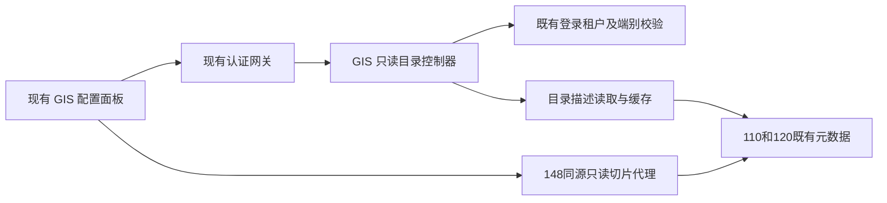
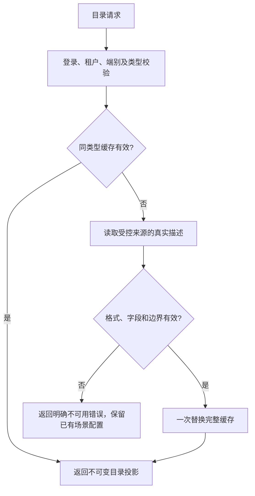

# 既有 GIS 目录只读接入设计

状态：GIS-01 本轮实施设计，2026-11-27。执行状态统一见[近期任务](../03_近期执行任务.md#gis-01-既有-gis-目录与编辑器接入2026-11-27)，历史字段来源见[接口合同第 5.6 节](../真实接口契约维护文档.md#56-管理后台-gis-切片信息列表)。

## 1. 目的与范围

修复当前编辑器高程、影像目录请求返回 404。按用户要求继续读取 110、120 的既有服务及 MinIO 数据，不迁移对象、不改变桶权限、不建新数据库表或独立 GIS 服务。仅接入已核验的公开共享切片目录；私有、租户专属目录和上传管理不纳入本轮。

## 2. 真实基线与数据归属

- 120 的 `9tyf/v2.0.0/gis/` 有既有高程和影像目录，可只读列举。已确认全球高程子目录及全球、文昌、南山影像描述文件。
- 110 的 `58000/gis-source/` 现有入口可读取同路径描述文件。120 的 `58000/gis-images/terrain/layer.json` 为另一个现存地形描述。描述及切片继续以原服务器为权威来源。
- 目录根地址、来源键、名称和可用层级上限由受控部署配置声明；运行时读取真实描述，不以常量成功数据代替源站读取。仅登记已核验目录，新增来源通过配置增量接入。
- 目录编号是只读数据源编号，不是资源表或原文件编号。使用固定命名空间及来源键的 SHA-256 前 63 位生成十进制字符串；不依赖主机名、展示名称或排序，避免重新配置来源地址时改变场景引用。碰撞、重复键和无效配置拒绝生效。

## 3. 架构与职责

后端负责目录投影和元数据校验，代理负责把 HTTPS 页面请求转发到既有 HTTP 数据源。两者均不保存 GIS 对象副本；目录缓存只保存可重建元数据。

## 4. 接口、身份与数据

外部沿用 `GET /api/operation/webgis/info/list`、`GET /api/tenant/web/webgis/info/list`，参数 `dataType` 仅接受 `ELEVATION`、`SATELLITE`。网关映射到 `/admin-api/dim3d/{operation|tenant}/webgis/info/list`，复用当前登录身份、租户上下文及 `Dim3dPlatformConfiguration` 端别校验。未登录返回业务 401，跨端或伪造租户拒绝，非法类型返回业务 400。

成功响应仍为 `{code:200,msg,data:[...]}`。`id` 为字符串；`gisName`、`dataType`、`coordinate`、`level`、`tileSize`、`path`、`fileName`、`sliceFlag`、`sliceRule`、`latitude`、`longitude` 沿用既有字段。影像依据瓦片地图服务描述（TMS）解析坐标、尺寸和中心点；地形依据量化网格描述（quantized-mesh）解析。未知值保持空值语义，不虚构像素尺寸或位置。

`path` 返回当前受控的绝对 HTTPS 读取地址：影像为切片目录，地形为 `layer.json`。来源配置和元数据不接收客户端传入的网址。影像元数据导出的最大层级可能高于实际对象目录，层级上限以本次只读枚举核验的配置值限制。新增可选 `bounds` 和 `fileExtension`，分别保留真实覆盖范围及图片后缀；旧记录不提供时沿用原兼容逻辑，避免用中心点生成的固定格网误裁切实际影像。

## 5. 流程与异常

## 6. 性能、安全与兼容

默认缓存 60 秒，同类型刷新串行合并；元数据响应体最多 1 MiB，连接和读取均有超时，来源数量有上限。禁止 HTTP 重定向、XML 外部实体和外部文档类型声明，URL 配置禁止凭据和片段。请求不携带用户令牌、Cookie 或租户头到存储服务器。

切片代理只开放已核验的 GIS 路径及读取方法，清除业务凭据，不代理桶列举或管理操作。源站保持原匿名读取策略；此代理不扩展至任何私有资源。旧场景的原始来源和未知字段保留，不批量改写旧档。

## 7. 实施依赖与验收

先补失败测试，再实现目录、认证边界和路由；构建及缓存固定在 D 盘。共享环境发布前记录原程序、配置及摘要，候选验证后切换，保留回退。真实验收包括列表、地形及影像选择、画面、保存重开、非法类型、未登录及跨端拒绝。

## 8. 当前状态与风险

本轮已完成只读源站核验、目录代码、双实例部署、网页同源接入与真实租户保存重开。浏览器联验定位并修复重开时绝对地址重复拼接前缀；新目录优先使用真实范围，旧相对地址及中心点规则保持兼容。详见 [GIS-01 验收记录](../evidence/gis01-20261127/README.md)。

148 当前使用精确同源代理映射到既有认证网关内部端别路径，未重启网关；网关源码中的外部路径映射已通过测试，供后续整体发布使用。后端以线上 TPL-10 程序为基包，追加已编译验证的 6 个新类，逐项核验原 917 个条目不变，避免覆盖其他功能。正式程序按原展开目录或启动包模式运行，通过独立配置导入启用来源；不更改数据库结构。

其他 GIS 数据、租户私有数据治理、数据上传和物理迁移不在本轮。源数据范围、精度、局部空白、越界旧描述及所有瓦片完整性不由本接口修复。110 的 SSH 身份及 120 的主机信任未就绪，但现有 HTTP 数据读取可用，本轮未登录两台存储服务器或修改其设置。回退资料已保留，未执行正式回退演练。
