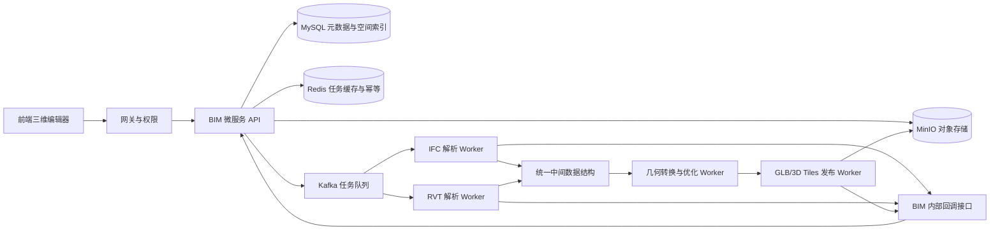
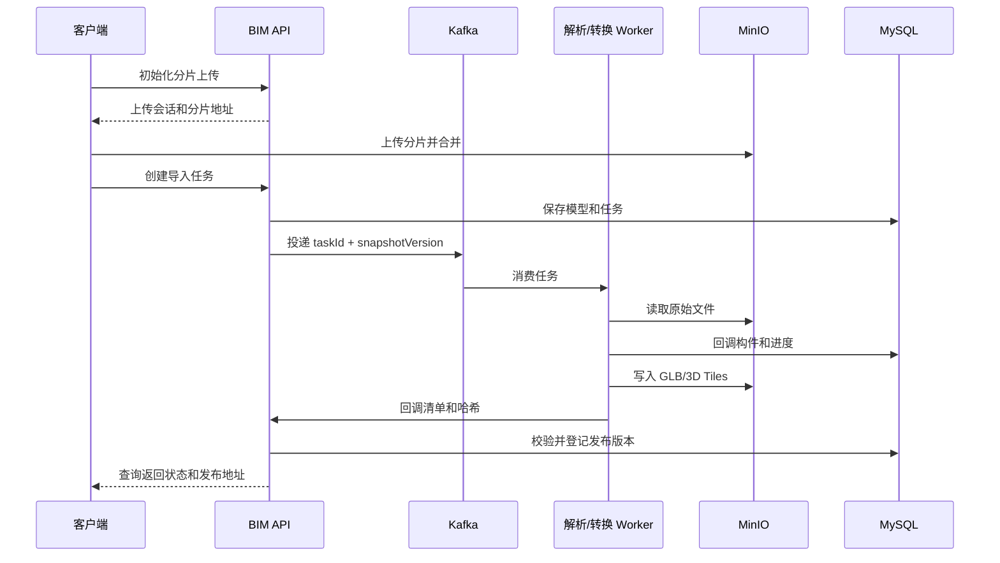

# BIM 模型处理微服务功能设计

## 1. 文档目的

本文档为 `jtyf-cloud` 增加 BIM 模型处理能力提供第一版功能设计，覆盖 IFC（Industry Foundation Classes，工业基础类）和 RVT（Revit 原生模型）导入、解析、转换、发布、构件查询、坐标配准及版本管理。文档以仓库现有 `wx-module-3d` 能力和《BIM转GLTF方案.docx》的技术建议为输入，目标是形成可评审、可拆分实施的后端方案。

附带方案文档中的内容属于需求背景和技术建议；其中的“应支持”作为本项目目标，“建议/需要验证”作为待确认项，不直接视为已验收的实现承诺。

## 2. 现状与设计结论

仓库当前的 `wx-module-3d` 已具备三维文件资源管理、MinIO 分片上传、Kafka 消息、WebSocket 推送及基于 Assimp 的 FBX/OBJ/3DS 转 glTF 能力。现有批量转换接口主要面向压缩包和同步本地临时目录，模型记录也以 `batch_conversion` 为中心，不能直接承载 BIM 的构件语义、空间索引和跨版本追踪。

因此新增独立的 `wx-module-bim` 微服务，Java 服务负责业务编排和统一接口，解析/转换 Worker（工作进程）负责重型 BIM 计算。服务通过对象存储保存原始文件和发布产物，通过消息队列驱动异步任务，通过关系数据库保存模型元数据、构件属性、空间索引和版本映射。现有 `wx-module-3d` 继续服务已有三维业务，避免在同一进程内引入 RVT 运行时、长耗时转换和大内存任务。

首期发布格式采用 GLB（Binary glTF，二进制 glTF）和可选的 3D Tiles（面向大规模三维场景的分块发布格式）双轨：GLB 支持局部预览和构件级交互，3D Tiles 支持大型 BIM 的分块、视距调度和渐进式加载。发布格式不改变构件统一 ID 和查询协议。

## 3. 目标与非目标

### 3.1 目标

1. 支持 IFC 4.x 导入，提取几何、材质、属性、空间层级和源构件标识。
2. 支持 RVT 导入，但将 Revit API 或经过验证的商业转换引擎封装为独立适配器；在未完成版本和许可验证前，不承诺任意 RVT 文件可转换。
3. 提供 500MB 级文件的分片上传、断点续传、对象存储和异步处理。
4. 对 10,000 个以上构件提供构件级查询、定位、高亮和属性读取。
5. 提供坐标系元数据、控制点校准、转换矩阵和独立检核点误差报告，目标误差不超过 5cm。
6. 提供模型版本、构件跨版本映射、差异查询和病害/业务对象关联。
7. 在明确的网络、设备和模型复杂度条件下，验证首屏不超过 15 秒；不把文件转成 GLB 等同于性能达标。
8. 通过 OpenAPI 3.0 定义 RESTful（表述性状态转移）接口，并接入现有权限和租户体系。

### 3.2 非目标

1. 首期不在 Java HTTP 请求线程中执行 IFC/RVT 解析、网格优化或瓦片切分。
2. 首期不承诺 RVT 跨所有 Revit 大版本兼容；版本矩阵需先通过样本验证。
3. 首期不将图像像素坐标直接当作 BIM 世界坐标；图像定位必须依赖相机参数、深度和配准关系。
4. 首期不改造现有 `wx-module-3d` 的 FBX/OBJ/3DS 转换接口，仅复用其已验证的文件、权限和消息基础设施。
5. 首期不把 3D Tiles 作为所有模型的强制输出格式；是否生成由模型复杂度和性能测试结果决定。

## 4. 总体架构



### 4.1 服务边界

| 组件 | 责任 | 运行约束 |
| --- | --- | --- |
| `wx-module-bim-api` | 跨服务接口、DTO（数据传输对象）、枚举和主题常量 | 不依赖数据库和转换引擎 |
| `wx-module-bim-biz` | 上传编排、任务状态、模型版本、构件查询、坐标和发布管理 | 无大规模几何计算；支持水平扩展 |
| IFC 解析 Worker | 读取 IFC 4.x，提取几何与属性 | 独立进程，可按 CPU/内存扩容 |
| RVT 解析 Worker | 通过 Revit API 或验证过的引擎读取 RVT | 单独运行环境；受 Revit 版本和许可约束 |
| 几何与发布 Worker | 网格优化、LOD（细节层级）、分块、GLB/3D Tiles 生成 | 临时磁盘隔离，输出写对象存储 |
| MySQL | 业务元数据、构件属性、版本映射、任务状态 | 不存放大型模型二进制 |
| MinIO | 原始模型、临时产物、正式发布清单和瓦片 | 正式版本使用不可变目录 |
| Kafka | 任务投递、进度和回调事件 | 消息只携带 ID 和版本，不携带大文件 |

### 4.2 模块目录建议

```text
wx-module-bim/
├─ pom.xml
├─ wx-module-bim-api/
│  └─ src/main/java/cn/iocoder/wx/module/bim/api/
│     ├─ BimModelApi.java
│     ├─ BimTaskApi.java
│     └─ dto/
└─ wx-module-bim-biz/
   └─ src/main/java/cn/iocoder/wx/module/bim/
      ├─ BimServerApplication.java
      ├─ controller/admin/
      ├─ controller/internal/
      ├─ service/
      ├─ dal/dataobject/
      ├─ dal/mysql/
      ├─ mq/producer/
      ├─ mq/consumer/
      ├─ adapter/ifc/
      ├─ adapter/rvt/
      ├─ publish/
      ├─ coordinate/
      ├─ version/
      ├─ enums/
      └─ config/
```

建议服务名为 `bim-server`。开发环境可在现有工程中独立启动，生产环境通过 Nacos 注册、网关路由和独立资源配额部署。

## 5. 核心业务流程

### 5.1 导入与转换

1. 客户端计算文件大小和 MD5，调用分片上传初始化接口。
2. 服务端创建上传会话并返回分片地址；分片完成后合并并校验大小、MD5 和扩展名。
3. 服务端创建模型记录和异步任务，冻结坐标、转换配置和解析器版本。
4. 任务按文件类型路由到 IFC 或 RVT 解析 Worker。
5. Worker 将结果写入统一中间数据结构，分别登记构件、属性、层级、包围盒和源 ID。
6. 几何 Worker 生成轻量化 GLB；达到大模型阈值时额外生成 3D Tiles。
7. 发布 Worker 校验清单、内容哈希和构件索引，成功后写入不可变发布目录。
8. 服务端将任务标记为 `SUCCESS`，客户端通过任务查询或 WebSocket 获取发布地址。



### 5.2 失败、重试和取消

任务状态由服务层统一变更，Worker 回调不得直接激活版本。建议状态如下：

```text
PENDING -> RUNNING -> SUCCESS
                   -> PARTIAL_FAILED -> RUNNING
                   -> FAILED
                   -> CANCELED
SUCCESS -> PUBLISHED -> ROLLED_BACK
```

- 同一幂等键（Idempotency Key，防重复提交标识）只能创建一个任务。
- Worker 回调按 `taskId + stage + itemId + attempt` 去重，重复回调不重复累计。
- 可恢复错误自动重试，最多 3 次；解析器不支持、文件损坏、许可不可用等不可恢复错误直接失败并保留诊断信息。
- 取消任务只阻止新阶段和新分块进入处理，已生成的临时产物不得进入正式版本。
- 新版本发布失败时，当前稳定版本不变。

## 6. 功能设计

### 6.1 模型与文件管理

- 模型创建、列表、详情、删除和归档。
- 原始文件分片上传、断点续传、MD5 校验和清理未完成会话。
- 记录输入格式、文件大小、哈希、来源项目、上传人和租户。
- 保留原始文件，不以转换产物覆盖源文件。
- 文件路径由服务端根据模型 ID 和版本生成，禁止拼接用户输入形成任意路径。

### 6.2 IFC 解析

- 支持 IFC 4.x 版本识别、实体类型统计和解析器版本记录。
- 提取 `IfcProject`、空间层级、构件类型、属性集、材料、几何包围盒和源 GUID。
- 对无法解析的实体生成可检索的告警，不因单个非关键实体导致整模静默丢失。
- 记录实体覆盖率、几何成功率、属性成功率和错误清单。
- 首期优先评估 IfcOpenShell；具体版本和运行方式在格式验证阶段冻结。

### 6.3 RVT 解析

- 采用独立 RVT 适配器，不把 RVT 当作普通文件交给 Assimp。
- 通过 Revit API 自动化或经验证的商业转换引擎读取模型，输出与 IFC 相同的中间数据结构。
- 记录 Revit 版本、适配器版本、许可证状态、运行节点和转换日志。
- 对不同 Revit 大版本维护兼容矩阵；不支持的版本在任务创建时快速失败。
- 处理进程必须具备超时、崩溃恢复、单任务隔离和优雅退出能力。

### 6.4 统一构件标识

每个构件保存三类标识，不互相替代：

| 标识 | 作用 | 示例 |
| --- | --- | --- |
| 平台构件 ID | 平台长期引用和权限控制 | `bimc_01J...` |
| 源模型构件 ID | 回溯源模型和跨版本匹配 | IFC GUID、Revit 稳定标识 |
| 分类编码 | 按行业规范进行统计和筛选 | GB/T 51269-2017 相关编码 |

模型更新时按照源 ID、类型/属性、空间位置和几何相似度建立映射。置信度不足的记录进入人工确认队列，不自动覆盖旧构件关联。

### 6.5 坐标与配准

- 保存源坐标系、目标坐标系、单位、轴向、旋转、平移和必要的投影参数。
- 提供控制点上传、可视化拾取、人工微调、配准预览和独立检核点统计。
- 坐标转换以版本化的变换参数为输入；每次发布记录变换参数哈希。
- 图像像素到 BIM 坐标必须经过相机内外参数、深度/射线和现场控制点配准，不能直接套用一个矩阵。
- 5cm 是检核点最终误差目标，验收报告必须给出样本、最大误差、均方误差和坐标基准。

### 6.6 几何转换与发布

- 标准 GLB：适用于中小模型、局部预览和单构件下载。
- 3D Tiles：适用于大模型、空间分块、视距调度和渐进加载。
- 转换过程中执行三角化、重复顶点合并、法线处理、材质整理、纹理压缩和 LOD 生成；具体开关按格式适配器配置。
- 每个节点保留平台构件 ID，支持点击高亮、属性查询和病害关联。
- 清单包含模型版本、坐标元数据、发布格式、内容地址、哈希、构件索引地址和生成器版本。
- 正式目录采用不可变版本目录，全部校验通过后原子切换 `current` 引用。

### 6.7 构件和空间查询

- 按平台构件 ID、源模型 ID、分类编码、名称、类型、空间层级和属性筛选。
- 按点、包围盒和空间范围查询构件；空间查询返回构件 ID、包围盒、层级和发布节点。
- 支持构件详情、属性集、材质摘要、源文件定位、当前版本和历史版本。
- 查询接口返回分页数据，不直接返回大段几何；几何通过发布地址或局部 GLB 获取。

### 6.8 版本与病害关联

- 模型版本由源文件哈希、解析器版本、坐标配置和发布配置共同确定。
- 提供版本列表、切换、差异统计、回滚和版本清理策略。
- 病害、设备、工单等业务对象只引用平台构件 ID 和模型版本，不直接依赖 GLB 节点名称。
- 旧版本被引用时禁止物理删除；仅在无业务引用且超过保留期后清理对象存储。

## 7. API 设计

接口前缀：`/admin-api/bim`；Worker 内部接口前缀：`/internal-api/bim`。所有接口遵循现有网关认证、租户隔离和权限注解约定。

### 7.1 管理接口

| 方法 | 路径 | 说明 |
| --- | --- | --- |
| POST | `/models/upload/init` | 初始化分片上传 |
| POST | `/models/upload/complete` | 合并并校验上传 |
| POST | `/models/import` | 创建导入任务，返回 `modelId`、`taskId` |
| GET | `/models/{modelId}` | 查询模型详情 |
| GET | `/models/{modelId}/components` | 构件分页查询 |
| GET | `/models/{modelId}/components/{componentId}` | 构件详情 |
| GET | `/models/{modelId}/spatial-query` | 点/包围盒/空间范围查询 |
| GET | `/tasks/{taskId}` | 查询任务阶段、进度和错误 |
| POST | `/tasks/{taskId}/cancel` | 取消任务 |
| POST | `/tasks/{taskId}/retry` | 重试可恢复失败 |
| GET | `/models/{modelId}/versions` | 查询模型版本 |
| POST | `/versions/{versionId}/publish` | 校验并激活发布版本 |
| POST | `/versions/{versionId}/rollback` | 回滚到指定稳定版本 |
| POST | `/models/{modelId}/alignment/check` | 计算控制点和检核点误差 |
| GET | `/models/{modelId}/component-mappings` | 查询跨版本构件映射 |

创建导入任务示例：

```json
{
  "modelId": "bim-model-001",
  "sourceObjectKey": "bim/model-001/source/xxx.ifc",
  "sourceFormat": "IFC",
  "sourceVersion": "IFC4",
  "coordinateConfig": {
    "sourceCrs": "EPSG:4547",
    "targetCrs": "EPSG:4547",
    "unit": "m",
    "transformVersion": "coord-2026-001"
  },
  "publishFormats": ["GLB", "TILES_3D"],
  "idempotencyKey": "sha256:..."
}
```

### 7.2 Worker 内部接口

```text
POST /internal-api/bim/tasks/{taskId}/heartbeat
POST /internal-api/bim/tasks/{taskId}/progress
POST /internal-api/bim/tasks/{taskId}/components/batch
POST /internal-api/bim/tasks/{taskId}/artifacts
POST /internal-api/bim/tasks/{taskId}/complete
POST /internal-api/bim/tasks/{taskId}/fail
```

内部回调必须带服务身份、任务 ID、快照版本、阶段、尝试次数和签名/内部令牌。批量构件上报应控制单批大小，失败时支持从批次边界恢复。

## 8. 数据模型

建议新增 `bim_` 业务表前缀，沿用工程审计字段和租户字段。正式建表前根据现有数据库命名规范决定是否增加 `wx_` 前缀。

### 8.1 核心表

| 表 | 关键字段 | 说明 |
| --- | --- | --- |
| `bim_model` | `id`, `project_id`, `name`, `source_format`, `source_object_key`, `source_hash`, `status` | 模型主记录 |
| `bim_model_version` | `id`, `model_id`, `version_no`, `parser_version`, `coordinate_config_hash`, `publish_status` | 可回滚版本 |
| `bim_task` | `id`, `model_version_id`, `stage`, `status`, `progress`, `attempt`, `error_code`, `idempotency_key` | 异步任务和状态机 |
| `bim_component` | `id`, `model_version_id`, `platform_id`, `source_id`, `category_code`, `name`, `bbox`, `geometry_ref` | 构件与空间摘要 |
| `bim_component_property` | `component_id`, `property_set`, `property_name`, `value_json` | 属性集与值 |
| `bim_component_mapping` | `from_component_id`, `to_component_id`, `match_method`, `confidence`, `review_status` | 跨版本映射 |
| `bim_coordinate_transform` | `model_version_id`, `source_crs`, `target_crs`, `matrix_json`, `control_points`, `check_report_key` | 坐标配准参数和报告 |
| `bim_artifact` | `model_version_id`, `format`, `object_key`, `content_hash`, `manifest_json` | GLB/3D Tiles/清单 |
| `bim_task_event` | `task_id`, `event_type`, `payload_json`, `event_time` | 任务审计和诊断 |

空间字段可以先用 MySQL JSON/数值字段落地；若空间范围查询成为主路径，再评估空间扩展或专用空间索引。构件属性不建议全部拼成宽表，稳定字段进入列，长尾属性进入 JSON。

## 9. 非功能设计与验收指标

| 指标 | 目标 | 验证方式 |
| --- | --- | --- |
| 文件大小 | 支持 500MB 级单文件 | 分片上传、合并校验、异常恢复压测 |
| 构件规模 | 支持 10,000 个以上构件 | 真实模型导入、查询、渲染和内存测试 |
| 首屏加载 | 明确环境下不超过 15 秒 | 固定网络、浏览器、GPU、模型和缓存条件测量 |
| 配准误差 | 独立检核点最大误差不超过 5cm | 控制点标定、检核点报告和复测 |
| 导入完整性 | 几何/属性覆盖率可量化 | 解析统计、抽样比对和错误清单 |
| 任务可靠性 | 重试、取消、重复回调可恢复 | 故障注入和重复消息测试 |
| 可追溯性 | 源文件、解析器、配置、产物可关联 | 哈希、版本和审计记录检查 |
| 安全性 | 租户隔离、路径校验、内部回调鉴权 | 权限测试、路径攻击测试、审计检查 |

首屏性能和 5cm 精度都依赖实际样本和部署条件，验收报告必须记录硬件、网络、浏览器、模型面数/材质数、坐标基准和测量方法。

## 10. 安全、运维和资源隔离

- 上传文件校验扩展名、大小、哈希和压缩包路径，拒绝目录穿越和任意输出路径。
- Worker 使用独立容器/节点、非 root 用户、资源请求与上限、临时目录配额和任务超时。
- RVT Worker 与 Java API 分离部署；Revit 运行时和许可证信息只进入受控节点。
- 任务、阶段、错误码、处理时长、队列等待时长和产物哈希写入日志/指标。
- 增加健康检查、就绪检查、优雅终止和僵尸任务回收。
- 对象存储正式产物使用版本化目录；清理程序只删除未引用的临时产物。
- 通过 Kafka 重放任务事件；通过 Redis 做短期锁和幂等缓存，数据库作为最终状态来源。

## 11. 分阶段交付边界

### 第一阶段：格式与性能可行性验证

交付 IFC 4.x 与至少一个目标 Revit 版本的样本报告，确认构件/属性覆盖率、坐标处理、解析时长、许可证和运行方式。用接近 500MB、10,000 构件的样本测量 GLB 与 3D Tiles 的候选方案。

### 第二阶段：基础导入服务

交付 `wx-module-bim-api`、`wx-module-bim-biz`、分片上传、模型/任务表、异步投递、任务查询和 Worker 回调骨架。先用模拟 Worker 跑通端到端链路。

### 第三阶段：正式解析与发布

接入 IFC 解析和 RVT 适配器，落地统一构件结构、GLB 发布、构件查询、清单校验和版本激活/回滚。

### 第四阶段：空间、版本和业务关联

完成坐标控制点与检核点、空间查询、跨版本构件映射、病害/设备关联和人工复核队列。

### 第五阶段：规模化与上线

根据真实模型压测结果调整分块、LOD、缓存和并发；完成灰度发布、监控、回滚演练、数据迁移和运维手册。

## 12. 关键风险与决策门槛

1. RVT 解析受 Revit 版本、运行环境和许可约束。若目标版本无法在服务器稳定运行，必须在阶段一改为经验证的商业引擎或受控转换节点。
2. Assimp 适合现有 FBX/OBJ/3DS 转换，不能替代 IFC/RVT 语义解析；禁止把现有 `convertToGltfUtil` 直接扩展为 BIM 解析器。
3. 5cm 配准精度需要真实控制点和检核点，不能靠配置一个四乘四矩阵作为验收依据。
4. 500MB 文件和 15 秒首屏不能只看文件大小，还要关注三角面、材质、纹理、网络和 GPU；必要时必须选择 3D Tiles。
5. 构件 ID 不能依赖 GLB 节点名或某个导出工具的临时序号，必须由平台 ID、源 ID 和版本映射共同保证可追溯。
6. 阶段一若格式覆盖率、许可、坐标基准或性能不达标，应先调整范围和技术路线，再进入正式开发。

## 13. 参考输入与仓库依据

- 外部方案：`D:\Y\Desktop\BIM转GLTF方案.docx`，提供 IFC/RVT、坐标、构件 ID、GLB/3D Tiles 和验收指标建议。
- 现有三维模块：`wx-module-3d`，包含 `BatchConversionController`、MinIO 文件接口、Kafka/WebSocket 能力及 Assimp 转换工具。
- 现有设计文档：`db/3d/3D模型转换工具使用手册.md`、`docs/植被生成微服务设计.md`，用于沿用仓库的模块拆分、异步任务和发布版本表达方式。
