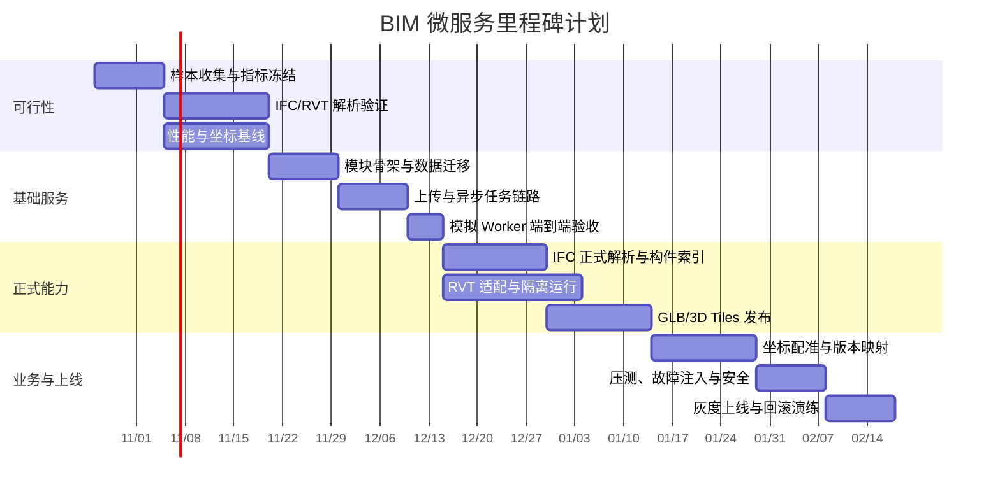

# BIM 模型处理微服务里程碑计划

## 1. 计划说明

本计划按“先验证关键不确定性，再建设可回滚的基础服务，最后规模化上线”安排。时间以 2 周一个迭代计算，默认投入 1 名后端、1 名 BIM/几何工程师、1 名前端/三维工程师、1 名测试兼 DevOps；RVT 适配阶段另需具备目标 Revit 版本和合法许可的专用环境。

计划中的日期是相对迭代，不代表已承诺的上线日期。阶段一的格式、许可、坐标和性能结论是后续排期的门槛。

## 2. 总体节奏

## 3. 里程碑明细

### M0 需求和样本冻结（第 1 周）

**目标**：把“支持 BIM”转成可以测试的样本、版本和指标。

**工作项**：

- 收集至少 2 个 IFC 4.x 样本，覆盖建筑、机电和空间层级。
- 收集至少 2 个目标 Revit 大版本的 RVT 样本，确认模型大小、族、材质、链接模型和属性集。
- 冻结目标坐标系、单位、轴向、控制点和独立检核点方案。
- 冻结测试设备、浏览器、网络、GPU、缓存策略及 15 秒首屏的测量口径。
- 明确 Revit API/商业引擎的许可、版本和部署节点。

**交付物**：样本清单、指标口径、版本兼容矩阵初稿、风险清单。

**退出条件**：每个硬指标都有样本、测量方法、负责人和“通过/不通过”的判定规则。

### M1 格式解析和坐标可行性验证（第 2 至 3 周）

**目标**：验证最可能导致返工的解析链路和配准链路。

**工作项**：

- 评估 IFC 解析器，输出实体、几何、属性、材质和空间层级覆盖率。
- 搭建 RVT 专用 Worker，完成至少一个目标 Revit 版本的批量读取和异常恢复验证。
- 输出统一中间数据结构样例，验证 IFC 与 RVT 能映射到相同的构件字段。
- 用控制点和独立检核点验证坐标转换，生成误差报告。
- 对接近 500MB、10,000 构件的样本测量解析、网格生成、发布和首屏基线。

**交付物**：格式验证报告、坐标精度报告、性能基线、解析器选型决策。

**退出条件**：RVT 链路可运行且许可明确；坐标误差测量方法可复现；若无法达标，必须在此阶段调整技术路线。

### M2 微服务骨架和数据层（第 4 周）

**目标**：建立独立可部署的 `wx-module-bim`。

**工作项**：

- 新增 `wx-module-bim` 父模块、API 模块和 BIZ 模块。
- 完成 `bim_model`、`bim_model_version`、`bim_task`、`bim_artifact` 等基础表和索引。
- 接入 Nacos、网关、权限、租户、MyBatis、Redis、Kafka、MinIO 和监控。
- 定义统一错误码、任务状态枚举、事件格式和内部回调鉴权。
- 建立接口文档、数据库迁移脚本和本地启动配置。

**交付物**：可启动服务、迁移脚本、OpenAPI 初稿、部署配置。

**退出条件**：服务能独立注册和健康检查；新旧 `wx-module-3d` 接口回归通过。

### M3 上传和异步任务链路（第 5 周）

**目标**：先用模拟 Worker 跑通可重试、可取消、可追踪的任务闭环。

**工作项**：

- 实现 500MB 级分片上传、断点续传、合并校验和脏会话清理。
- 实现导入任务创建、幂等键、队列投递、进度、取消、重试和超时回收。
- 实现模拟 Worker，按批次回调构件、产物和错误。
- 完成数据库状态机和重复回调去重。
- 接入 WebSocket 或轮询返回任务进度。

**交付物**：端到端模拟链路、任务状态图、故障注入记录。

**退出条件**：重复提交不产生重复任务；重复回调不重复计数；取消和失败可恢复；正式版本不会被失败任务覆盖。

### M4 IFC 正式解析与构件索引（第 6 至 7 周）

**目标**：完成 IFC 生产链路。

**工作项**：

- 接入阶段一选定的 IFC 解析器和版本。
- 写入统一构件、属性、空间层级、包围盒和源 GUID。
- 输出解析统计、错误清单和原始实体定位信息。
- 建立构件 ID 生成、唯一性检查和空间查询索引。
- 对典型 IFC 样本完成抽样比对。

**交付物**：IFC Worker、构件/属性查询接口、解析验收报告。

**退出条件**：样本覆盖率达到阶段一约定值；构件 ID、属性和空间层级可回查源模型。

### M5 RVT 适配和隔离运行（第 6 至 8 周，可与 M4 并行）

**目标**：完成已批准 Revit 版本的正式转换链路。

**工作项**：

- 固化 Revit 运行镜像/节点、许可和版本矩阵。
- 实现文件接收、单任务隔离、超时、崩溃恢复和日志采集。
- 将 RVT 输出转换为统一中间数据结构。
- 验证族、材质、属性、链接模型和坐标的保真度。
- 对不支持版本、许可不足和模型损坏给出明确错误码。

**交付物**：RVT Worker、版本兼容矩阵、许可与运维手册、样本报告。

**退出条件**：目标版本连续批量测试稳定；失败任务不阻塞其他任务；转换产物可被后续发布链路消费。

### M6 GLB 和 3D Tiles 发布（第 8 至 9 周）

**目标**：生成可交互、可追溯的正式发布产物。

**工作项**：

- 实现网格优化、材质/纹理处理、LOD 和构件 ID 保留。
- 生成标准 GLB；按模型复杂度和性能基线生成 3D Tiles。
- 生成 `manifest.json`、内容哈希、构件索引和坐标元数据。
- 实现正式目录原子切换、版本激活、回滚和保留策略。
- 接入前端预览和构件高亮/属性查询。

**交付物**：GLB/3D Tiles 发布 Worker、清单协议、发布接口、前端联调版本。

**退出条件**：产物能被现有三维运行时加载；构件点击、查询、病害引用仍使用平台构件 ID。

### M7 坐标配准、版本映射和业务关联（第 10 周）

**目标**：补齐 BIM 平台能力，而不是停留在格式转换。

**工作项**：

- 完成坐标配置、控制点、检核点、预览和误差报告。
- 实现源 ID、属性、空间和几何相似度的跨版本映射。
- 建立人工确认队列和映射审核接口。
- 将病害、设备和工单关联到平台构件 ID + 模型版本。
- 验证版本切换、历史查询和回滚后的关联完整性。

**交付物**：配准接口、映射表、审核流程、业务关联示例。

**退出条件**：独立检核点满足约定精度；无法自动匹配的构件可被识别和人工处理。

### M8 压测、安全和可运维性（第 11 周）

**目标**：在上线前验证资源边界和故障恢复。

**工作项**：

- 进行 500MB/10,000 构件模型的并发、内存、磁盘、网络和首屏压测。
- 进行 Kafka 重复消息、Worker 崩溃、对象存储超时、数据库故障和断点续传中断注入。
- 进行路径穿越、越权访问、租户隔离、内部回调伪造和恶意压缩包测试。
- 建立指标：排队时长、解析时长、转换时长、失败率、重试率、产物大小和首屏时延。
- 完成告警、日志关联、任务回收和对象存储清理演练。

**交付物**：压测报告、故障注入报告、安全检查清单、监控面板。

**退出条件**：硬指标有实测数据；重大故障可恢复；无高风险越权和任意路径问题。

### M9 灰度上线和正式验收（第 12 周）

**目标**：小范围上线并保留可回滚路径。

**工作项**：

- 选择一个试点项目和固定样本进行灰度。
- 与现有 `wx-module-3d` 的文件和三维预览能力并行验证。
- 完成数据库、对象存储、消息主题和 Worker 的生产配置。
- 演练任务回滚、发布回滚和版本恢复。
- 完成使用手册、故障手册和验收签字材料。

**交付物**：灰度版本、上线检查表、回滚记录、正式验收报告。

**退出条件**：试点项目稳定运行；所有阶段性退出条件满足；产品、技术和运维共同确认上线范围。

## 4. 关键依赖

| 依赖 | 需要在何时确认 | 未满足时的影响 |
| --- | --- | --- |
| 目标 Revit 版本和合法许可 | M0-M1 | RVT 链路无法进入正式开发 |
| IFC/RVT 样本文件 | M0 | 覆盖率和性能无法测量 |
| 坐标基准、控制点、检核点 | M0-M1 | 5cm 指标无法验收 |
| 目标部署硬件和网络 | M0-M1 | 15 秒首屏无法复现 |
| Kafka、MinIO、MySQL、Nacos 环境 | M2-M3 | 端到端任务无法联调 |
| 前端三维运行时支持 3D Tiles/构件 ID | M6 | 需退回 GLB 或增加适配工作 |
| 业务方定义病害/设备关联字段 | M7 | 版本关联接口只能先交付基础能力 |

## 5. 里程碑验收总表

| 里程碑 | 主要验收证据 | 是否允许进入下一阶段 |
| --- | --- | --- |
| M0 | 样本、指标和兼容矩阵 | 所有指标有可复现口径 |
| M1 | 格式、坐标和性能基线报告 | RVT/坐标路线可行，风险已决策 |
| M2 | 服务启动、迁移和 OpenAPI | 独立部署与权限可用 |
| M3 | 模拟 Worker 故障注入报告 | 幂等、取消、重试、回滚可靠 |
| M4/M5 | IFC/RVT 样本验收报告 | 构件、属性、坐标可追溯 |
| M6 | 发布清单和前端加载结果 | GLB/3D Tiles 与构件查询一致 |
| M7 | 配准和跨版本映射报告 | 5cm 目标和人工复核闭环成立 |
| M8 | 压测和安全报告 | 500MB/15 秒目标有实测结论 |
| M9 | 灰度及回滚记录 | 试点稳定并具备上线回退能力 |

## 6. 需要项目启动时确认的事项

1. 首批必须支持的 Revit 版本和部署操作系统。
2. IFC 解析器可接受的开源许可证和安全审查范围。
3. 5cm 配准验收采用的坐标基准、控制点数量和检核点数量。
4. 首屏 15 秒的目标设备、网络带宽、浏览器和模型复杂度。
5. 是否首期同时交付 3D Tiles，还是先以 GLB 完成构件交互和版本闭环。
6. 病害、设备、工单等现有业务表中可复用的关联字段和权限边界。
7. 历史模型和现有 `batch_conversion` 数据是否需要迁移；若需要，先做只读映射，避免直接改写旧数据。
