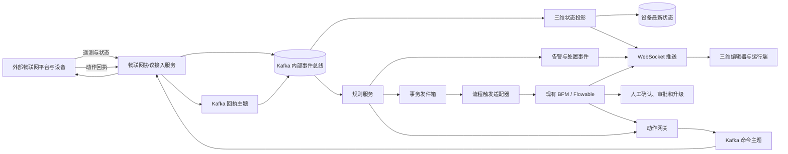
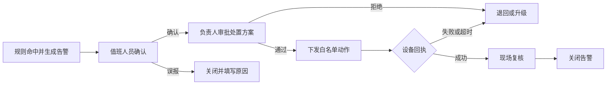

# 01 数字孪生流程引擎与规则引擎设计规划

## 1. 文档信息

| 项目 | 内容 |
|---|---|
| 文档编号 | 01 |
| 文档状态 | 规划稿 |
| 适用系统 | `wx-cloud` 数字孪生体系 |
| 设计范围 | 规则管理与执行、告警处置流程、设备/场景动作、审计与运行保障 |
| 设计原则 | 复用现有 Flowable、Kafka、Redis 和三维服务；规则执行与人工流程分层；规则和场景配置版本化 |

本文基于仓库当前实现和现有设计文档形成，作为后续需求拆分、接口设计和实施评审的依据。新增数据表、接口和前端页面均属于建议方案，实施时应通过增量迁移和兼容接口逐步落地。

2026-10-19 整理说明：本专项完整规则消费和流程联动尚未交付；`wx-module-iot` 已有 API/BIZ、通用上行和可靠接收代码。本文规则模型及事件示例属于目标设计，当前事件契约以 `TwinTelemetryEvent` 和[MQTT 联调样例](../guides/01_MQTT上行接入与联调.md)为准。当前状态统一见[后端台账](../plan/01_后端里程碑与进度台账.md)。

外部物联网协议接入、设备映射和命令回执的详细设计见 [02 数字孪生物联网接入系统设计规划](02_数字孪生物联网接入系统设计规划.md)。本文件中的规则服务只消费统一事件，不直接连接外部设备平台。

## 2. 设计结论

在现有数字孪生服务中增加规则能力和事件处置编排能力，建议采用以下边界：

1. **流程引擎复用现有 `wx-module-bpm` 中的 Flowable**，不再引入第二套流程引擎。
2. **新增 `wx-module-rule` 规则服务**，管理规则版本、实时计算、去重、告警事件和流程触发。
3. **新增 `wx-module-iot` 负责外部物联网服务的协议接入**；`wx-module-3d` 继续负责场景对象映射、三维状态投影和前端推送，现有设备 Kafka 消费链路逐步桥接到统一事件总线。
4. **规则引擎负责快速判断，流程引擎负责持续处置**。高频设备数据不逐条创建流程实例；命中规则并形成业务事件后才触发流程。
5. 初期采用受限的 JSON 规则模型，不执行用户任意脚本。只有在决策表或复杂时间窗口需求明确后，再评估专门规则运行时或流处理框架。

目标链路：



## 3. 当前项目基础与边界

### 3.1 已有能力

| 能力 | 当前实现 | 设计影响 |
|---|---|---|
| 三维业务服务 | `wx-module-3d`，启动类为 `DimensionsApplication` | 设备、场景、资源和运行接入已有承载服务，规则计算不宜继续堆入该模块 |
| 设备消息接入 | 多个 `@KafkaListener` 消费建筑、消防、电气、人员等主题 | 这些是当前内部接入链路；新增外部协议接入由 `wx-module-iot` 负责，旧主题通过适配器逐步桥接 |
| 设备当前态与消息留存 | `AbstractTaskMessageConsumer` 写入 Redis，并调用 `TaskMessageService` 保存消息 | Redis 可作为当前状态查询缓存；原始消息和规则事件的留存策略应另行定义 |
| 前端实时推送 | WebSocket 消息发送器和 `SendQueueManager` | 可复用既有推送通道展示设备状态；告警和流程任务应使用独立消息类型与权限控制 |
| 流程引擎 | `wx-module-bpm` 使用 Flowable；版本由依赖管理指定为 7.0.1 | BPM 服务继续负责流程定义、实例和人工任务，不负责高频规则匹配 |
| 内部启动流程接口 | `BpmProcessInstanceApi` 接收流程定义标识、业务唯一标识和变量 | 可作为规则服务启动流程的入口；需要补充或确认重复调用的幂等保障 |
| 告警展示方案 | `alert_scheme` / `AlertScheme` 保存颜色、位置、文本样式和展示方式 | 保留为展示配置；告警条件、规则版本和处置状态应使用新的模型 |
| 三维任务动作 | `task_event` 保存旧引擎任务与设备动作配置 | 作为兼容能力保留；新联动通过稳定的动作编码和版本化配置引用，不把规则逻辑塞进该表 |
| 消息中间件 | 三维服务使用 Kafka 消费设备主题，同时项目也存在 RocketMQ 依赖 | 设备事件与规则触发链路应明确统一使用 Kafka，避免同一业务事件双写多个消息系统 |

### 3.2 需要在实施前核对的现状

- 不同 Kafka 消费者当前有自己的消费组与处理方法；新增规则消费组应独立部署，避免规则故障阻塞三维前端数据推送。
- 当前消息接收流程包含 Redis、数据库和 WebSocket 等多个副作用。规则触发必须有独立的失败重试与消费记录，不能仅依赖日志或前端推送成功与否。
- 现有 `BpmProcessInstanceApi` 提供了启动入口，但需确认按 `processDefinitionKey + businessKey` 重复请求时是否返回既有流程实例。若未保证，需要在 BPM 侧增加唯一约束和幂等逻辑。
- 场景持久化设计文档中提出了场景版本和设备绑定模型；这些模型部分属于规划内容。规则绑定应以稳定的 `sceneId`、`objectKey`、`deviceId` 为基础，逐步衔接场景版本体系。

## 4. 业务范围

### 4.1 本期纳入

- 规则草稿、校验、发布、停用和版本查询。
- 设备属性阈值、状态变化、多条件组合、次数/持续时间窗口、冷却时间和恢复条件。
- 告警事件产生、确认、关闭、升级以及与三维对象关联。
- 命中规则后启动现有 Flowable 流程。
- 流程任务、告警状态和设备/场景动作状态向前端推送。
- 规则试算、历史消息回放、执行记录和操作审计。

### 4.2 暂不纳入首期

- 任意 Java、Groovy、JavaScript 或 SpEL 表达式执行。
- 对设备数据逐条启动 BPM 流程。
- 跨大量设备的复杂事件关联、分钟级以上大规模窗口计算。
- 规则直接执行任意 HTTP 地址、SQL 或 Shell 命令。
- 将已有 `task_event` 整表迁移或替换。

## 5. 服务与模块职责

| 模块 | 职责 | 不负责 |
|---|---|---|
| `wx-module-iot` | 外部物联网协议连接、消息映射、统一事件发布、设备命令下发和回执 | 场景版本管理、规则匹配、人工审批 |
| `wx-module-3d` | 场景对象映射、兼容旧 Kafka 主题、Redis 当前态投影、场景可视动作适配、WebSocket 推送 | 外部平台协议会话、设备命令发送、规则版本管理、人工审批流程 |
| `wx-module-rule-api` | 跨服务 API、消息 DTO、规则和告警枚举 | 数据库实体和引擎实现 |
| `wx-module-rule-biz` | 规则管理、规则校验与编译、事件消费、运行态窗口、告警、发件箱、规则审计 | 设备专有协议解析、人工审批任务执行 |
| `wx-module-bpm` | Flowable 流程定义、流程实例、用户任务、审批、流程超时和流程状态 | 高频事件过滤、设备状态维护 |
| 动作网关能力 | 设备命令由 IoT 服务校验和发送；三维可视动作由 3D 服务执行；统一记录幂等、超时、回执和审计 | 自行推断业务规则或跳过人工审批 |

建议模块结构：

```text
wx-module-rule
├─ wx-module-rule-api
└─ wx-module-rule-biz
   ├─ controller/admin       规则、事件、执行记录管理接口
   ├─ consumer               规范化事件消费者
   ├─ service                发布、校验、匹配、告警、触发服务
   ├─ runtime                规则模型、操作符、缓存和窗口状态
   ├─ dal                    规则、告警、执行记录和发件箱
   └─ integration            BPM 与三维动作适配器
```

第一阶段可以把动作网关实现放在 `wx-module-3d` 内，以内部服务接口供规则服务调用；当设备协议和动作数量明显增加时，再拆成独立模块或服务。

## 6. 统一事件协议

### 6.1 事件信封

各设备主题进入规则服务前统一转换为以下结构。`payload` 保留设备业务字段，外层字段用于路由、排序、版本追溯和幂等。

```json
{
  "eventId": "evt-20261015-000001",
  "eventType": "fire.smoke.updated",
  "schemaVersion": 1,
  "tenantId": 1001,
  "appId": 2001,
  "sceneId": "scene-001",
  "sceneRevisionId": 38,
  "deviceId": "smoke-001",
  "deviceType": "smoke-detector",
  "objectKey": "building-a-floor-2-smoke-01",
  "occurredAt": "2026-10-15T10:20:30+08:00",
  "receivedAt": "2026-10-15T10:20:31+08:00",
  "sequence": 10086,
  "traceId": "trace-001",
  "origin": "device",
  "payload": {
    "smoke": 86,
    "temperature": 72
  }
}
```

### 6.2 字段约束

- `eventId`：事件全局唯一标识，用于消费幂等。
- `eventType`：稳定的业务事件编码，不使用中文显示名作为机器路由键。
- `tenantId`、`appId`：租户和应用范围，规则查询、执行和流程变量必须带上。
- `sceneRevisionId`：可获得时记录事件关联的场景版本；无法获得时保留为空，不能用规则执行时的“当前版本”伪造事件历史。
- `deviceId`、`objectKey`：设备与三维对象的关联标识；映射缺失时允许规则继续判断，但动作执行需要重新校验目标。
- `occurredAt` 与 `sequence`：区分事件时间和接收时间，支持迟到、重复和乱序处理。
- `traceId`：贯穿规则执行、告警、流程、命令和回执。
- `origin`：标记设备、仿真、人工、流程或规则产生，防止自动联动循环。

### 6.3 主题建议

沿用现有 Kafka 集群，新增统一主题，具体名称按部署环境前缀配置：

| 主题 | 方向 | 用途 |
|---|---|---|
| `twin.event.v1` | 三维接入 → 规则服务 | 规范化设备和仿真事件 |
| `twin.alert.v1` | 规则服务 → 告警消费者 | 告警产生、升级、恢复和关闭事件 |
| `twin.workflow.trigger.v1` | 规则服务 → BPM 适配器 | 请求启动或关联流程 |
| `twin.command.v1` | 规则/BPM → 动作网关 | 经过授权的设备或场景动作请求 |
| `twin.command.ack.v1` | 设备接入 → 规则/流程 | 动作执行回执或失败结果 |
| `twin.workflow.status.v1` | BPM → 三维/告警服务 | 流程开始、待办、完成、驳回或终止状态 |

实际主题是否合并由吞吐量、保留策略和运维能力决定；主题版本应通过 `schemaVersion` 管理。不要将 Kafka 与 RocketMQ 双写为同一业务事实来源。

## 7. 规则定义与运行

### 7.1 规则生命周期

```text
草稿 → 校验通过 → 试算/回放 → 发布 → 生效 → 停用
```

- 发布后生成不可变规则版本；修改必须创建新版本。
- 每个事件只按消费时确定的有效规则版本执行，并在执行记录中保存版本号。
- 规则停用不删除历史版本和执行记录。
- 规则发布应支持灰度范围、立即生效时间和回滚到上一版本。

### 7.2 首期条件表达能力

首期使用领域专用语言（Domain-Specific Language，DSL）的 JSON 子集，通过字段路径和白名单操作符表达条件：

```json
{
  "all": [
    { "path": "payload.smoke", "operator": ">=", "value": 80 },
    { "path": "payload.temperature", "operator": ">=", "value": 70 }
  ]
}
```

首期操作符建议：

- 比较：`>`、`>=`、`<`、`<=`、`==`、`!=`。
- 集合与范围：`in`、`notIn`、`between`、`exists`。
- 组合：`all`、`any`、`not`。
- 时间状态：持续时间、指定窗口内次数、状态变化。

表达式需要类型校验、最大嵌套层级、最大条件数和字段白名单。不得将配置内容拼接为 SQL 或交给通用脚本解释器执行。

### 7.3 规则配置示例

```json
{
  "ruleCode": "fire-smoke-escalation",
  "name": "烟感与温度联合告警",
  "eventType": "fire.smoke.updated",
  "deviceType": "smoke-detector",
  "priority": 100,
  "enabled": true,
  "condition": {
    "all": [
      { "path": "payload.smoke", "operator": ">=", "value": 80 },
      { "path": "payload.temperature", "operator": ">=", "value": 70 }
    ]
  },
  "window": {
    "type": "count",
    "count": 3,
    "withinSeconds": 30
  },
  "deduplication": {
    "keyTemplate": "${tenantId}:${deviceId}:fire",
    "cooldownSeconds": 300
  },
  "recovery": {
    "condition": {
      "all": [
        { "path": "payload.smoke", "operator": "<", "value": 40 },
        { "path": "payload.temperature", "operator": "<", "value": 45 }
      ]
    },
    "continuousSeconds": 60
  },
  "actions": [
    { "type": "raiseAlert", "severity": "CRITICAL", "alertCode": "fire-confirmed" },
    { "type": "startWorkflow", "processDefinitionKey": "twin-fire-disposal" }
  ]
}
```

### 7.4 规则匹配执行

1. 事件消费者校验信封、租户范围、事件编号和协议版本。
2. 按 `eventType`、设备类型和租户从本地缓存获取已发布规则集合，避免每条事件访问数据库。
3. 对字段路径与值做类型安全匹配；仅对需要窗口的规则读写 Redis 运行态。
4. 生成命中结果、告警或恢复事件，并在同一数据库事务内写执行记录与发件箱记录。
5. 发件箱异步投递告警和流程触发；投递失败采用有上限的退避重试并进入死信/人工处置队列。
6. 规则结果不直接修改三维场景版本，实时状态通过告警、状态投影或动作回执更新。

### 7.5 窗口与性能策略

- 首期仅支持固定数量和固定时长的短窗口；使用 Redis 原子操作并为状态设置过期时间。
- Redis 运行态按 `tenantId + ruleCode + deviceId` 分区，避免不同设备串用计数。
- 消息分区键建议为设备标识或规则聚合键，保证同一设备的事件顺序；处理逻辑仍需容忍重复和迟到消息。
- 已发布规则按事件类型分组并缓存编译结果，发布后通过版本变更通知刷新缓存。
- 规则执行线程不等待人工流程，也不执行慢速设备调用；动作请求通过发件箱和动作网关异步处理。
- 当窗口查询、跨设备关联或吞吐量超过单服务能力时，再评估 Kafka Streams 或 Flink 等复杂事件处理（Complex Event Processing，CEP）组件。

## 8. 告警事件与处置流程

### 8.1 告警状态

```text
OPEN（待确认） → ACKNOWLEDGED（已确认） → RESOLVING（处置中） → RESOLVED（已解决）
       │                    │                       │
       └──────────────→ CLOSED（误报/关闭） ←────────┘
```

告警升级应作为状态与操作历史记录，不覆盖首次发生时间、规则版本和原始事件引用。

### 8.2 流程启动原则

- 仅在规则明确配置 `startWorkflow` 且告警达到触发条件时启动流程。
- 推荐业务唯一键：`tenantId:sceneId:ruleCode:deviceId:incidentId`。
- 流程变量只放处置所需的稳定标识和摘要，包括 `incidentId`、`eventId`、`ruleCode`、`ruleVersion`、`sceneId`、`sceneRevisionId`、`deviceId`、`objectKey`、`traceId`。
- 不把高频原始传感器数组和凭证放入 Flowable 流程变量；需要查看时通过受权 API 查询事件详情。
- 由 BPM 侧提供重复启动幂等保障：相同流程定义和业务键重复请求返回既有流程实例。并发请求也必须受数据库唯一约束保护。
- Flowable 服务任务调用动作网关或领域 API，不直接访问设备数据库或向设备协议发送原始命令。

示例处置流程：



### 8.3 可靠触发与事务发件箱

事务发件箱（Transactional Outbox）用于避免“告警已写库，但流程触发消息丢失”：

1. 规则命中事务内写入 `rule_execution_log`、`incident` 和 `rule_outbox`。
2. 后台投递器读取未发送的发件箱记录，调用 BPM 内部 API 或发布 Kafka 触发事件。
3. 成功后标记已投递；超时按退避策略重试；超过上限后进入待人工处理状态并告警。
4. 下游 BPM 以业务唯一键幂等接收；动作网关以命令幂等键阻止重复执行。

不要依赖“先提交数据库，再直接发消息”的双写顺序作为可靠性保障。

## 9. 动作网关与安全控制

规则动作只声明受控动作编码和参数，不填写任意 URL、SQL、脚本或设备原始协议报文。

动作类别建议：

- `raiseAlert`：创建或升级告警。
- `startWorkflow`：启动已发布的流程定义。
- `sendCommand`：调用动作白名单中的设备能力。
- `sceneAction`：触发已登记的场景对象动画、显隐或状态效果。
- `notify`：通过已配置通知渠道发送通知。

动作执行必须校验：

1. 租户、应用、场景和目标设备权限。
2. 目标对象与设备绑定仍有效，设备处于可控状态。
3. 命令属于设备类型允许的动作白名单。
4. 规则发布人具备相应动作权限；高风险动作要求人工流程确认。
5. 命令唯一键、超时时间、重试次数、回执关联标识和审计内容。

首期默认只支持只读判断和告警；远程控制按设备类型逐项开放，并以人工审批和现场安全要求为前置条件。

## 10. 数据模型建议

所有配置和事件按项目的多租户习惯带上租户/应用范围。高频查询字段独立成列，较复杂的条件和参数放 JSON。规则版本、流程触发和设备命令都需要可追溯。

| 表 | 核心字段 | 用途与约束 |
|---|---|---|
| `rule_definition` | `id`、`tenant_id`、`app_id`、`rule_code`、`name`、`status`、`current_revision` | 规则身份和生命周期；唯一索引 `(tenant_id, app_id, rule_code)` |
| `rule_revision` | `rule_id`、`revision_no`、`event_type`、`device_type`、`condition_json`、`window_json`、`actions_json`、`content_hash`、`published_by`、`published_at` | 不可变规则配置；唯一索引 `(rule_id, revision_no)` |
| `rule_binding` | `rule_id`、`scene_id`、`object_key`、`device_id`、`device_type`、`enabled` | 规则适用范围；为范围查询建立组合索引 |
| `rule_execution_log` | `event_id`、`rule_id`、`rule_revision`、`matched`、`result_code`、`incident_id`、`trace_id`、`cost_ms`、`created_at` | 规则审计与排障；唯一约束或幂等表阻止同一事件版本重复执行 |
| `incident` | `incident_id`、`tenant_id`、`scene_id`、`device_id`、`object_key`、`rule_code`、`rule_revision`、`severity`、`status`、`first_event_id`、`workflow_instance_id`、`occurred_at`、`resolved_at` | 告警/处置事实记录；按租户、状态、时间和设备建立索引 |
| `incident_history` | `incident_id`、`operation`、`operator_id`、`from_status`、`to_status`、`comment`、`created_at` | 确认、升级、转派、关闭和恢复历史 |
| `rule_runtime_state`（可选） | `tenant_id`、`rule_code`、`device_id`、`state_json`、`expire_at` | 仅当窗口状态不能全部放 Redis 时使用；避免与 Redis 同时作为可写事实来源 |
| `rule_outbox` | `event_key`、`event_type`、`payload_json`、`status`、`retry_count`、`next_retry_at`、`created_at` | 持久化告警、流程和动作待投递事件；唯一索引 `event_key` |
| `device_command` | `command_id`、`idempotency_key`、`incident_id`、`device_id`、`command_code`、`payload_json`、`status`、`sent_at`、`acked_at`、`error_code` | 动作下发与回执；唯一索引 `idempotency_key` |

设计约束：

- 表结构按增量脚本新增，不修改或删除现有生产表。
- 规则 JSON 是规则版本的单一事实来源；列表筛选字段通过关系列或投影实现，不建立可独立编辑的重复副本。
- 大字段详情按需查询；规则执行记录和设备原始消息应配置保留期、归档和分区策略。
- `sceneRevisionId`、`ruleRevision`、`processDefinitionKey` 和命令版本都要保存在业务记录中，避免历史记录被新配置覆盖。
- 逻辑删除仅用于定义数据；事件、执行和流程审计记录按保留策略归档，不应级联物理删除。

## 11. 接口规划

接口路径以现有网关和模块规范为准，以下为职责示例。

### 11.1 规则管理

| 方法 | 示例路径 | 用途 |
|---|---|---|
| `POST` | `/admin-api/rule/definition/create` | 创建规则草稿 |
| `PUT` | `/admin-api/rule/definition/update` | 修改草稿并生成新修订草稿 |
| `POST` | `/admin-api/rule/definition/validate` | 校验字段、类型、范围、动作权限和流程定义 |
| `POST` | `/admin-api/rule/definition/simulate` | 用样例事件试算，不产生真实动作 |
| `POST` | `/admin-api/rule/definition/replay` | 按指定规则版本回放历史事件 |
| `POST` | `/admin-api/rule/definition/publish` | 发布规则版本 |
| `POST` | `/admin-api/rule/definition/disable` | 停用规则 |
| `GET` | `/admin-api/rule/execution/page` | 查询执行记录 |

### 11.2 告警与处置

| 方法 | 示例路径 | 用途 |
|---|---|---|
| `GET` | `/admin-api/incident/page` | 分页查看告警和处置事件 |
| `GET` | `/admin-api/incident/detail` | 查看事件、命中规则和流程关联信息 |
| `POST` | `/admin-api/incident/acknowledge` | 确认告警 |
| `POST` | `/admin-api/incident/close` | 关闭误报或完成事件 |
| `POST` | `/admin-api/incident/retrigger` | 经授权后重试失败的流程触发 |
| `GET` | `/admin-api/incident/{id}/history` | 查询处置历史 |

规则管理、告警处置和流程待办都应使用现有鉴权与数据权限能力。规则发布、远程控制授权和事件关闭需记录操作者及原因。

## 12. 前端与三维运行端规划

建议按现有管理端导航和 3D 场景交互拆分为以下页面：

1. **规则列表**：规则编码、名称、场景/设备范围、状态、当前版本、更新时间。
2. **规则编辑器**：事件类型、字段选择、条件组合、窗口和冷却、告警等级、恢复条件、流程及动作选择。
3. **校验与试算**：显示字段类型错误、命中结果、模拟告警和拟触发动作；试算禁止调用真实设备。
4. **规则版本记录**：查看差异、发布时间、发布人、停用和回滚操作。
5. **告警中心**：按等级、状态、场景、设备、对象和时间筛选；支持确认、转派和处置。
6. **告警详情**：显示三维对象定位、触发事件、规则版本、流程进度、设备命令和回执历史。
7. **流程待办**：复用 `wx-module-bpm` 已有待办/已办能力；通过 `incidentId` 返回告警详情和三维定位。

WebSocket 消息仅负责运行端即时刷新，告警、流程任务和命令结果的权威状态仍通过服务端查询接口读取。

## 13. 可观测性、可靠性与权限

### 13.1 必需指标

- 事件接收量、消费延迟、重复事件比例、迟到事件比例。
- 规则命中率、规则执行耗时分位值、规则异常数量、缓存版本。
- 发件箱待投递数量、最大等待时间、重试和死信数量。
- 告警打开数量、恢复时间、流程启动成功率、待办超时数。
- 动作发送成功率、回执延迟、设备超时和重试次数。

### 13.2 日志与追踪

每条日志至少携带 `tenantId`、`eventId`、`ruleCode`、`ruleRevision`、`incidentId`、`processInstanceId`、`commandId` 和 `traceId` 中适用的标识。敏感字段和设备凭证必须脱敏。

### 13.3 故障处理

- 事件校验失败进入隔离/死信处理，并保留错误原因和原始消息引用。
- 规则服务不可用时由 Kafka 保留未确认事件；不得以 WebSocket 发送成功作为消费完成依据。
- Redis 窗口不可用时，按规则配置选择暂停该规则、降级为单事件判断或进入重试；不能静默当作条件不命中。
- BPM 暂时不可用时，发件箱积压等待恢复，不丢弃已经创建的告警。
- 命令失败要记录设备回执和流程任务状态；是否重试应按动作类型配置，避免重复造成危险操作。

## 14. 分阶段实施规划

### 阶段一：事件契约与消息接入

- 固化规范化事件字段和主题版本。
- 新增物联网接入服务处理外部协议；将现有设备 Kafka 主题逐步桥接为统一事件，并由三维服务和规则服务使用独立消费组订阅。
- 明确事件编号、消息分区键、保留期、异常队列和租户字段。
- 不改变旧 WebSocket 消息结构，采用并行新事件主题逐步接入。

**交付物**：事件契约文档、样例消息、字段映射表、消费监控指标。

### 阶段二：规则服务与告警闭环

- 新增 `wx-module-rule-api` 和 `wx-module-rule-biz`。
- 实现规则版本、校验、阈值/组合/短窗口/冷却/恢复规则。
- 增加执行记录、告警事件、确认/关闭历史和发件箱。
- 先以只读告警方式上线，完成规则试算和历史回放。

**交付物**：规则管理 API、告警中心 API、最小管理界面、规则回放能力。

### 阶段三：接入 Flowable 处置流程

- 定义首批流程模板，例如消防确认、设备故障处置和环境超限处置。
- BPM 侧补齐按流程定义和业务键的幂等启动能力。
- 规则发件箱异步触发流程，流程状态通过内部事件关联到 `incident`。
- 告警详情页显示流程待办、审批和完成状态。

**交付物**：流程定义、跨服务幂等协议、告警到流程的闭环链路。

### 阶段四：受控动作与设备回执

- 建立动作白名单、目标权限校验、命令幂等和回执协议。
- 从单一、低风险、可回执设备类型开始灰度。
- 高风险动作必须由人工流程确认；验证失败补偿与手动重放。

**交付物**：动作网关、设备命令记录、回执状态、审计和安全评审。

### 阶段五：扩展复杂事件能力

根据实际吞吐量、跨设备关联和窗口要求评估 Kafka Streams 或 Flink。规则运行时通过接口隔离，避免将复杂事件计算实现绑定在管理模块内。

**交付物**：容量评估、技术选型记录和迁移/扩容方案（达到触发条件后实施）。

## 15. 首期验收标准

1. 重复投递同一 `eventId` 不重复生成告警、流程或设备命令。
2. 同一告警的流程触发超时重试后仍只关联一个 BPM 流程实例。
3. 发布新规则版本后，新事件使用新版本，旧执行记录仍可查看原版本和输入摘要。
4. 规则服务或 BPM 暂停时，事件/发件箱可恢复处理，已产生的告警不丢失。
5. 规则试算、历史回放不产生真实设备动作。
6. 规则字段、操作符、嵌套层级和动作编码受到服务端白名单约束。
7. 告警可定位到场景、设备和三维对象；场景版本未知时如实展示未知状态。
8. 处置、发布、停用、转派、流程启动和命令执行都可以按 `traceId` 或业务编号追溯。
9. 高频事件下，规则匹配不对每条事件执行数据库规则查询，也不在消费线程同步等待人工流程或慢速设备接口。
10. 新增库表通过增量 SQL 创建，旧设备主题和旧前端消息可继续运行。

## 16. 主要风险与应对

| 风险 | 应对方案 |
|---|---|
| 事件重复、乱序或迟到 | 唯一事件编号、设备分区键、序列号和事件时间；消费者具备幂等和迟到策略 |
| 规则误配置造成告警风暴 | 发布前校验、试算、历史回放、冷却时间、灰度发布和快速停用 |
| 流程重复启动 | 业务键幂等、BPM 侧数据库唯一约束、规则侧发件箱去重 |
| 自动动作形成循环 | 事件 `origin`、规则触发链标识、最大联动层级和同一对象的循环检测 |
| 未授权远程控制 | 动作白名单、目标绑定复核、角色授权、人工审批和完整审计 |
| Redis 状态丢失或过期 | 明确规则降级策略；重要处置事实落 MySQL；必要时回放事件重建运行态 |
| 数据量持续增长 | 事件、执行和回执保留期、按时间归档/分区、冷热数据分层 |
| 双消息系统导致状态不一致 | 为孪生事件链指定 Kafka 为唯一总线；RocketMQ 只保留已有独立用途 |
| 场景配置变更后历史定位偏移 | 规则和事件记录场景版本引用；新旧场景模型逐步迁移，不覆盖历史引用 |

## 17. 建议的实施决策

建议先按阶段一和阶段二形成最小闭环：规范事件 → 规则命中 → 告警产生/恢复 → 三维端定位与查看。待事件可靠性、规则试算、处置权限和告警状态稳定后，再接入 BPM 流程和设备控制。该顺序可以先验证规则准确率与事件质量，降低流程误启动和自动控制的风险。

本规划不要求一次性引入 Drools、Flink 等额外运行时。需要新增专用引擎时，以真实规则复杂度、事件吞吐量和运维指标作为选型依据。

## 18. 参考代码与文档

- `wx-module-3d/src/main/java/cn/iocoder/wx/module/dimensions/consumer/common/AbstractTaskMessageConsumer.java`
- `wx-module-3d/src/main/java/cn/iocoder/wx/module/dimensions/consumer/common/KafkaTopicsEnum.java`
- `wx-module-3d/src/main/java/cn/iocoder/wx/module/dimensions/entity/AlertScheme.java`
- `wx-module-3d/src/main/java/cn/iocoder/wx/module/dimensions/entity/TaskEvent.java`
- `wx-module-bpm/wx-module-bpm-api/src/main/java/cn/iocoder/wx/module/bpm/api/task/BpmProcessInstanceApi.java`
- `wx-module-bpm/wx-module-bpm-api/src/main/java/cn/iocoder/wx/module/bpm/api/task/dto/BpmProcessInstanceCreateReqDTO.java`
- `docs/design/06_场景持久化与二维组件设计.md`
- `wx-dependencies/pom.xml` 中的 Flowable 版本管理
