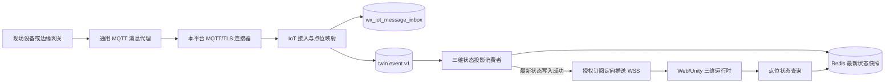

# IoT 三维状态投影设计说明

后端状态投影及查询已有实现，默认关闭。第 10 节为设备到三维实例的目标设计，报文字段与现场阈值在实现前确认。核对日期为 2026-11-11。
依据：IoT 遥测契约 `TwinTelemetryEvent`、主题 `twin.event.v1` 及 `wx-module-3d` 现有 Kafka、Redis、WebSocket 消费流程。

## 1. 目标与边界

三维服务独立消费标准遥测事件，保存每个租户、设备、点位的最新值，并提供带认证与权限校验的查询接口。当前实现为只读投影，定向推送见第 10 节。规则判断、告警、控制命令和历史时序存储另行规划。

新消费者位于 `wx-module-3d`，使用独立且稳定的消费组 `dimensions-iot-state-v1`，可通过环境配置覆盖。默认不启用，准备好依赖、主题和权限后再开启。

## 2. 现有契约与实现约束

`TwinTelemetryEvent` 已包含 `eventId`、`schemaVersion`、`eventTime`、`tenantId`、`sceneId`、`objectId`、`deviceId`、`pointCode`、`value`、`valueType`、`unit`、`quality`、`replay` 和 `traceId`。IoT 生产者目前以 `eventId` 作为 Kafka 消息键，因此同一设备点位的事件不保证进入同一分区或按设备顺序消费。

现有三维消费者将旧格式消息写入 Redis，并向 WebSocket 推送；它们不理解标准遥测契约。新投影必须独立实现，不能把新事件伪装成旧设备消息或覆盖旧 Redis 键。

事件绑定允许部分场景或对象信息为空，遥测请求也存在兼容兜底字段。因此投影主键必须使用明确的租户、设备和点位身份，不能仅依赖 `sceneId` 或 `objectId`。缺少必要身份的事件应记录可检索的拒绝原因，不得写入共享或跨租户状态。

## 3. 推荐状态模型

投影键按 `(tenantId, deviceId, pointCode)` 唯一确定。Redis 键为 `twin:iot-state:v1:{tenantId}:{设备编码}:{点位编码}`，设备和点位使用不带填充的 URL 安全 Base64 编码，避免分隔符歧义。哈希字段 `payload` 保存标准遥测快照，`version` 保存比较版本；不保存签名、凭据或外部平台原始请求。

更新必须具备幂等性和过期事件保护：

1. 同一 `eventId` 重复投递不得改变投影结果。
2. 只有比当前投影更新的 `eventTime` 才能覆盖当前值；较早的重放或迟到事件不回退最新状态。
3. 同一设备点位的事件时间相同时，取事件编号按 UTF-8 字节排序较大的事件，确保不同分区消费顺序下最终结果一致。该规则只是确定平局结果，不代表设备实际发生先后；未来有业务序号时再版本化扩展契约。
4. 以 `state-upsert.lua` 原子比较、写入并设置过期时间。秒和纳秒编码为定长字符串，避免 Lua 浮点数造成时间精度丢失。

当前实现通过原子版本比较处理跨分区乱序，无需变更 IoT 生产消息键。事件必须具有 `schemaVersion=1.0`、非负租户号、事件编号、设备编号、点位、事件时间和值类型；三个编号最长 256 个字符。事件时间超过消费端当前时间五分钟时隔离，避免错误远期时间阻挡后续更新。

状态默认从事件发生时间保留 24 小时，可配置为 1 秒至 365 天。迟到事件只使用剩余保留期；已超过保留期的事件直接忽略，即使缓存已淘汰，历史重放也不能将它恢复。重复和乱序事件不延长缓存保留期。该缓存用于最新状态，审计仍依赖 IoT Inbox 与 Kafka 保留策略。

## 4. 消费、失败和推送语义

- 使用固定消费组、关闭自动提交，并按记录确认。写入成功或明确忽略重复/过期事件后确认消费。
- 格式及契约错误直接进入 `twin.event.v1.dimensions.dlt` 隔离主题；Redis 等运行时错误间隔一秒重试两次，仍失败时隔离。
- 隔离主题按字符串保留原文及框架添加的来源主题、分区、偏移和异常头。使用全部副本确认与幂等生产；只有死信发送确认成功后才能完成错误处理。隔离失败继续保留待处理记录，不把日志输出视为处理成功。死信主题不能与源主题相同。
- Kafka 至少一次消费意味着写入后、确认前进程退出时可能再次处理。Redis 更新与推送都必须容忍重复。
- 当前三维服务的全量 WebSocket 广播不筛选租户，因此本阶段未调用该广播接口。后续推送需按已认证会话的租户、场景和订阅权限定向发送，并允许客户端通过查询接口恢复状态。

## 5. 查询接口与部署

接口：`GET /admin-api/dimensions/iot-state/get?deviceId=device-1&pointCode=temperature`。需要有效管理员身份和 `dimensions:iot-state:query` 权限。查询租户来自认证用户，参数和 `tenant-id` 请求头不能覆盖它；机器人及无租户身份会被拒绝。即使旧三维配置允许匿名路由或关闭租户拦截，服务层仍显式校验身份和权限。未收到或已过期的状态返回 `data=null`。

响应使用 `IotStateRespVO`，保留标准状态字段；`eventTime` 为 ISO 8601 字符串，保留纳秒。Kafka 解码使用与默认 JSON 生产者一致的时间语义，缓存也使用 ISO 时间字符串，数值通过 BigDecimal 保持精度。标准遥测事件已补齐无参构造，以支持不带 Web 构造参数模块的 Kafka 反序列化器。

| 环境变量 | 默认值 | 说明 |
|---|---|---|
| `IOT_STATE_ENABLED` | `false` | 三维服务中的投影及查询开关 |
| `IOT_STATE_CONSUMER_GROUP` | `dimensions-iot-state-v1` | 固定消费组，多实例共享 |
| `IOT_STATE_DLT_TOPIC` | `twin.event.v1.dimensions.dlt` | 隔离主题 |
| `IOT_STATE_TTL` | `24h` | 从事件发生时间计算的状态保留期 |

启用前创建源主题和隔离主题，并授予消费者读源主题、消费组访问和写隔离主题权限。消费端禁止自动建主题，源主题缺失时启动失败；隔离主题应按遥测数据敏感级别限制访问并配置保留期。Redis 使用现有三维服务连接，应用账号需支持哈希、脚本和过期命令。连接配置均沿用三维服务现有配置，不新增明文凭据。

新增容器工厂及死信生产资源使用独立字符串编解码。死信资源不以 `KafkaTemplate` 或 `ProducerFactory` 类型注册 Bean，避免让旧链路的 Spring Boot 自动配置退让；应用关闭时释放其生产者。

## 6. 后续推送契约草案

首版目标采用定向安全长连接（WSS），报文、快照和兼容边界见[设备到三维实例联动总体设计](#iot-model-binding)。

## 7. 监控与验收

当前消费者以调试日志记录主题、分区、偏移和是否更新，未主动记录遥测载荷。错误处理使用 Kafka 框架日志和隔离主题。专用业务计数器、延迟面板及 WebSocket 指标待后续补齐。

集成验收需覆盖：重复事件、乱序事件、相同时间戳、历史重放、Redis 写入失败、WebSocket 失败、跨租户读取/推送、消费组重启续读，以及旧三维任务消息回归。此前环境核验未发现可用的本机 Kafka Broker，本轮未连接实际 Kafka，不能宣称端到端验收通过。

## 8. 后续推送待冻结事项

1. 三端核对第 10 节的报文、绑定持久化和当前编辑器属性标识。
2. 确认安全长连接（WSS）的认证方式、订阅鉴权及权限撤销流程。
3. 如业务要求同一时间戳下的真实设备顺序，提供可验证的设备序号契约。
4. 按试点规模配置缓存保留期，并确认点位数量和容量监控。
5. 补齐实际 Kafka Broker、隔离主题及 ACL，完成真实消息系统验收。

以上事项确认后，继续开发租户与订阅范围内的推送。服务端当前态可先通过本阶段查询接口读取。

## 9. 本轮验证（2026-10-19）

- 标准 Kafka 编解码契约测试先复现无构造器错误，补齐无参构造后通过；现有 JSON 字段保持兼容。
- 新增 27 项测试：配置及完整组件装配 4 项、死信确认 2 项、版本排序及键隔离 4 项、投影编排 9 项、认证及租户查询 4 项、Redis 存储交互 3 项、Kafka 契约 1 项。
- 与现有 IoT 38 项测试一起运行，共 65 项通过、无失败、无跳过，Maven 构建成功。
- Redis 存储交互使用项目现有 Redisson 驱动，连接本机临时 FakeRedis 协议模拟服务并执行 Lua，覆盖 20 条并发乱序写入、重复消息不续期和身份损坏拒绝。临时模拟器的批量字符串响应编码已按 Redis 协议修正；测试没有连接实际 Redis 服务，不能代替部署环境兼容性验证。验证工具只放在系统临时目录，未加入工程依赖。
- Kafka 死信测试使用真实错误处理器和可控发送结果，未连接真实 Broker；未部署应用、创建远端主题或修改服务器。

使用 Redis 复核存储交互时，在 PowerShell 中指定测试主机和端口后运行下列命令。`IOT_STATE_TEST_REDIS_HOST` 省略时默认连接 `127.0.0.1`；测试仅写入和清理本用例的随机租户键，不执行清库操作。连接共享环境前必须确认账号权限和隔离窗口。

```powershell
$env:IOT_STATE_TEST_REDIS_PORT = '16379' # 填写已启动的本机专用测试 Redis 端口。
$env:IOT_STATE_TEST_REDIS_HOST = '127.0.0.1' # 148 环境联调时改为 192.168.10.148。
mvn -pl wx-module-3d,wx-module-iot/wx-module-iot-biz -am test '-Dtest=Iot*Test' '-Dsurefire.failIfNoSpecifiedTests=false' '-DskipTests=false'
Remove-Item Env:IOT_STATE_TEST_REDIS_PORT
Remove-Item Env:IOT_STATE_TEST_REDIS_HOST
```

未提供测试端口时，三个 Redis 存储交互用例会明确跳过，其余用例仍可执行。

<a id="iot-model-binding"></a>

## 10. 设备到三维实例联动总体设计（2026-11-11）

### 10.1 目标与明确边界

本节把管理端的设备绑定扩展为可验收的三维联动合同：外部设备上报经过绑定和点位换算后，按租户、场景、实例对象和点位送达三维运行时，驱动实例属性或表现变化。

消息系统（Kafka）分发标准事件，状态缓存（Redis）保存最新快照。三维服务向已认证会话定向推送，客户端进入场景、重连或发现同步中断时读取快照。现有管理页面维护连接器、设备绑定和接收记录，场景编辑器维护实例的数据源配置。

### 10.2 端到端链路



接入服务先持久化接收记录（Inbox），随后发布标准遥测。接收记录中的 `PUBLISHED` 表示 Kafka 已确认，三维状态更新需另查消费者和 Redis 证据。首版采用网关后端的定向 WSS，由网页运行时按场景会话管理连接，并通过现有引擎适配层交给 Unity。单推送实例先验证端到端路径，多实例部署前再验各会话所属节点都能收到更新，共享消费组本身只会把每条记录交给组内一个消费者。

### 10.3 绑定合同

| 归属 | 标识及规则 |
|---|---|
| 物联网管理 | 用当前租户下的 `connectorId + externalDeviceId` 查找有效设备绑定。绑定将外部设备及原始点位转换成内部 `deviceId + pointCode`。现有 `pointMappingJson` 继续保存原文并做精确十进制换算。 |
| 编辑器实例 | 在模型实例的数据页选取已授权设备和标准点位，再选择该实例的可绑定属性。用 `sceneId + objectId + propertyId` 定位目标，`propertyId` 代表现有属性系统的稳定标识，具体路径在合同确认时复用项目已有定义。 |
| 场景保存 | 设备引用与现有实例设备编号保持同一来源，点位到属性的规则随场景草稿保存和重开。已有场景若只填了设备编号，保留该值，配置目标属性后才生成订阅。 |
| 运行时 | 以 `tenantId + deviceId + pointCode` 获取数据，按场景会话中的 `objectId + propertyId` 应用。多个目标可共享一份源状态，同名实例、同名点位按编号隔离。实时值进入运行态，不回写草稿。 |

例如设备 `pump-01` 的 `temperature` 点位可以驱动场景中泵实例的温度属性。管理端已有的 `sceneId/objectId` 可继续随事件提供定位信息，编辑器保存的绑定决定实际目标。服务端校验租户、场景及设备读取权限，编辑器校验目标属性存在且类型匹配。

编辑器解绑或删除来源时立即取消该目标的订阅并丢弃旧代次结果。管理端停用或换绑时，三维服务须使相关订阅失效，重新查询和应用状态时核对当前有效绑定。当前 Redis 键未区分绑定代次，`mappingRevision` 也不能单独证明绑定仍有效。实现时须按有效绑定身份和代次过滤快照及推送，并覆盖同编号重绑、旧事件晚到和旧缓存命中。

### 10.4 三维状态更新合同

以下为待确认的独立推送报文示例。查询与推送复用状态字段，现有单点查询继续按第 5 节提供：

```json
{
  "type": "IOT_STATE_UPDATE",
  "schemaVersion": "1.0",
  "eventId": "3a21226a-04e3-31af-aad9-8e74f93803f3",
  "subscriptionId": "订阅编号",
  "sceneId": "scene-1",
  "objectId": "object-1",
  "deviceId": "device-1",
  "pointCode": "temperature",
  "value": 23.5,
  "valueType": "NUMBER",
  "unit": "°C",
  "quality": "GOOD",
  "eventTime": "2026-11-11T08:00:00Z",
  "receivedAt": "2026-11-11T08:00:00.120Z",
  "asOf": "2026-11-11T08:00:00.150Z",
  "staleAt": "2026-11-11T08:00:06Z",
  "ageMs": 150,
  "freshness": "FRESH",
  "stateVersion": "31557015961603200000000000:3a21226a-04e3-31af-aad9-8e74f93803f3",
  "bindingGeneration": "3",
  "mappingRevision": "v3",
  "replay": false,
  "traceId": "链路编号"
}
```

`receivedAt` 取接入服务首次持久接收时间，当前推送和查询尚未提供该字段。服务端取 `asOf` 作为评估时刻，计算非负 `ageMs`。同一数据源和绑定代次内，`stateVersion` 沿用第 3 节的定长编码及字节排序，保留纳秒精度。租户来自认证身份。线上延迟按接收、发布确认、状态写入、推送接收、画面应用分别记录，通过事件编号关联。跨主机采样需记录时钟同步状态，单条成功只用于定位链路。

### 10.5 时效与过期

现有 `IOT_STATE_TTL` 默认 24 小时，是 Redis 快照保留期，不是实时新鲜度承诺。投影仍按以下规则运行：事件时间超过服务端未来五分钟直接拒绝；早于当前时间减 `stateTtl` 的事件不写入；重复或旧事件不刷新过期时间。

按实际设备周期设定点位的新鲜度阈值，试点同时登记允许抖动。服务端给出 `staleAt = eventTime + staleAfter`，客户端根据服务端时间与单调时钟推进，在没有新消息时也能到期降级。断开时标记连接不可用，恢复后按新快照重新判定。缺值、陈旧、连接不可用各有独立状态，设备上报的质量码（`quality`）单独保留。上线前用代表性负载测量端到端延迟中位数和第 95 百分位（P95），再确定验收阈值。

### 10.6 三维订阅生命周期

进入场景或重连后先注册订阅，收到订阅确认后读取快照。查询在途时继续接收推送，按数据源只暂存最新版本，快照和推送统一按服务端提供的可比较版本合并，避免较晚到达的快照覆盖新值。缓冲超限或服务端指示失步时重新读取快照。共享同一来源的实例复用订阅，最后一个目标退出时释放订阅。

切场景、解绑或取消加载时先推进场景或绑定代次，再注销订阅、取消查询和清理回调。运行时应用任何结果前核对当前代次、有效绑定和事件版本。推送为尽力交付，Redis 写入成功后进程退出可能漏推，使用重连查询与有界的周期对账恢复，不依赖重复投递触发推送。

### 10.7 权限与故障边界

- 查询和推送均以认证身份确定租户，禁止使用请求头或客户端字段覆盖租户。
- 现有单点查询为后台权限接口。三维快照和推送共用场景、对象及设备范围校验，建立订阅和权限撤销时重新校验。公开预览的遥测授权单独评审，首版只开放已认证场景。
- Kafka 重复、跨分区乱序和相同时间戳由 Redis 原子版本比较处理；推送层也必须允许重复而不重复创建对象。
- Redis 不可用时不能伪造实时成功；推送层应报告不可用并允许之后查询恢复。
- WebSocket 断开、容器重启和消费组重平衡后，必须通过查询补偿，不要求客户端猜测丢失区间。
- 任何错误日志不得包含凭据、原始报文或完整敏感字段。

### 10.8 联动验收出口

联动实现至少需要以下证据：唯一事件编号、绑定版本、场景/对象/点位编号、接入时间、Kafka topic/分区/偏移、Redis 快照、推送到达时间、Unity 画面变化和释放结果。重复、乱序、过期、解绑、来源删除、断线恢复及跨租户拒绝必须分别留证。

实施顺序和取证要求见[六层验收与里程碑计划](../plan/02_IoT服务进度与后续计划.md#iot-acceptance-plan)。
