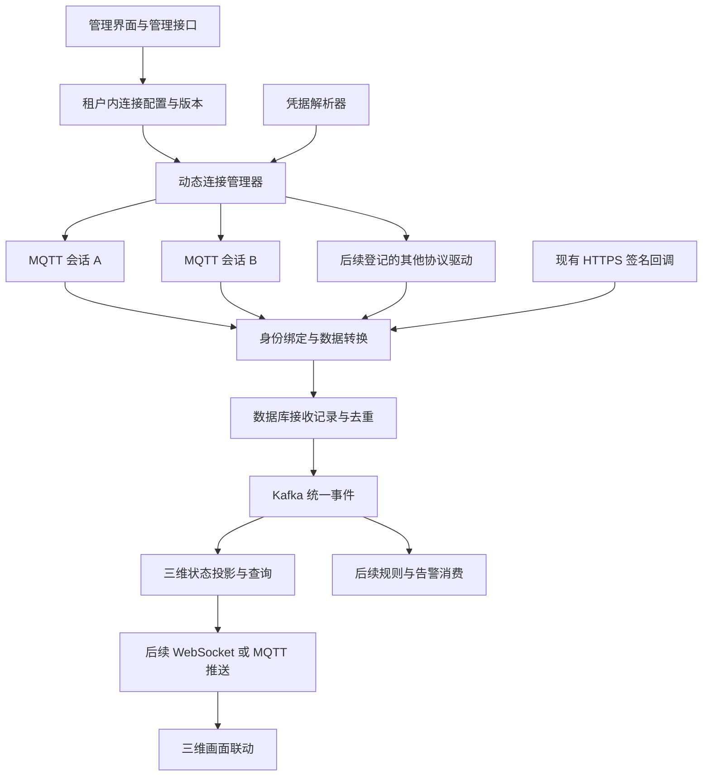

# IoT 动态多连接接入方案与里程碑

核对日期：2026-10-19。状态：增量设计，尚未实现动态多连接运行时。

## 1. 结论与范围

将现有 IoT 服务逐步建设为可配置的数据接入层：管理员创建多个连接器，同一工作进程按授权租户范围动态发现并运行多个连接，统一完成身份绑定、字段转换、可靠接收和事件分发。多个连接器可以连接不同的消息代理（Broker），也可以使用同一代理上的不同账号和主题。

首个增量实现同一部署租户内的动态多 MQTT 连接，保留现有单连接部署模式。随后增加凭据动态轮换、管理页面、跨租户工作分配以及三维实时推送。不同运行模式互斥，避免新旧管理器同时接管一个连接器。

协议驱动由代码实现并登记，连接地址、主题和映射由管理配置决定；新协议通过新增驱动接入。首版沿用消息队列遥测传输协议（MQTT）3.1.1，不把动态配置扩大为任意代码、脚本上传或 MQTT 5.0 支持。

## 2. 总体结构

已有签名回调继续按请求路径定位连接器，无需为每个 HTTPS 连接器建立长连接。当前接收记录（Inbox）不是独立消息队列；事件发布仍由既有遥测服务编排，图中箭头表示处理顺序。

## 3. 配置分层

| 层次 | 主要配置 | 当前基础与增量 |
|---|---|---|
| 协议驱动 | 驱动标识、支持版本、配置校验规则 | 已有 MQTT/HTTPS/模拟入口，统一驱动登记待补 |
| 连接器 | 租户、业务编号、协议、地址、凭据引用、启停、版本 | 已有数据库实体和管理接口，多会话发现及有效版本待补 |
| MQTT 会话 | 确切主题、传输质量等级（QoS）、会话参数 | 当前仅支持 QoS 1 和固定会话策略；扩展项必须经驱动验证 |
| 报文适配 | 外部设备、点位、数值、时间及追踪号的提取规则 | 当前只接受通用单点 JSON，厂商字段提取及批量拆点待实现 |
| 设备与点位绑定 | 内部设备、场景、对象、类型、单位、量程换算、映射版本 | 已有绑定及基础换算，版本追踪需继续完善 |
| 运行资源 | 租户授权范围、最大连接数、并发建立数、扫描批次、超时 | 当前是指定租户与单个连接器，动态管理需增加有界资源配置 |

连接器配置描述外部系统会话，设备绑定描述该系统中的设备身份。不同连接器上的同名外部设备仍以“租户 + 连接器 + 外部设备编号”区分。

首个增量维持现有通用报文和确切主题约束，不把多连接与厂商报文适配同时重构。后续字段提取采用受限的声明式规则，经样例预览和校验后发布，继续使用现有点位换算链路。

## 4. 动态管理流程

### 4.1 发现与配置版本

1. 管理接口保存时先调用已登记驱动验证配置；无效配置不成为运行版本。
2. 配置更新采用递增版本和并发条件更新，防止同时编辑覆盖。现有 `version` 字段目前只有创建初值，尚未形成配置发布或运行版本机制。
3. 管理器在明确的授权租户内分批读取连接配置，比较期望版本与实际会话版本。初期采用周期核对，可增加变更通知降低延迟，周期核对仍用于补偿漏通知。
4. 删除、停用、租户失效时停止会话；新增且启用的连接器在容量允许时取得租约并启动。
5. 若未来一个进程服务多个租户，先通过可信工作分配获得允许的租户列表，再逐租户查询。禁止直接绕过租户拦截器全表扫描。

### 4.2 会话与变更切换

会话以“租户 + 不变的连接器主键”登记，携带配置版本、运行代次及租约令牌。连接器业务编号改名需检查既有绑定引用；首版优先限制已使用连接器改名，具体兼容处理在实现时确定。

配置变化先做结构和凭据可解析性验证；真实网络连通、认证和订阅结果只能在连接时确认。首版切换顺序为暂停旧会话接收、关闭旧会话、建立新版本会话，不承诺无中断。新连接失败时保留失败版本与错误摘要，进入退避；凭据撤销、停用和权限收紧不自动恢复旧配置。

MQTT 持久会话与客户端编号策略必须单独定义。现有实现按配置指纹改变客户端编号，多连接改造首版先保持该行为：配置变化产生的新会话不会自动继承旧会话积压，需明确旧会话排空或运维隔离策略。后续若采用稳定客户端编号，必须处理旧订阅删除与权限变化。不能同时宣称任意切换、无重复、无丢失和零中断。

相同配置的重启继续使用原客户端编号；每个会话保持 Inbox 持久接收后手动确认，重复投递继续使用事件编号去重。

### 4.3 故障隔离与资源上限

- 每个连接器独立保存连接状态、退避时间和错误摘要，一个代理故障不阻塞其他连接的配置核对。
- 定时核对和租约续期不执行阻塞网络建连；建连、订阅及关闭放入有上限的执行器，拒绝无限排队。
- 每实例、每租户连接总量和并发建连数设上限；实际值通过试点规模和压测确定。计入 MQTT 客户端自身线程、套接字及缓冲开销，不仅统计管理器线程数。
- 回调不引入无限本地队列。慢数据库、慢 Kafka、无效报文分别维持既有确认和持久接收边界。
- 实例退出时停止发现、使会话代次失效、关闭客户端，最后释放自己的租约。旧回调不得凭新一轮续租恢复确认资格。
- 租约仅允许持有对应令牌的实例续期、释放；运行状态回写同时校验配置版本和运行所有权，避免迟到更新覆盖新实例。

### 4.4 凭据

先抽出统一凭据解析接口，兼容当前环境变量引用。环境变量模式下，新增凭据仍需要部署注入，不能算后台全动态；轮换后的生效方式必须显式说明。

完整后台配置阶段接入已有可用的密钥服务，或经单独设计的加密存储：业务表仅保存引用，接口不回显密码，主密钥不与密文同表保存；凭据版本变化触发受控重连及审计。具体存储实现需核实部署基础设施后选择，当前没有实现证据。

## 5. 管理端交付

目标页面包含连接器列表、创建编辑、协议参数表单、启停、配置验证、受限连接测试、运行状态和失败记录入口。当前已有部分管理接口，没有核验到完整管理页面的交付证据。

运行状态展示区分“管理员期望启用”和“实际连接状态”，至少包括配置版本、运行版本、所属实例、最近连接时间、最近消息时间和脱敏错误摘要。网络测试、状态字段和指标接口需要单独实现，不能把现有 `CONNECTED` 当作设备业务健康证明。

网络目标受部署出口策略约束，配置与连接测试使用同一地址校验和访问权限。保存与连通测试分开，避免后台请求被慢代理长期占用。

## 6. 分阶段交付与验收

| 阶段 | 交付内容 | 完成标准 | 当前状态 |
|---|---|---|---|
| M0 基础能力 | 连接配置、绑定、通用上行、Inbox、Kafka 发布、三维状态投影 | 本地编译及定向回归通过，列明真实依赖缺口 | 主要代码已实现，真实依赖待验收 |
| M1 动态多 MQTT | 授权租户内动态发现、多会话、版本、资源上限、隔离退避 | 同进程至少两个连接独立工作；新增、变更、停用无需重启；单连接故障不影响另一个；失租约和旧回调受控 | 下一开发重点 |
| M2 管理与凭据 | 管理页面、配置验证、连接测试、凭据解析与安全轮换、运行健康 | 页面操作可追踪到运行结果；秘密不回显；凭据变更按版本生效；旧配置不能覆盖新状态 | 待实现，凭据接口基础可随 M1 补齐 |
| M3 上行与三维闭环 | 实际 MQTT、数据库、Kafka、Redis 联调；三维推送及画面联动 | 上报能更新正确租户的正确对象；重复、乱序、重启、断线恢复及跨租户负向用例通过 | 投影已有代码，其余待完成 |
| M4 规则和控制 | 独立规则消费、告警、命令幂等、回执、超时和审计 | 重复消息不重复告警或执行命令；传输确认与设备执行结果可区分 | 待实现 |
| M5 扩展与运维 | 厂商报文、第二平台、边缘协议、容量、配额和恢复 | 按真实平台契约验收，给出容量及故障恢复证据 | 待实际需求与后续实施 |

M1 开发期间即可并行准备实际 Broker、Kafka、数据库账号和样例，先验证 M0 单连接链路。跨租户工作分配、MQTT 5.0、工业边缘协议和长期时序存储按需求排期，不挤入首个多连接增量。

## 7. 进度与验证口径

按原有整体范围加上动态多连接要求，当前仍采用“整体约 40%”的粗略工程估算，不能由通过测试的数量推算完成率。“上行到三维展示主线约 65%”仅是此前代码工作量估算，不代表实时画面联动已交付。后续主要按 M0—M5 的验收结果汇报，避免两个百分比混用。

最近一次代码回归为 2026-10-19：IoT 68 项通过，三维投影 24 项通过、3 项 Redis 交互用例因未指定本机专用端口跳过；合计 92 项通过，失败和错误均为零。MQTT 套接字测试使用真实 Paho 客户端和协议替身，仍缺完整 Broker、持久化、权限、证书及重投验收。动态多连接设计没有被这批测试覆盖。

本设计仍处于待实施状态。本次文档归类时已将前序单连接 MQTT 与三维投影代码单独提交并复跑回归，范围见[版本验证记录](../records/01_20261019提交与验证记录.md)；没有实现动态多连接，也未部署服务。

## 8. 关联文档

- [总体规划](02_数字孪生物联网接入系统设计规划.md)：长期服务边界、事件、规则及命令设计。
- [当前进度](../plan/02_IoT服务进度与后续计划.md)：当前状态总表与历史实施记录。
- [MQTT 首版联调](../guides/01_MQTT上行接入与联调.md)：已实现的单连接部署模式和报文契约。
- [三维状态投影](04_IoT三维状态投影设计说明.md)：已实现的消费、存储、查询和验证范围。
