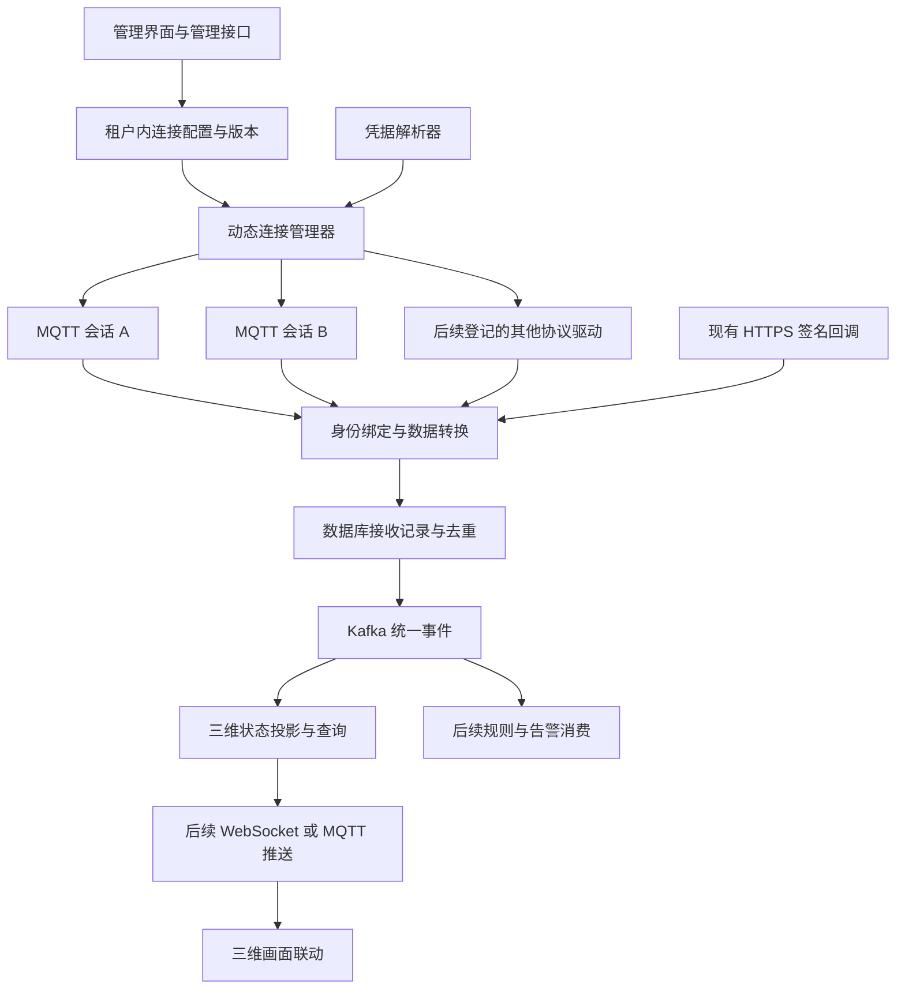

# IoT 动态多连接接入方案与里程碑

设计更新日期：2026-11-10。动态多连接、管理接口及Redis的历史证据保留；实际状态见[IoT 专项台账](../plan/02_IoT服务进度与后续计划.md)。按用户要求优先后端接口及网页，当前已实施首批代码并完成隔离验证；实际服务部署、网关及账号联验待完成，完整上行和三维后置。

## 1. 结论与范围

将现有 IoT 服务逐步建设为可配置的数据接入层：管理员创建多个连接器，同一工作进程按授权租户范围动态发现并运行多个连接，统一完成身份绑定、字段转换、可靠接收和事件分发。多个连接器可以连接不同的消息代理（Broker），也可以使用同一代理上的不同账号和主题。

首个增量已实现同一部署租户内的动态多 MQTT 连接，保留现有单连接部署模式。当前优先收口后端管理接口和网页管理端；完整凭据安全轮换与增强观测后续补齐，跨租户工作分配以及三维实时推送继续单独验收。不同运行模式互斥，避免新旧管理器同时接管一个连接器。

协议驱动由代码实现并登记，连接地址、主题和映射由管理配置决定；新协议通过新增驱动接入。首版沿用消息队列遥测传输协议（MQTT）3.1.1，不把动态配置扩大为任意代码、脚本上传或 MQTT 5.0 支持。

## 2. 总体结构

已有签名回调继续按请求路径定位连接器，无需为每个 HTTPS 连接器建立长连接。当前接收记录（Inbox）不是独立消息队列；事件发布仍由既有遥测服务编排，图中箭头表示处理顺序。

## 3. 配置分层

| 层次 | 主要配置 | 当前基础与增量 |
|---|---|---|
| 协议驱动 | 驱动标识、支持版本、配置校验规则 | 已有 MQTT/HTTPS/模拟入口，MQTT 保存与运行时共用参数校验；跨协议统一驱动登记待补 |
| 连接器 | 租户、业务编号、协议、地址、凭据引用、启停、版本 | 已有多会话发现、版本条件更新及运行所有权；完整管理页面待补 |
| MQTT 会话 | 确切主题、传输质量等级（QoS）、会话参数 | 当前仅支持 QoS 1 和固定会话策略；扩展项必须经驱动验证 |
| 报文适配 | 外部设备、点位、数值、时间及追踪号的提取规则 | 当前只接受通用单点 JSON，厂商字段提取及批量拆点待实现 |
| 设备与点位绑定 | 内部设备、场景、对象、类型、单位、量程换算、映射版本 | 已有绑定及基础换算，版本追踪需继续完善 |
| 运行资源 | 租户授权范围、最大连接数、并发建立数、扫描批次、超时 | 已有同租户动态模式、连接容量、控制/建连并发和游标批次限制 |

连接器配置描述外部系统会话，设备绑定描述该系统中的设备身份。不同连接器上的同名外部设备仍以“租户 + 连接器 + 外部设备编号”区分。

首个增量维持现有通用报文和确切主题约束，不把多连接与厂商报文适配同时重构。后续字段提取采用受限的声明式规则，经样例预览和校验后发布，继续使用现有点位换算链路。

## 4. 动态管理流程

### 4.1 发现与配置版本

1. 管理接口保存时先调用已登记驱动验证配置；无效配置不成为运行版本。
2. 配置编辑和实际启停变化均递增版本，采用并发条件更新；新客户端编辑时应提交查询版本，旧客户端省略时只提供服务端读写窗口内的并发保护。重复启停不修改版本。当前版本是生效配置版本，尚无独立草稿发布页面。
3. 管理器在明确的授权租户内分批读取连接配置，比较期望版本与实际会话版本。初期采用周期核对，可增加变更通知降低延迟，周期核对仍用于补偿漏通知。
4. 删除、停用、租户失效时停止会话；新增且启用的连接器在容量允许时取得租约并启动。
5. 若未来一个进程服务多个租户，先通过可信工作分配获得允许的租户列表，再逐租户查询。禁止直接绕过租户拦截器全表扫描。

### 4.2 会话与变更切换

会话以“租户 + 不变的连接器主键”登记，携带配置版本、运行代次及租约令牌。连接器业务编号创建后不可修改，避免破坏绑定、租约和持久会话引用；展示名称可修改。

保存和启用时校验结构；凭据解析在实际建连前完成，不在管理接口读取秘密。真实网络连通、认证和订阅结果只能在连接时确认。首版切换顺序为暂停旧会话接收、关闭旧会话、建立新版本会话，不承诺无中断。新连接失败时保留失败版本与错误摘要，进入退避；凭据撤销、停用和权限收紧不自动恢复旧配置。

MQTT 持久会话与客户端编号策略必须单独定义。现有实现按配置指纹改变客户端编号，多连接改造首版先保持该行为：配置变化产生的新会话不会自动继承旧会话积压，需明确旧会话排空或运维隔离策略。后续若采用稳定客户端编号，必须处理旧订阅删除与权限变化。不能同时宣称任意切换、无重复、无丢失和零中断。

相同配置的重启继续使用原客户端编号；每个会话保持 Inbox 持久接收后手动确认，重复投递继续使用事件编号去重。

### 4.3 故障隔离与资源上限

- 每个连接器独立保存连接状态、退避时间和错误摘要，一个代理故障不阻塞其他连接的配置核对。
- 定时核对和租约续期不执行阻塞网络建连；建连、订阅及关闭放入有上限的执行器，拒绝无限排队。
- 每实例、每租户连接总量和并发建连数设上限；实际值通过试点规模和压测确定。计入 MQTT 客户端自身线程、套接字及缓冲开销，不仅统计管理器线程数。
- 回调不引入无限本地队列。慢数据库、慢 Kafka、无效报文分别维持既有确认和持久接收边界。
- 实例退出时停止发现、使会话代次失效、关闭客户端，最后释放自己的租约。旧回调不得凭新一轮续租恢复确认资格。
- 租约仅允许持有对应令牌的实例续期、释放；运行状态回写同时校验配置版本和运行所有权，避免迟到更新覆盖新实例。

### 4.4 凭据

已抽出统一凭据解析接口，默认实现兼容当前环境变量引用。环境变量模式下，新增凭据仍需要部署注入，不能算后台全动态；轮换后的生效方式必须显式说明。

完整后台配置阶段接入已有可用的密钥服务，或经单独设计的加密存储：业务表仅保存引用，接口不回显密码，主密钥不与密文同表保存；凭据版本变化触发受控重连及审计。具体存储实现需核实部署基础设施后选择，当前没有实现证据。

## 5. 管理端交付

目标页面包含连接器列表、创建编辑、协议参数表单、启停、配置验证、受限连接测试、运行状态和失败记录入口。当前已有增删改查、启停、分页、MQTT 草稿预校验、数据库运行快照和隔离连接测试接口，具体契约见[管理接口指南](../guides/04_IoT连接器管理接口.md)；完整管理页面尚未交付。

运行状态展示目标区分“管理员期望启用”和“实际连接状态”，包含配置版本、运行版本、所属实例、最近连接时间、最近消息时间和脱敏错误摘要。当前首批接口仅观测数据库配置、历史状态及租约；过期租约不再按历史 `CONNECTED` 展示，SINGLE 无数据库所有者时标为未观测。运行版本、实例和消息时间等仍待实现，数据库快照也不能作为网络主动探测或设备业务健康证明。

网络目标受部署出口策略约束，配置与连接测试使用同一地址校验和访问权限。保存与连通测试分开，避免后台请求被慢代理长期占用。

### 5.1 首批后端与网页交接设计

首批围绕连接器、设备绑定/点位映射、接收记录三个管理入口，复用当前 Web 工程的布局、表格、表单、请求层和认证能力。后端复用三个已有控制器及服务，不新增另一套物联网管理主数据，也不把模拟上报入口包装为真实设备链路。

连接器页面先使用分页、详情及版本化编辑，运行快照只在选中详情时按需读取；列表不逐行轮询，也不为页面上线新增实时推送。设备绑定已有 list 和增改删查，首批需要分页时在数据库补有界分页，不在浏览器全量截取。映射表单仅编辑后端已支持的参数，非法类型、单位和换算数值由前后端共同校验，后端负责最终拒绝。

接收记录页面复用已有分页和人工重放，失败摘要脱敏；无 Kafka 或不具备重放权限时不得显示假成功。连接测试只针对当前租户已保存配置，保持超时和资源上限，结果不能覆盖正式会话运行状态。页面读取配置不回显秘密，不新增任意外部 URL 探测能力。

响应沿用当前工程 `CommonResult` 业务成功码 200；网页请求层的封套、租户头、权限来源、编号精度和日期序列化在 IOT-M2-01 核对后冻结。独立业务编号与数据库主键不能混用，不能按小数值示例假定浏览器数字类型总是安全。

第一批只使用已注入的凭据引用，页面展示引用及可解释的可用性限制，不保存明文密码；缺少凭据是受控失败状态。安全后台新增/轮换仍按第 4.4 节设计和后续子项交付，不将这一限制隐瞒为全动态凭据管理。

页面及接口开发不依赖完整 MQTT→Kafka→三维画面链路。首批验收仍需要真实数据库、认证、网关和适用动作的真实依赖；缺少 Broker/Kafka 时，可以推进其他功能，但对应连接测试/重放子项不冒充已验。具体执行顺序、状态和退出条件见[专项第 4.1～4.3 节](../plan/02_IoT服务进度与后续计划.md#41-首批交付后端接口与网页管理端)。

网页落点为现有Web工程，见[IoT设计](../../../../Web/web-unity/docs/design/01_IoT管理界面设计.md)。当前三个模块统一接入标准授权menus，后端控制层级、名称、排序与可见范围，前端映射编译白名单；资源/场景不再保留静态入口。NAV-01 [统一设计](../../../../Web/web-unity/docs/design/02_管理导航统一设计.md)覆盖原过渡方案。实际角色、租户套餐与菜单配置需部署前核对，菜单隐藏不能替代接口授权。

## 6. 分阶段交付与验收

| 阶段 | 交付内容 | 完成标准 |
| --- | --- | --- |
| M0 基础能力 | 连接配置、绑定、通用上行、Inbox、Kafka 发布、三维状态投影 | 本地回归及适用真实上行、去重、错误恢复和租户负向用例通过，不只列缺口 |
| M1 动态多 MQTT | 授权租户内动态发现、多会话、版本、资源上限、隔离退避 | 真实双连接独立工作；新增、变更、停用无需重启；单连接故障、失租约和旧回调受控 |
| M2 管理与凭据 | 优先交付后端接口及网页管理；后续补完整安全轮换与增强观测 | 首批真实页面和接口闭环、权限及版本冲突通过；完整 M2 仍需秘密不回显、轮换生效和旧状态防护 |
| M3 上行与三维闭环 | 管理端之后完成真实 MQTT、数据库、Kafka、Redis；再补推送及画面 | 上报更新正确租户对象；重复、乱序、重启、断线恢复及跨租户负向用例通过 |
| M4 规则和控制 | 独立规则消费、告警、命令幂等、回执、超时和审计 | 重复消息不重复告警或执行命令；传输确认与设备执行结果可区分 |
| M5 扩展与运维 | 厂商报文、第二平台、边缘协议、容量、配额和恢复 | 按真实平台契约验收，给出容量及故障恢复证据 |

本表只维护范围与完成标准，不重复登记执行状态；当前主状态和 M2 子项以专项台账为准。首批管理端的准备可使用已实现的 M0/M1 配置和身份服务，不等待 M0/M1 全部外部故障验收，但数据库结构和权限前置不能跳过。

M1 开发期间即可并行准备实际 Broker、Kafka、数据库账号和样例，先验证 M0 单连接链路。跨租户工作分配、MQTT 5.0、工业边缘协议和长期时序存储按需求排期，不挤入首个多连接增量。

## 7. 进度与验证口径

2026-10-19 的“整体约 40%”保留为历史粗估；不将测试增量换算为完成率。“上行到三维展示主线约 65%”仅是此前代码工作量估算，不代表实时画面联动已交付。当前按专项台账的执行主状态及代码/真实联调/业务验收程度汇报，管理端优先安排不改变旧证据的日期和覆盖范围。

历史代码基线为 2026-10-19：IoT 68 项通过，三维投影 24 项通过、3 项 Redis 交互用例因未指定本机专用端口跳过；合计 92 项通过，失败和错误均为零。MQTT 套接字测试使用真实 Paho 客户端和协议替身，仍缺完整 Broker、持久化、权限、证书及重投验收。该历史批次未覆盖当时尚未实现的动态多连接；当前 M1 已新增 32 项测试，联合回归 124 项通过、3 项跳过，详见本轮记录。

2026-10-20 已实现管理器、异步多会话、版本更新及数据库所有权防护。当前结果和限制见[本轮验证记录](../records/03_20261020动态多连接验证记录.md)。先前 2026-10-19 结果为历史基线，不能覆盖本轮改动；本轮未部署服务。

## 8. 关联文档

- [总体规划](../10_专项设计/02_物联网接入设计.md)：长期服务边界、事件、规则及命令设计。
- [当前进度](../plan/02_IoT服务进度与后续计划.md)：当前状态总表与历史实施记录。
- [MQTT 首版联调](../guides/01_MQTT上行接入与联调.md)：已实现的单连接部署模式和报文契约。
- [三维状态投影](04_IoT三维状态投影设计说明.md)：已实现的消费、存储、查询和验证范围。

## 9. 已落地的运行边界（2026-10-20）

- 默认 SINGLE；显式选择 DYNAMIC 时连接器编号必须留空，管理器只扫描部署租户。单实例默认容量 64、建连并发 4、控制并发 4、扫描批次 32，超额连接不入无界队列。
- 运行所有权同时使用 Redis 令牌和数据库期限。数据库运行状态更新要求当前版本、当前令牌及未过期期限；过期认领或版本变化会关闭旧代次。它们不能组成跨系统原子事务，业务仍需 Inbox 幂等。
- 两种模式不混合滚动部署；旧库须先执行 `wx-module-iot/db/iot-connector-runtime-migration.sql`。该实体表变更对关闭 MQTT 的服务也有效，新库使用最新建表脚本。
- 配置指纹变化的新客户端会话不继承旧积压；目前保留运维隔离/清理边界。已注入环境凭据可用于动态新增连接器，环境本身的秘密新增与轮换仍需部署操作。
- 多实例目前协调同一租户内前 N 个连接器，不实现跨实例均衡分片。容量、网络故障、数据库期限与大规模停机预算需真实依赖验收。

配置变量、启用步骤及数据库迁移顺序见[联调指南](../guides/01_MQTT上行接入与联调.md)。

## 10. 双机部署冻结（2026-11-11）

用户确认采用每机Docker Compose及统一发布脚本，不安装Kubernetes。246承载前端/IoT应用，148保留认证、MySQL、Redis、资源及三维；当前仅一个有效IoT运行实例，MQTT仍关闭。节点角色明确配置，不将Compose描述为跨机自动调度器；未来控制平面高可用另行设计。

246现有20逻辑CPU、约32GB内存及大容量数据盘，保留植被API/worker/Redis（已占48095）和原生48094服务；不修改其Compose、卷或网络。数据和制品写入`/home`，不再挤占148系统盘。SELinux及防火墙保持开启。

跨机初版采用可审计的受限SSH通道，避免直接暴露原本仅回环的认证RPC/Redis端口：246仅本地绑定14881→148的48081、14880→16380、13316→3306、14825→12525；反向仅允许148回环48097→246回环48096，以保持148原12525/9447公共地址。节点密钥在246生成，148公钥授权限制来源IP、允许的端口及禁止交互执行，主机公钥经现有可信连接核验，不跳过主机校验。

IoT使用仅限既有隔离库三张IoT表的独立SQL账号；只传输必需的数据库/Redis环境字段，不复制管理员身份文件、全量环境或旧私钥。配置保留标准身份、租户、方法权限及长小数原文规则；不改变业务合同或新建数据库。通道由systemd保活，应用由独立Compose项目管理，依赖故障显式失败，不伪报运行成功。

246前端使用同一固定静态包及独立证书，先在回环候选入口验证，再公开246管理入口。用户补充Unity当前使用148:12525后，本批调整为仅将148:9447新管理端的IoT精确代理接向48097通道，不重启或改写12525，不停止其原IoT；两节点管理进程访问同一三表且MQTT均关闭，不声称已实现设备会话多活。旧实例停机和12525迁移待Unity固定构建验收收口后单独实施。

148前端精确代理与原Nginx配置逐项对比并保存回退快照，失败恢复本批配置，不回滚数据、不改`/threeWeb/`及旧公共接口路径。246通道由systemd保持运行，两容器由独立Compose项目管理；这不等同跨机自动调度或数据高可用。实际主机故障迁移、Broker/Kafka与设备恢复另行验收。
