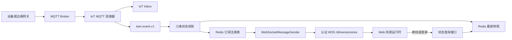

# IoT 定向 WebSocket 推送交付设计

## 1. 交付结论

前端不直接连接 MQTT。MQTT 由 IoT 服务通过连接器接入，标准遥测事件进入 Kafka，三维服务完成 Redis 最新状态投影，再通过已认证 WebSocket 向已授权会话推送状态更新。

首版复用三维服务现有 WebSocket 端点 `/dimensions/ws`、登录握手拦截器和 `WebSocketMessageSender`。新增 IoT 专用消息类型和订阅注册表，不复用旧的任务广播消息，也不把遥测事件伪装成旧业务消息。

## 2. 链路和职责



IoT 连接器负责设备协议、身份绑定、点位换算和 Kafka 发布。状态投影负责幂等、乱序保护、TTL 和死信。订阅服务负责租户、场景、设备和点位范围校验。Web 运行时负责订阅生命周期、版本合并和断线补偿。

## 3. WebSocket 认证和权限

连接地址沿用 `/dimensions/ws`。前端握手时携带现有访问令牌，框架通过 `LoginUserHandshakeInterceptor` 把认证用户写入会话。服务端从会话身份读取用户编号、用户类型和租户编号，不接受客户端提供的租户头覆盖会话租户。

订阅请求需要：

- 有效的管理员租户身份
- `dimensions:iot-state:subscribe` 权限
- 对场景的读取权限
- 对设备绑定和点位的读取权限

查询接口继续使用 `dimensions:iot-state:query`。订阅权限独立于查询权限，便于后续允许用户读取快照但禁止建立持续推送。订阅建立、续期和每次绑定变更都重新执行租户与范围校验。

## 4. 消息帧

订阅与场景运行时快照查询以已保存场景中的实例数据源为依据。配置保存后才能订阅，服务端核对场景归属、实例编号及点位，并只分发场景和实例与订阅一致的标准事件。无场景参数的原有管理查询仍使用独立查询权限。Unity 通过现有对象更新接口接收运行态显隐和变换，运行态更新不产生编辑提交事件。

框架外层使用现有 JSON 帧，`content` 是 JSON 字符串：

```json
{
  "type": "iot-state-subscribe",
  "content": "{\"requestId\":\"req-01\",\"sceneId\":\"scene-01\",\"bindings\":[{\"subscriptionId\":\"sub-01\",\"objectId\":\"pump-01\",\"deviceId\":\"device-01\",\"pointCode\":\"temperature\"}]}"
}
```

服务端确认：

```json
{
  "type": "iot-state-subscribe-ack",
  "content": "{\"requestId\":\"req-01\",\"accepted\":[\"sub-01\"],\"rejected\":[]}"
}
```

状态更新：

```json
{
  "type": "iot-state-update",
  "content": "{\"subscriptionId\":\"sub-01\",\"sceneId\":\"scene-01\",\"objectId\":\"pump-01\",\"eventId\":\"event-01\",\"deviceId\":\"device-01\",\"pointCode\":\"temperature\",\"value\":31.2,\"valueType\":\"NUMBER\",\"unit\":\"C\",\"quality\":\"GOOD\",\"eventTime\":\"2026-11-13T03:28:00Z\",\"stateVersion\":\"...\"}"
}
```

错误和撤销：

- `iot-state-subscribe-error` 表示请求级错误，带 `requestId` 和稳定错误码。
- `iot-state-unsubscribe-ack` 表示注销完成。
- 服务端权限撤销或绑定失效时发送 `iot-state-subscription-revoked`，前端删除本地订阅并重新读取快照。

服务端不发送 MQTT 凭据、原始报文、完整设备密钥或跨租户字段。状态更新只保留标准遥测字段和已授权的场景、对象、订阅标识。

## 5. 订阅注册表

订阅注册表放入 Redis，支持多三维服务实例：

| 键 | 内容 |
|---|---|
| `twin:iot-subscription:v2:index:{tenantId}:{deviceId}:{pointCode}` | 订阅成员有序集合，分值为各订阅的到期时间。设备和点位使用 URL 安全编码 |
| `twin:iot-subscription:v2:session:{sessionId}` | 会话订阅映射，用于注销、断开清理和发送前校验 |

订阅写入和续期使用 Lua 更新索引和租约，默认有效期 90 秒，客户端每 30 秒续期。投影服务按租户、设备、点位读取有效订阅，检查事件的场景和实例，再通过现有 `WebSocketMessageSender` 按会话编号发送。

## 6. 前端运行时

Web 场景进入运行态后执行以下步骤：

1. 读取场景中的 `deviceBinding`，要求存在 `deviceId` 和标准 `pointCode`。
2. 建立或复用当前租户的 `/dimensions/ws` 连接。
3. 发送场景订阅请求，等待确认后读取一次状态查询接口作为首屏快照。
4. 收到 `iot-state-update` 后按 `stateVersion` 合并，旧版本、重复事件和已撤销订阅直接丢弃。
5. 使用已有对象数据绑定规则，将 `value` 映射到模型实例属性。运行时更新只写引擎运行态，不写回场景草稿、撤销栈或发布正文。
6. 切换场景、切换身份、删除对象或解绑设备时发送注销请求并清理本地订阅。

连接断开时采用 1、2、4、8、16 秒退避，最大间隔 30 秒。重连成功后先重新订阅，再按订阅编号读取快照，补偿断线期间漏掉的更新。页面隐藏时暂停续期和非首屏补偿，恢复可见后重新校验订阅。

## 7. 通用数据源适配器

现有数据源面板支持静态数据、数据集、HTTP 动态请求和公共接口。实时 IoT 不直接增加一组硬编码分支，而是增加通用的扩展数据源适配器入口。通用面板负责来源选择、结果字段和属性映射，适配器负责配置表单、权限校验、运行时获取和断线恢复。

历史 `static`、`dataset`、`ajax` 和 `public` 请求类型保持原协议。新增请求类型使用稳定的适配器标识：

```json
{
  "type": "adapter",
  "config": {
    "adapterId": "iot-state",
    "config": {}
  }
}
```

每个适配器注册以下能力：

- 稳定编号和显示名称
- 配置结构及表单组件
- 配置校验和权限要求
- 首次读取、持续更新和释放方法
- 统一输出行结构和可用字段
- 断线恢复及错误状态

物联网状态适配器保存为请求项配置：

```json
{
  "id": "request-iot-temperature",
  "name": "泵温度",
  "request": {
    "type": "adapter",
    "config": {
      "adapterId": "iot-state",
      "config": {
        "deviceId": "iot-resident-device-01",
        "pointCode": "temperature",
        "delivery": "auto",
        "pollIntervalSeconds": 5
      }
    }
  },
  "dataset": {
    "dimensions": ["value", "eventTime", "quality", "unit"],
    "source": []
  },
  "bindings": [
    {
      "kind": "object",
      "targetPath": "visible",
      "sourceField": "value",
      "valueType": "boolean"
    }
  ]
}
```

IoT 适配器表单提供以下字段：

- 设备编号，来源为当前场景中已授权的设备绑定
- 标准点位，来源为该设备绑定的有效点位
- 交付方式，`auto`、`websocket`、`polling`
- 轮询间隔，仅在 `polling` 或 `auto` 的降级路径使用
- 现有属性映射，继续使用 `value`、`eventTime`、`quality`、`unit` 等状态字段

`auto` 的运行规则是优先使用已认证 WebSocket，连接不可用时查询快照并按轮询间隔补偿。`websocket` 连接失败时显示错误并保留重连状态，不静默切换到未经确认的 MQTT 连接。`polling` 只使用状态查询接口，适合调试和不需要实时推送的场景。

三维对象仍保留 `deviceBinding.deviceId + pointCode` 作为场景绑定合同。数据源请求项引用同一设备和点位，避免表单中的临时值绕过场景设备授权。历史 `ajax`、`public`、`dataset` 和 `static` 配置保持原协议，加载旧场景时不自动转换。

## 8. 顺序和故障语义

- `stateVersion` 复用 Redis 投影版本，按事件时间、事件编号和绑定代次比较。
- WebSocket 推送是尽力交付，不能替代 Redis 快照查询。
- Redis 写入成功后推送失败，事件仍视为已投影，客户端通过重连查询恢复。
- Kafka 重平衡、三维服务重启或节点切换不改变订阅合同，Redis 注册表租约继续有效。
- Redis 订阅注册表不可用时拒绝新订阅并返回稳定错误码，不伪报实时连接成功。
- 绑定删除、连接器停用或权限撤销会使对应订阅立即失效，旧事件不能继续写入或推送。

## 9. 交付顺序

1. 冻结 `deviceBinding.deviceId`、`deviceBinding.pointCode`、`sceneId`、`objectId` 和对象数据映射字段。
2. 新增 `dimensions:iot-state:subscribe` 菜单权限和订阅请求监听器。
3. 实现 Redis 订阅注册表、租约 Lua 和订阅范围校验。
4. 在状态投影成功写入后发布定向更新，复用 WebSocket Kafka 发送器完成多节点广播。
5. Web 运行时接入连接、订阅、版本合并、重连查询和对象属性应用。
6. 先用单用户、单场景、单设备、单点位验收，再覆盖重复、乱序、解绑、权限撤销、重连和多节点。

## 10. 验收出口

- 未登录握手被拒绝，租户 2 不能订阅租户 1 设备。
- 无 `dimensions:iot-state:subscribe` 权限的账号收到稳定拒绝。
- 订阅确认只包含已通过范围校验的绑定。
- 一条 MQTT 遥测对应一条状态更新，`eventId` 和 `stateVersion` 可与 Inbox、Kafka、Redis 对账。
- 重复、迟到和旧绑定事件不会回退模型属性。
- 断线重连后模型恢复到 Redis 最新值，场景切换后旧对象不再收到更新。
- WebSocket 失败、Redis 不可用和权限撤销均有可检索错误和清理结果。
