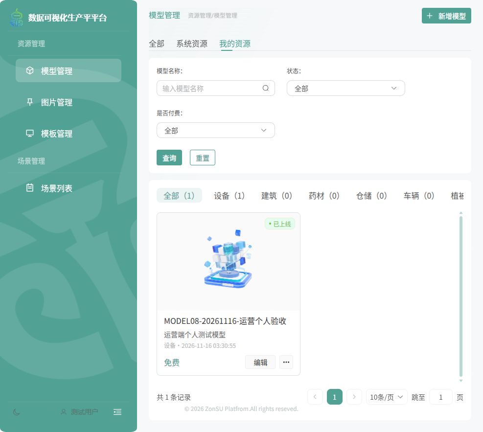

# 模型图片式新增适配

本批按用户最新范围完成上传、转换等待、上传归属和可信账号记录、目录保存及成功后触发刷新。主方案见[新增计划](../../10_专项设计/12_模型资源新增功能完善计划.md)。

后端复用现有 `resource/uploadConvert` 与 `model/add`。上传表单发送文件及系统或我的归属，服务端计算摘要、流式存储并交给已有队列。上传账号和租户来自统一登录信息。保存复用原操作发布事务，目录继承原归属和账号，整数分金额保留原始类型，重复确认返回原结果。

前端弹窗自动等待转换和最终提交，保存成功后关闭并刷新。关闭、身份切换和组件销毁终止本地等待。上传失败保留表单，存储失败取消本次操作并尝试清理本次固定原包。历史上传及文件编号保存保持兼容。

后端 150 项相关检查通过，前端 13 项检查和类型检查通过。前端提交 d3b3be9 已推送。服务器已从后端提交 6f35f08e 拉取构建并更新两库独立候选。系统资源和我的资源四组真实新增各 17 项通过，涵盖上传、实际转换、完整字段保存、原操作重放、继承归属及上传账号。测试模型对象、封面和登录会话已清理。部署状态统一见[近期台账](../../03_近期执行任务.md)。

系统模型全租户共享、我的模型按账号筛选的业务规则已记录。用户明确筛选由列表接口负责，本轮扩展的列表、资源读取和场景引用代码已撤回，后续单独实施。

## 现场结果与接续

服务器证据目录为 `/opt/wx/editor-test148/releases/model05-6f35f08e`，构建包 194705067 字节，摘要见[验证记录](verification.json)。两个候选分别监听回环端口 49112 和 49113，使用既有演练库及目录事务测试兼容标识。旧 main 候选改名保留为 `wx-editor-model04-main-before-model05-6f35f08e`，可停止新候选后恢复旧候选。

我的资源首次两次后台转换返回 `CONVERTER_UNAVAILABLE`，重新上传后两库均通过全部 17 项检查。根因尚未确认，初次失败和复验报告一并保留，转换器稳定性接续核验。

正式业务入口尚未更新。当前接续 MODEL-08 的正式部署与真实页面新增验收。运行端兼容标识和画面联调仍按后续任务记录，候选中的测试标识用于目录事务验证。

台账提交曾误纳入一段历史删除，已在 6f35f08e 恢复，并按 MODEL 表格边界复核本轮差异。

## 2026-11-16 正式新增及列表查询验收

早期候选结论保留为历史记录。一次性转换流独立连接修复后，2cf872b3 两库连续两轮八组各 17 项通过，随后已完成正式部署。用户追加列表为空与运营端个人上传反馈后，87e5f661 修复公共目录被通用租户条件过滤、列表及详情缺少账号范围和运营管理员个人上传被旧角色条件拒绝的问题。当前部署版本 f6bba185 包含远端既有物联网更新，最终 192 项检查中 189 项通过、3 项物联网条件跳过。

两个候选分别验证运营系统、运营我的、租户我的，六组各 19 项通过，覆盖真实上传转换、完整字段、重放、列表及详情和上传账号。候选模型对象、封面和会话清理成功。正式 12525 三种组合各 7 项通过，测试模型、对象及会话已清理。主入口 12522 使用内置浏览器真实 shu.zip 保存个人模型，最终 COMMITTED、修订 1，弹窗自动关闭并显示在我的资源页签。此前系统模型也已出现在列表。两条目录的 data_user_id、create_by 与原操作 operator_id 均为当前可信账号 1。

正式包 194733720 字节，SHA-256 为 ae11e40b6f658f656c572a0607368127b751af8a7f7d55b73dd7a0729efff99b7。两正式服务均健康，无结构变更。发布目录 /opt/wx/editor-test148/releases/model08-f6bba185，备份目录 /opt/wx/editor-test148/backups/model08-20261116T032610Z。回退需停止对应服务，恢复本次备份的程序与主服务 previous-extracted-main，再启动核验健康；配置本轮保持现场值，当前应用兼容标签 0.1.0、转换器回环 32804。恢复前应比较有无后续发布。

页面保留模型目录 22、23 两条验收样例供用户查看。最初未保存上传操作 6bf68ba6-efa4-4c88-be72-7087c8a09db1 的取消命令执行后浏览器连接中断，结果尚未核实。该回收尾项与已提交两条模型分别记录。页面网络诊断在浏览器连接中断前开启，后续关闭命令未能送达，浏览器诊断会话结束后的清理未核对。

