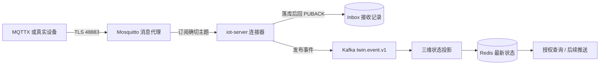

# MQTT 入门与 Kafka 对比

日期：2026-11-12。用途：给首次接触物联网接入的开发和运维一份能直接上手的说明，讲清 MQTT 是什么、本项目怎么用、它和 Kafka 各自解决什么问题。协议细节以 MQTT 3.1.1 为准（本项目固定该版本，MQTT 5.0 未启用）；项目侧取值以源码和[上行接入指南](01_MQTT上行接入与联调.md)为准。

先读结论：

- **MQTT** 解决“设备怎么连上来、怎么低功耗地收发小消息”。核心是消息代理（Broker）按主题转发，适合海量长连接、弱网和下行命令。
- **Kafka** 解决“服务端之间怎么解耦、缓冲、回放、多消费者分摊”。核心是持久化事件日志和消费组偏移量。
- 两者不是替代关系。本项目里 MQTT 在边缘接入，Kafka 在中心分发，中间用数据库接收记录（Inbox）做可靠交接。

## 1. 一句话理解 MQTT

MQTT 是发布/订阅模型：设备把消息发布（Publish）到某个主题（Topic），Broker 把消息转发给所有订阅（Subscribe）了该主题的客户端。发布者和订阅者互不知道对方地址，也不需要同时在线。

类比：Broker 像报刊发行站，主题像栏目，设备只管往栏目投稿，读者只管订栏目。发行站负责认证投稿人、校验他能投哪些栏目，并按订阅关系派送。

和 HTTP 的关键差别：HTTP 是客户端主动请求、服务端被动响应；MQTT 连接建立后是长连接，Broker 可以随时把消息推给订阅者，不需要客户端轮询。设备侧因此省电、省流量。

## 2. 六个必懂概念

| 概念 | 含义 | 本项目取值 |
|---|---|---|
| Client / Broker | 客户端是设备或服务；Broker 是转发中枢，负责认证、主题 ACL、会话和离线队列 | Mosquitto 2.0.22，规划在 246 的 `48883` TLS 端口 |
| Topic 主题 | UTF-8 字符串，用 `/` 分层。`+` 匹配单层，`#` 匹配多层（只能放末尾） | **只允许确切主题，`+`/`#` 会被配置校验拒绝**，见 [IotMqttSettings.java](../../wx-module-iot/wx-module-iot-biz/src/main/java/cn/iocoder/wx/module/iot/mqtt/IotMqttSettings.java) |
| QoS 服务质量 | 0 最多一次、1 至少一次、2 恰好一次（四次握手）。注意 QoS 是逐跳的，订阅端实际 QoS 取发布与订阅的较小值 | 只支持 QoS 1；Broker 拒绝订阅或把 QoS 降为 0 都算接入失败 |
| Retain 保留消息 | Broker 为每个主题保留最后一条消息，新订阅者立即收到 | 业务上报要求 `retain=false`，避免新订阅者误读历史值 |
| Session 会话 | `cleanSession=false` 时 Broker 保存订阅关系，并为离线客户端缓存 QoS 1/2 消息 | 启用持久会话，重连后继续收积压 |
| Keep Alive / 遗嘱 | 客户端按周期发 PINGREQ 证明存活；异常断线时 Broker 可代发遗嘱消息（LWT） | 保活 30 秒；当前未使用遗嘱消息，在线状态由接收记录和事件时间判断 |

补充两条容易忽略的：

- **clientId 必须唯一**。同一个 clientId 重复连接，Broker 会踢掉前一个连接。MQTTX 手工测试时要避开平台自己的客户端号（平台用 `wx-iot-` 前缀加指纹生成的 UUID）。
- **凭据与 ACL 是 Broker 的职责**。平台只负责“用哪个账号连、订哪些主题”，账号能不能发布/订阅由 Broker 判定。平台不会替你补权限。

## 3. 一条消息在本项目里的完整旅程



八个阶段，每一步都可能失败，排查看这一列：

| 阶段 | 动作 | 失败表现 | 先查什么 |
|---|---|---|---|
| 1 | TCP 连接 246:48883 | 连接被拒或超时 | 监听地址、防火墙、端口是否只绑了回环 |
| 2 | TLS 握手 | 证书链或主机名不匹配 | CA 是否导入信任库；证书 SAN 是否含实际访问的 IP |
| 3 | CONNECT 认证 | CONNACK 返回 4（账号密码错）或 5（未授权） | 账号密码、`allow_anonymous false`、密码文件 |
| 4 | SUBSCRIBE 订阅 | SUBACK 返回 0x80，或授予 QoS 0 | ACL 是否允许读该主题；主题是否确切匹配 |
| 5 | PUBLISH → PUBACK | 发布端收不到确认 | Broker 持久化、离线队列上限、报文大小上限 |
| 6 | 平台落 Inbox | 平台不回 PUBACK，消息会被重投 | 数据库可用性、设备绑定是否启用 |
| 7 | 发布 Kafka | Inbox 停在 FAILED，可人工重放 | Kafka 地址、主题权限；失败不会假装成功 |
| 8 | 投影与查询 | Redis 无值或查询 401 | 消费组、投影开关、查询权限 |

最重要的一条语义：**PUBACK 只代表平台已持久接收，不代表 Kafka 已发布，更不代表三维画面已更新**。这是本项目先落库再确认的设计，见[上行接入指南](01_MQTT上行接入与联调.md)的“生命周期与故障边界”一节。

## 4. 上手三步

### 4.1 先有 Broker

Broker 是独立基础设施，前端不能创建它。当前 246 还没有可用的 Broker，需要先部署。下面是最小参考示例，端口和镜像版本与其他联调材料保持一致，实际部署按现场调整。

```yaml
# docker-compose.yml 参考示例
services:
  mosquitto:
    image: eclipse-mosquitto:2.0.22
    restart: unless-stopped
    ports:
      - "48883:48883"
    volumes:
      - ./mosquitto.conf:/mosquitto/config/mosquitto.conf:ro
      - ./acl:/mosquitto/config/acl:ro
      - ./pwfile:/mosquitto/config/pwfile:ro
      - ./certs:/mosquitto/certs:ro
      - mosquitto-data:/mosquitto/data
volumes:
  mosquitto-data:
```

```conf
# mosquitto.conf 参考示例
per_listener_settings true
listener 48883
allow_anonymous false
password_file /mosquitto/config/pwfile
acl_file /mosquitto/config/acl
cafile /mosquitto/certs/ca.crt
certfile /mosquitto/certs/server.crt
keyfile /mosquitto/certs/server.key
tls_version tlsv1.2
require_certificate false
persistence true
persistence_location /mosquitto/data/
max_queued_messages 1000
message_size_limit 262144
```

```
# acl 参考示例：发布与订阅分权，单主题
user writer
topic write acceptance/iot/tenant-2/telemetry

user reader
topic read acceptance/iot/tenant-2/telemetry
```

生成密码文件用 `mosquitto_passwd -c pwfile writer`，再 `mosquitto_passwd pwfile reader`。签发服务器证书时，**SAN 必须包含客户端实际使用的地址**：用 IP 访问就加 `IP:192.168.10.246`，用域名访问就加对应 DNS 名。平台会校验主机名，SAN 不对会直接握手失败。

### 4.2 再建连接器

在前端或管理接口创建 `connectorType=MQTT` 的连接器，创建后默认停用：

| 字段 | 示例 | 说明 |
|---|---|---|
| endpoint | `ssl://192.168.10.246:48883` | 只接受 `ssl://`，开发环境才允许 `tcp://` |
| credentialRef | `IOT_MQTT_TEST` | 只存引用名，真实账号密码由部署注入环境变量 |
| configJson | `{"topics":["acceptance/iot/tenant-2/telemetry"],"qos":1}` | 1～32 个确切主题，QoS 只能为 1 |

然后准备设备绑定（外部设备编号到内部设备、点位映射），再调用 `/enable`。地址是配置项而不是写死的常量，换 Broker 只需改连接器。

### 4.3 最后用 MQTTX 发一条

| 项 | 值 |
|---|---|
| Host / Port | `192.168.10.246` / `48883` |
| TLS | 开启，CA 选测试 CA 文件，不跳过主机名校验 |
| Username / Password | `writer` / 对应密码 |
| Client ID | 自定义且唯一，别用平台的 `wx-iot-` 开头 |
| Topic | `acceptance/iot/tenant-2/telemetry` |
| QoS / Retain | 1 / 关闭 |

报文是一个点位一条，UTF-8 JSON，最大 64 KiB：

```json
{
  "externalDeviceId": "iot-pilot-sensor-01",
  "pointCode": "rawTemperature",
  "value": 26.125,
  "valueType": "NUMBER",
  "unit": "°C",
  "quality": "GOOD",
  "eventTime": "2026-11-12T06:00:00.000Z",
  "traceId": "mqttx-20261112-0001"
}
```

发送后按 `traceId` 回查：接收记录状态、Kafka 分区与偏移、Redis 点位值。重发时保持时间、值和 `traceId` 不变，用来验证去重。

需要脚本化模拟、而不只是手工发一条时，用[物联网虚拟设备模拟器](07_IoT虚拟设备模拟器.md)；它同样连 48883 发布单点位报文，并内置正常、重复、乱序等场景。

## 5. 本项目约束与常见坑

1. **通配符订阅不支持**。`acceptance/iot/tenant-2/+/telemetry` 这种写法会被配置校验拒绝，配置里必须写确切主题。需要一设备一主题时，在连接器里列多条确切主题（上限 32）。
2. **QoS 降级等于失败**。Broker 若只授予 QoS 0，平台按接入失败处理，不静默接受。
3. **改配置就是新会话**。clientId 由租户、连接器、地址、凭据引用和配置文本共同决定，任何一项变化都会换新客户端号，旧会话积压不会自动迁移。
4. **凭据轮换要重启工作进程**。凭据在长连接期间不会自动刷新，轮换后必须重启，否则旧连接继续用旧密码。
5. **报文大小受两边限制**。平台限制 64 KiB，Broker 的 `message_size_limit` 必须配得比它大，否则大包在 Broker 侧就被丢弃。
6. **自签名证书要进 JVM 信任库**。平台当前不支持在管理端上传客户端证书，也不做双向 TLS。
7. **PUBACK 语义不要误读**，见第 3 节。
8. **重复 clientId 会互相踢线**。MQTTX 联调时尤其注意。

## 6. MQTT 与 Kafka 的区别

| 维度 | MQTT | Kafka |
|---|---|---|
| 设计目标 | 海量设备低带宽接入，实时双向通信 | 服务端高吞吐事件管道，持久化与回放 |
| 通信模型 | 发布/订阅，Broker 按主题转发 | 发布到分区日志，消费组按偏移量拉取 |
| 消息生命周期 | 转发后一般不长期保存，仅在会话离线队列里短期缓存 | 按时间或容量保留，可重复读取 |
| 消费方式 | 每个订阅者都收到一份（扇出） | 同一消费组内分摊，不同组各读一份 |
| 回放能力 | 无偏移量概念，不能回放 | 可重置偏移量重放历史 |
| 有序性 | 单主题内通常有序，重连和重投可能乱序 | 分区内严格有序，跨分区不保证 |
| 投递语义 | QoS 0/1/2，逐跳保证 | 默认至少一次，配合幂等生产者与事务可更强 |
| 连接规模 | 十万级长连接是常态 | 连接数少，吞吐和分区数才是瓶颈 |
| 客户端生态 | 嵌入式 C、各类模组、手机 SDK | Java、Go、大数据与流处理生态 |
| 典型用途 | 设备遥测上行、命令下发、遗嘱告警 | 事件分发、削峰、数据集成、流计算 |
| 运维重心 | 认证、ACL、TLS、会话与队列上限 | 分区、副本、磁盘、消费组滞后 |
| 本项目角色 | 设备到平台的上行入口 | 平台内部事件总线（`twin.event.v1`） |

三个常见误区：

- **“MQTT 也能当队列”**：持久会话确实能短期缓存离线消息，但没有偏移量、不能回放、容量受 Broker 队列上限约束，不能替代 Kafka 或数据库。
- **“Kafka 也能直接接设备”**：技术上要加网关，且没有长连接会话、遗嘱、主题 ACL 这些设备侧能力，海量小报文场景成本很高。
- **“QoS 2 就是业务恰好一次”**：QoS 2 只保证客户端与 Broker 这一跳不重复，端到端仍要靠事件编号幂等。本项目用 Inbox 去重 + 事件编号实现业务幂等。

## 7. 为什么本项目两个都要

因为两段的职责不同，硬合并会同时损失两端优势：

- 设备侧需要长连接、低功耗、断线重连、主题级权限，这是 MQTT 的主场。
- 平台内部需要多个消费者（三维投影、规则告警、后续审计）各自独立消费、互不阻塞、可回放，这是 Kafka 的主场。
- 中间必须有可靠交接点。本项目的交接点是数据库 Inbox：先落库再回 PUBACK，Kafka 发布失败留在 Inbox 等人工重放。这样“设备以为发出去了”和“平台确实收到了”才不是一回事。

## 8. 选型速查

| 你的需求 | 选什么 |
|---|---|
| 设备/传感器/边缘网关接入，弱网、海量连接 | MQTT |
| 给设备下发命令、收执行回执 | MQTT（本项目下行尚未实现） |
| 服务之间解耦、削峰、多消费者 | Kafka |
| 需要回放历史事件、按偏移量重算 | Kafka |
| 设备接入 + 内部事件分发 | 两者组合，中间加持久化交接 |
| 只做前端实时刷新 | WebSocket 即可，不必引入 MQTT |

## 9. 当前项目状态与下一步

- 246 常驻环境**没有** MQTT Broker，IoT 服务 MQTT 上行处于关闭状态；148/246 分机部署与管理端已验收。
- 246 回环隔离环境已用真实 Mosquitto TLS、MySQL Inbox、Kafka、Redis 贯通单点位，并验证重复、迟到、死信和停用释放，见[消息链路证据](../evidence/iot-m3-02-20261111/README.md)。
- 下一步：按第 4.1 节部署固定 Broker 与证书，在前端录入连接器，再做真实设备上报与三维联动。状态以[IoT 专项台账](../plan/02_IoT服务进度与后续计划.md)为准。

## 10. 术语表

| 英文 | 中文 | 一句话 |
|---|---|---|
| Broker | 消息代理 | 转发消息、认证账号、校验主题权限的中枢 |
| Topic | 主题 | 消息的分类路径，用 `/` 分层 |
| QoS | 服务质量等级 | 0 最多一次、1 至少一次、2 恰好一次（逐跳） |
| Retain | 保留消息 | Broker 保存主题最后一条，新订阅者立即收到 |
| Session | 会话 | 持久会话保存订阅关系和离线消息 |
| LWT | 遗嘱消息 | 客户端异常断线时由 Broker 代发 |
| ACL | 访问控制列表 | Broker 侧的主题读写权限规则 |
| Consumer Group | 消费组 | Kafka 中分摊消费、各自维护偏移量的一组消费者 |
| Offset | 偏移量 | 消费者在分区中的读取位置 |
| Partition | 分区 | Kafka 并行与有序的基本单位 |
