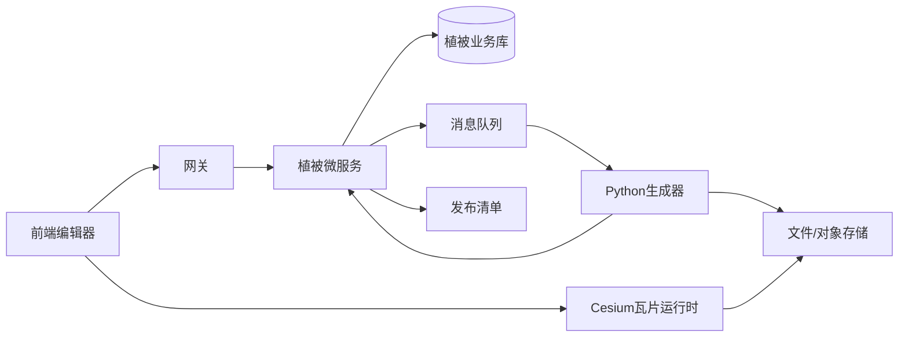
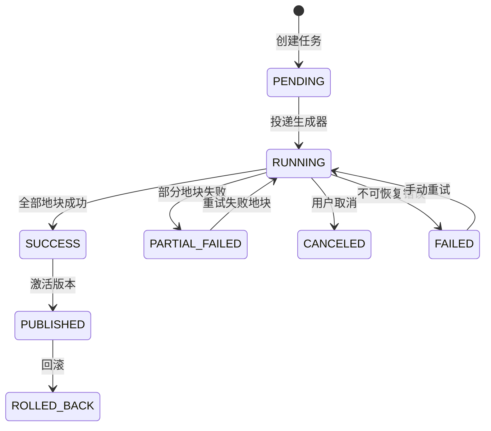
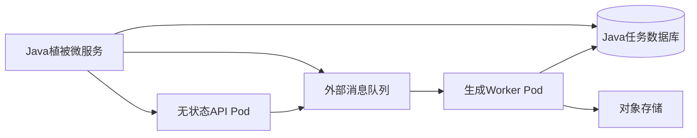

# 植被生成微服务设计

## 1. 设计结论

在 `jtyf-cloud` 中新增独立微服务：

```text
jtyf-module-vegetation
├─ jtyf-module-vegetation-api
└─ jtyf-module-vegetation-biz
```

该服务只负责植被业务编排、生成任务和发布版本管理，不在Java接口线程中执行大规模地块计算。正式生成由独立Python生成器完成，Java通过内部接口或消息队列调用它。



## 2. 为什么不放进 `jtyf-module-3d`

当前 `jtyf-module-3d` 的启动类为 `DimensionsApplication`，业务包名为 `cn.iocoder.jtyf.module.dimensions`，已经承载维度、模型和文件相关职责。植被生成还需要独立的任务状态、版本清单、增量重建和Python工作进程，因此单独注册服务更容易：

1. 独立扩容Python生成器，不影响普通三维接口。
2. 独立配置任务并发、磁盘和内存预算。
3. 独立发布和回滚植被版本。
4. 独立设置服务权限和接口限流。
5. 未来可替换生成器语言，不影响前端和Java业务契约。

## 3. Maven模块结构

根工程 `pom.xml` 新增：

```xml
<module>jtyf-module-vegetation</module>
```

父模块 `jtyf-module-vegetation/pom.xml`：

```xml
<modules>
    <module>jtyf-module-vegetation-api</module>
    <module>jtyf-module-vegetation-biz</module>
</modules>
```

### 3.1 API模块

```text
jtyf-module-vegetation-api/
└─ src/main/java/cn/iocoder/jtyf/module/vegetation/api/
   ├─ GenerationTaskApi.java
   ├─ GenerationTaskApiConstants.java
   └─ dto/
      ├─ VegetationGenerationTaskCreateReqDTO.java
      ├─ VegetationGenerationTaskRespDTO.java
      ├─ VegetationRuleSnapshotRespDTO.java
      └─ VegetationGenerationResultDTO.java
```

API模块只放跨服务调用所需的接口和数据传输对象，不依赖数据库、控制器或Python客户端实现。

### 3.2 BIZ模块

```text
jtyf-module-vegetation-biz/
└─ src/main/java/cn/iocoder/jtyf/module/vegetation/
   ├─ VegetationServerApplication.java
   ├─ controller/admin/
   │  ├─ GenerationTaskController.java
   │  └─ PublicationController.java
   ├─ controller/internal/
   │  └─ GenerationWorkerCallbackController.java
   ├─ service/
   │  ├─ GenerationTaskService.java
   │  ├─ RuleSnapshotService.java
   │  ├─ PublicationService.java
   │  └─ impl/
   ├─ dal/
   │  ├─ dataobject/
   │  ├─ mysql/
   │  └─ mapper/
   ├─ mq/
   │  ├─ producer/
   │  └─ consumer/
   ├─ convert/
   ├─ enums/
   └─ config/
```

启动类建议使用：

```java
package cn.iocoder.jtyf.module.vegetation;

@SpringBootApplication
public class VegetationServerApplication {
    public static void main(String[] args) {
        SpringApplication.run(VegetationServerApplication.class, args);
    }
}
```

服务名建议为：

```yaml
spring:
  application:
    name: vegetation-server
server:
  port: 48094
```

## 4. 服务职责

### 4.1 Java服务负责

- 场景和植被规则快照；
- 物种模型资源引用；
- 生成任务创建、取消、重试和查询；
- 任务幂等和并发限制；
- Python生成器调用；
- 地块结果登记；
- 发布版本校验、激活和回滚；
- 对前端提供管理接口；
- 对内部生成器提供回调接口。

### 4.2 Java服务不负责

- 候选点随机采样；
- 数字高程模型批量计算；
- 最小株距空间索引；
- 模型实例矩阵生成；
- GLB或实例化瓦片编码；
- 大文件转换和压缩。

## 5. 任务状态机



状态变更必须由服务层统一执行，禁止控制器或Python回调直接修改数据库状态。

## 6. 管理接口

接口前缀：

### 6.1 动态九宫格接口

动态窗口使用独立入口 `POST /admin-api/vegetation/dynamic-tile/window`，不复用城市级
`generation-task` 的请求或发布语义。请求包含版本为1的九块地理地块，以及同一份圈选、行道树和海拔
规则快照；Java 服务按地块计算服务端幂等键，并把九块分别投递给现有 Python 生成任务。

每块任务携带 `clipToGenerationRegion=true` 和稳定 `dynamicTileId`。Python 仅在该动态标记下将圈选多边形
裁剪到当前地块、过滤偏移后的行道树根点，并把地块编号加入随机种子；旧静态任务默认关闭这两个字段，
因此既有圈选和行道树任务的几何、种子、发布路径不变。响应按 `tileId` 返回 `HIT/PENDING/RUNNING/READY/FAILED`，
单块失败不会阻断其余八块。

接口只负责提交和状态汇总，不等待九块全部完成。客户端应按 `tileId` 建索引轮询任务，在正式瓦片健康后
替换对应编辑预览；协议、规则版本、地形版本或种子变化会生成新的幂等键，迟到结果不能覆盖新窗口。

```text
/admin-api/vegetation
```

### 6.2 创建生成任务

```text
POST /generation-task/create
```

请求字段：

| 字段 | 类型 | 说明 |
| --- | --- | --- |
| `sceneId` | String | 场景编号 |
| `ruleVersion` | String | 规则版本 |
| `region` | JSON | 生成范围，可为空表示使用规则范围 |
| `qualityPreset` | String | 质量档位 |
| `idempotencyKey` | String | 幂等键 |
| `callbackMode` | String | 回调模式 |

返回：

```json
{
  "taskId": "veg-task-001",
  "snapshotVersion": "veg-snapshot-001",
  "status": "PENDING"
}
```

### 6.3 查询任务

```text
GET /generation-task/get?taskId=veg-task-001
```

返回必须包含：

- 任务状态；
- 总地块数量；
- 已完成和失败地块数量；
- 候选点数量；
- 最终实例数量；
- 当前错误信息；
- 生成器版本；
- 清单地址；
- 创建、开始和完成时间。

### 6.4 取消任务

```text
POST /generation-task/cancel
```

取消只改变Java任务状态并发送取消消息。Python收到取消后停止新地块生成，已完成的临时地块不得进入稳定发布版本。

### 6.5 发布版本

```text
POST /publication/activate
POST /publication/rollback
GET  /publication/list
```

发布前必须检查：

1. 任务状态为 `SUCCESS`；
2. 所有地块均有内容地址；
3. `tileset.json` 可以读取；
4. 发布清单哈希完整；
5. 规则、模型和高程数据版本已记录。

## 7. Python内部接口

接口前缀：

```text
/internal-api/vegetation
```

### 7.1 获取规则快照

```text
GET /generation-snapshots/{snapshotVersion}
```

快照必须是不可变数据，包含：

```json
{
  "snapshotVersion": "veg-snapshot-001",
  "sceneId": "scene-001",
  "seed": 123456,
  "ruleVersion": "v3",
  "coordinateSystem": "EPSG:4326",
  "gridSizeM": 100,
  "elevationSource": {
    "url": "http://dem-service/source.tif",
    "version": "dem-20260818",
    "verticalDatum": "orthometric"
  },
  "species": [],
  "rules": []
}
```

### 7.2 上报地块进度

```text
POST /generation-tasks/{taskId}/tiles/{tileId}/progress
```

### 7.3 上报地块结果

```text
POST /generation-tasks/{taskId}/tiles/{tileId}/complete
```

```json
{
  "instanceCount": 320,
  "candidateCount": 410,
  "contentUrl": "vegetation/scene-001/pub-001/tile-12-8.glb",
  "contentHash": "sha256:...",
  "generatorVersion": "1.0.0"
}
```

### 7.4 上报任务完成

```text
POST /generation-tasks/{taskId}/complete
```

Java收到完成消息后只登记结果，不自动激活版本。版本激活必须由前端或发布流程明确触发。

## 8. 数据表设计

数据库建议使用独立表前缀 `veg_`，便于独立迁移。

### 8.1 任务表 `veg_generation_task`

```sql
CREATE TABLE veg_generation_task (
  id BIGINT NOT NULL PRIMARY KEY,
  scene_id VARCHAR(64) NOT NULL,
  snapshot_version VARCHAR(64) NOT NULL,
  rule_version VARCHAR(64) NOT NULL,
  idempotency_key VARCHAR(128) NOT NULL,
  status VARCHAR(32) NOT NULL,
  total_tile_count INT NOT NULL DEFAULT 0,
  completed_tile_count INT NOT NULL DEFAULT 0,
  failed_tile_count INT NOT NULL DEFAULT 0,
  candidate_count BIGINT NOT NULL DEFAULT 0,
  instance_count BIGINT NOT NULL DEFAULT 0,
  generator_version VARCHAR(64),
  manifest_url VARCHAR(512),
  error_message VARCHAR(2000),
  creator BIGINT,
  create_time DATETIME NOT NULL,
  update_time DATETIME NOT NULL,
  deleted BIT NOT NULL DEFAULT 0,
  UNIQUE KEY uk_veg_task_idempotency (idempotency_key)
);
```

### 8.2 地块结果表 `veg_generation_tile`

```sql
CREATE TABLE veg_generation_tile (
  id BIGINT NOT NULL PRIMARY KEY,
  task_id BIGINT NOT NULL,
  publication_version VARCHAR(64) NOT NULL,
  tile_id VARCHAR(128) NOT NULL,
  tile_row INT NOT NULL,
  tile_column INT NOT NULL,
  status VARCHAR(32) NOT NULL,
  candidate_count INT NOT NULL DEFAULT 0,
  instance_count INT NOT NULL DEFAULT 0,
  content_url VARCHAR(512),
  content_hash VARCHAR(128),
  error_message VARCHAR(2000),
  create_time DATETIME NOT NULL,
  update_time DATETIME NOT NULL,
  UNIQUE KEY uk_veg_tile_task_tile (task_id, tile_id)
);
```

### 8.3 发布表 `veg_publication`

```sql
CREATE TABLE veg_publication (
  id BIGINT NOT NULL PRIMARY KEY,
  scene_id VARCHAR(64) NOT NULL,
  publication_version VARCHAR(64) NOT NULL,
  task_id BIGINT NOT NULL,
  rule_version VARCHAR(64) NOT NULL,
  generator_version VARCHAR(64) NOT NULL,
  manifest_url VARCHAR(512) NOT NULL,
  tileset_url VARCHAR(512) NOT NULL,
  source_hash VARCHAR(128) NOT NULL,
  status VARCHAR(32) NOT NULL,
  instance_count BIGINT NOT NULL DEFAULT 0,
  tile_count INT NOT NULL DEFAULT 0,
  create_time DATETIME NOT NULL,
  update_time DATETIME NOT NULL,
  UNIQUE KEY uk_veg_publication_version (scene_id, publication_version)
);
```

## 9. 生成器调用方式

### 9.1 推荐方式：消息队列

Java只发送任务编号和快照版本：

```json
{
  "taskId": "veg-task-001",
  "snapshotVersion": "veg-snapshot-001",
  "action": "GENERATE"
}
```

Python消费后主动读取快照。这样消息较小，且规则不会在生成过程中被修改。

### 9.2 简化方式：内部HTTP

没有消息队列时，Java可以调用Python：

```text
POST http://vegetation-generator:8080/internal/generate
```

HTTP只负责启动任务，不能等待整个生成过程。Python必须异步执行并通过回调接口上报状态。

## 10. 发布目录约定

```text
vegetation/
└─ {sceneId}/
   └─ {publicationVersion}/
      ├─ manifest.json
      ├─ tileset.json
      └─ tiles/
         ├─ {tileId}/content.glb
         └─ {tileId}/content.glb
```

生成期间使用临时目录：

```text
{publicationVersion}.tmp
```

全部地块成功并完成瓦片校验后，才切换为正式目录。Java数据库只记录正式清单地址，不记录运行时模型对象。

## 11. 配置建议

```yaml
spring:
  application:
    name: vegetation-server

server:
  port: 48094

jtyf:
  vegetation:
    generator:
      base-url: http://vegetation-generator:8080
      callback-base-url: http://vegetation-server:48094/internal-api/vegetation
      connect-timeout-ms: 3000
      read-timeout-ms: 10000
      max-concurrent-tasks: 2
    publication:
      root-path: ./data/vegetation
      keep-version-count: 3
```

生产环境中的生成器地址、消息队列和文件根目录应放在配置中心，不写死在代码中。

## 12. 安全和边界

即使生成服务部署在内网，也必须：

1. 限制生成区域面积、地块数量和密度上限；
2. 校验源GLB、数字高程模型和输出路径；
3. 禁止任务参数拼接任意文件路径；
4. 内部回调携带任务编号、快照版本和签名或内部令牌；
5. Python回调只能更新自己的任务，不能直接激活发布版本；
6. 发布版本只能由Java服务原子切换。

## 12.1 Kubernetes部署要求

Python生成服务最终部署到Kubernetes时，不能把进程内任务存储和容器本地目录当作正式能力。生产拓扑必须拆分为：



要求：

1. API Pod只负责接收任务和健康检查，可以水平扩容。
2. Worker Pod独立消费队列，按队列长度或CPU使用率扩容。
3. 任务状态、幂等键、取消标记和重试次数必须保存在外部数据库或消息系统。
4. 正式瓦片和发布清单必须写入对象存储；容器本地目录只用于临时工作文件。
5. 发布版本采用不可变目录，Java成功校验后再切换当前版本引用。
6. Pod退出前停止接收新任务，正在执行的地块回到可重试状态。
7. 必须配置存活探针、就绪探针、资源请求、资源上限和优雅终止时间。
8. Python生成器镜像应使用非root用户，并禁止写入只读根文件系统。

## 13. 实施顺序

### 第一阶段：Java业务骨架

1. 新增父模块、API模块和BIZ模块。
2. 完成服务启动、Nacos注册和数据库迁移。
3. 完成创建、查询、取消任务接口。
4. 完成规则快照冻结接口。

### 第二阶段：Python联调

1. Python读取快照。
2. Python模拟单地块结果回调。
3. Java完成进度累计和失败重试。
4. 用固定测试数据验证幂等和取消。

### 第三阶段：正式发布

1. 接收真实地块瓦片结果。
2. 完成清单校验。
3. 完成版本激活和回滚。
4. 前端接入任务和发布接口。

## 14. 验收标准

1. 服务以 `vegetation-server` 独立启动并注册。
2. 创建任务返回快照版本和任务编号。
3. 相同幂等键不会创建重复任务。
4. Python可以读取完整不可变快照。
5. 地块进度可累计，重复回调不会重复计数。
6. 单个地块失败不会导致旧发布版本失效。
7. 全部地块成功后才能创建可发布版本。
8. 发布失败时当前稳定版本保持不变。
9. 回滚只切换版本引用，不删除新版本文件。
10. Java接口线程不执行大规模植被生成。

## 15. 与前端的对接

前端最终只需要调用植被微服务的管理接口：

```text
创建生成任务
查询任务状态
取消或重试任务
查询发布版本
激活版本
回滚版本
```

正式渲染时，前端从发布响应获取 `tilesetUrl`，交给现有Cesium植被瓦片控制器加载。64株编辑预览仍然保留，不应与正式发布实例数量混用。

## 16. 最终边界

```text
Java植被微服务 = 规则快照 + 任务编排 + 发布版本
Python生成服务 = 地块计算 + 实例数据 + 三维瓦片内容
3d-tiles-tools = 瓦片转换 + 优化 + 校验
Cesium运行时 = 瓦片加载 + 可见性 + 缓存
```

该拆分允许Java微服务独立扩容和发布，也允许未来替换Python生成算法，而不修改前端规则模型和发布接口。
